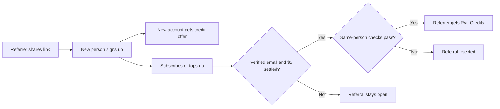

Ryu has two referral paths that use tracked attribution but pay different rewards. The credit referral campaign gives Ryu Credits to the new account and to the referrer. The separate affiliate program can pay cash commission on eligible revenue.

Use the live [Referrals page](https://ryuhq.com/referrals) for the current campaign offer and your account's tracked link.
Signed-in users can open that page from the website or desktop user menu by choosing **Invite a friend**.

## At a glance

| Program | New account | Referrer | Reward trigger |
|---|---|---|---|
| Credit referral campaign | Current campaign amount in Ryu Credits | Ryu Credits | The referred account becomes a paying Ryu customer |
| Affiliate program | No cash reward is promised for signup alone | Cash commission | An eligible referred subscription or Marketplace purchase |

The two programs can apply to the same referral. A referred person may receive the current credit offer, while the referrer may earn Ryu Credits and an affiliate commission when the relevant payment conditions are met.

## Credit referral campaign

### How it works

1. Share the referral link from your Ryu account.
2. The new person signs up through the link. Their account normally receives the live Ryu Credits offer within moments, with no card and no trial clock.
3. When that person subscribes or buys a credit top-up, the referrer can receive Ryu Credits.

The referrer reward is paid only after the referred person has a verified email address and at least $5 of settled payments.

Ryu also rejects referrals that look like the same person or the same team, such as:

- Accounts in the same Ryu organization.
- The same mailbox under another address (for example, a `+tag` variant).
- A shared private company email domain. Public mailbox domains such as Gmail do not count.
- The same sign-up IP address.

The referral dashboard shows the current amount, converted referrals, open referrals, and remaining headroom when those details are available.

### Rules

- Ryu Credits are spendable on Ryu's managed cloud models. They are not cash and cannot be withdrawn.
- A free trial does not count as payment for the referrer reward.
- A refunded or reversed payment does not pay a referral.
- Self-referrals are rejected.
- Each referred account earns at most one reward. Each referrer has a lifetime referral cap unless Ryu configured the account without one.
- The campaign uses a fixed pool of donated credits. If the pool is fully committed, open referrals stay recorded. They are not silently cancelled.

Referral campaign amounts and availability are live values. Do not copy a dollar amount from an old screenshot or an older version of this page.

## Affiliate program

The affiliate program is the cash-commission path for people who refer customers. It can record commissions from:

- Referred Ryu subscriptions.
- Paid Marketplace items when the item or seller has affiliate terms.

Commission rules can be percentage-based or flat, one-time or recurring, and can include a duration limit for subscription revenue. Ryu records the terms used when a commission is earned, so changing current terms does not rewrite past commissions.

Commissions move through review before payout. Nobody reviews their own earnings:

- A reviewer who also earns commissions, or who applies to the [Creator Program](/docs/programs/creator-program), cannot approve or reject their own commission or application.
- An operator-run bulk payout skips the operator's own earnings.

Refunds or disputes can reverse an unpaid commission, and Ryu does not pay a self-referral.

### Set up payouts

Payouts use Stripe Connect and an organization payout account. Open the **Referrals** tab in your account settings to see your commissions and payout status.

- **On the web**, **Set up payouts** opens the same **Marketplace payouts** page that Marketplace sellers use, for the organization that receives your commissions. Stripe's verification runs on that page. Once payouts are enabled, **Manage payout account** reopens it.
- **In the desktop app**, **Set up payouts** opens Stripe's hosted onboarding.

See [Publishers & payouts](/docs/surfaces/desktop/user-guide/marketplace-publishing#sell-your-own-items) for the seller side of the same page.

## Share your referral link

The public [Referrals page](https://ryuhq.com/referrals) supports the share link flow. Signed-in users can copy their link or send invitations by email (up to 100 email invitations per account in any 24 hours). A visitor arriving through someone else's link can sign up from the same page and keep the attribution through the signup flow.

Signed-in users can switch from **Overview** to **Invite history** to see referral emails they sent and when a tracked referral link was opened. Referral signup and reward progress appears separately with masked identities. An entered recipient address, successful delivery, or link open does not identify which masked referral belongs to that address.

Referral links, access codes, invite codes, and invite QR codes are masked by default on the
waitlist and referral screens, including the 3D passes.

- The eye button reveals one value.
- **Reveal all** reveals every value on the page, and **Hide all** masks them again.
- Copy and share actions still use the real code or link.
- Revealed values are masked again when you reload the page, leave it, or switch to another
  window.

If only part of an email batch is delivered, the invite composer keeps the failed addresses for retry and removes the addresses that were sent, so a retry does not send duplicates.

### Referral checkpoints

When you are still waiting for access, the waitlist shows a next referral
checkpoint with the number of friends left to reach it. The signed-in
Referrals page uses the same near-term cue for the current referral quest. The
cue links back to the share action or the reward that is ready to claim.

Checkpoints do not promise a specific approval time, or a payout before the
program's stated trigger.

A friend counts toward your queue position and these checkpoints once their
email address is verified. Signing up with Google or another provider that
already verifies the address counts right away; an account whose email is
never verified does not count.

### Submit quest proof

Some quests ask for a public link to a post. Enter a valid URL and submit it for
review. The field is locked while the request is in progress. If the request
fails, the link stays in the field so you can retry. After a successful
submission, the quest shows that its proof is under review. An approved proof
makes its reward available to claim.

When a reward grants Ryu Credits, choose the organization whose wallet should
receive them, then select **Place here**.

- The chooser lists the organizations available to your account and defaults to
  your personal organization when one is available.
- **Not now** dismisses it without claiming.
- While a claim is in progress, the chooser blocks another submission.
- You can retry a failed claim. The credit appears only after the claim succeeds.

## Related pages

Weekly invite passes and milestone passes grant account access rather than referral rewards.

To recommend specific paid Marketplace apps to an audience, use the separate Creator Program.
Creator campaigns have their own handles, support windows, and standard bonuses. They do not
replace the account-level referral link.

- [Invite and Milestone Passes](/docs/programs/invite-passes)
- [Creator Program](/docs/programs/creator-program)
- [Sell Your Own Agents](/docs/programs/sell-your-own-agents)
- [Perks](/docs/programs/perks)
