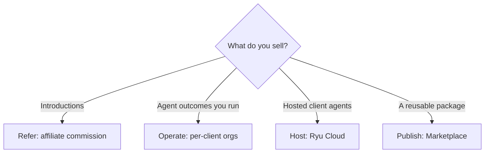

This page is for people who want to earn by selling agent work or agent packages built on Ryu. There are three service paths (refer, operate, host) and one product path (publish to the Marketplace). You own the customer relationship and the offer. Ryu provides the agent and governance stack underneath.

See the live [Ryu for Agent Operators page](https://ryuhq.com/for/agent-operators) for the current commercial offer.

## Refer

Share Ryu with businesses that need agents and earn through the affiliate program.

- Sign up and get a tracked referral link.
- Earn commission on eligible referred subscriptions and Marketplace purchases. Ryu pays a Marketplace commission from its own platform fee, so the commission never exceeds that fee, whatever rate the seller sets.
- Complete Stripe Connect payout onboarding for self-serve payouts.
- Track referrals and commissions in the **Referrals** tab of your account settings.

[Referrals and Affiliates](/docs/programs/referrals) has the full commission and payout rules.

This path needs no implementation work, so it suits people with an audience, a client network, or a consulting practice.

## Operate

Sell a managed agent outcome to a business while you run the implementation.

- Give each client a separate organization, access, and budget.
- Configure an agent, workflow, tools, and Spaces for each client.
- Set Gateway budgets, firewall rules, and audit controls.
- Connect the channels the client already uses, such as Telegram or Slack.
- Charge for setup, a retainer, usage, or a packaged service.

This is an agency model. Clients buy the outcome from you, and you operate Ryu underneath.

For the policy boundary, see [Gateway governance](/docs/gateway/governance) and [Gateway security](/docs/gateway/security).

## Host

Run client agents on Ryu Cloud to sell hosting instead of managing each deployment yourself.

The hosted model is for operators who sell and support the service while Ryu hosts the servers. Running extra servers needs a Teams, Business, or Enterprise plan.

<Callout type="warn">
  Hosting is arranged with the Ryu team through the [agent operator page](https://ryuhq.com/for/agent-operators). It is not a self-serve signup like the desktop path.
</Callout>

## Publish a reusable package

To sell a reusable package instead of a client service, use the **Sell** tab in the [Ryu Marketplace](https://ryuhq.com/marketplace).

- Free listings do not need seller payout setup.
- Paid listings use organization payouts through Stripe Connect.
- The current seller flow supports organization-owned skills, plugins, and tools.
- GitHub publishing validates the package manifest and immutable release before submission. Buyers install through Ryu and do not need GitHub access.
- A platform commission is deducted per paid sale.

This publishing path is separate from the service paths above. A published package runs on the buyer's node with the buyer's models and connections. It does not transfer your API keys, identities, Spaces, or chat history.

Pricing, licences, and payouts for paid listings are covered in [Marketplace monetization](/docs/extend/develop/extensions/marketplace-monetization).

<Callout type="warn">
  The current operator offer is not a white-label rebrand of the Ryu app. You own the client relationship, scope of work, and service terms. Ryu supplies the stack you run.
</Callout>
