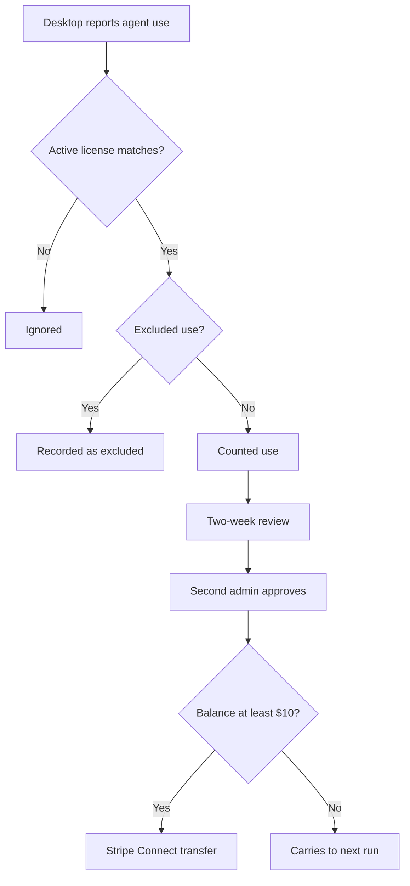

Template Rewards is an invite-only pilot. It rewards publishing organizations whose public
Marketplace templates people find useful enough to keep using. Rewards are paid to the
organization's Stripe payout account, the same account that receives Marketplace sales.

<Callout type="warn">
  The pilot is invite-only and off by default. If your organization has not been invited, the
  **Template rewards** card does not appear in **Organization settings → Marketplace & payouts**.
</Callout>

## How rewards work

Rewards are discretionary. They are not a revenue share, a commission, or guaranteed income. Every
two weeks, Ryu reviews how many people used each eligible template and how many came back on another
day. Ryu then decides whether to reward each organization and how much. Ryu can change the review
method or pause, extend, or end the pilot at any time.

When Ryu reviews a period, it looks at two things for each template:

- **People:** the number of distinct signed-in accounts that used the template during the period.
  An account counts once per day, however many times it runs the template that day.
- **Returning people:** accounts that used the template on at least two different days in the
  period. Repeat use is weighted more than a one-time try.

A template needs a minimum number of people in a period before Ryu considers it, so one-person
noise and small groups of coordinated accounts do not qualify.

## What counts

Eligible templates are public, published Marketplace listings of three kinds: agent, workflow, and
stack template. They must belong to an organization that has accepted the pilot terms.

The Ryu desktop app reports a use when a signed-in person chats with an agent they installed from
the Marketplace. A temporary chat never counts. Ryu records a use at most once per person, per
template, per day.

A report from the app is not enough on its own. Ryu counts a use only when an organization the
person belongs to holds an active Marketplace license for that template. A license is the record
Ryu keeps when a template is bought, and uses Ryu cannot match to one are ignored.

During the pilot this means only paid templates can earn rewards, because free templates have no
purchase record to check a use against. If a license is later refunded or disputed, the uses it
backed stop counting.

<Callout type="warn">
  Only agent use is reported today. Workflow and stack template listings cannot earn rewards until
  the app reports their use.
</Callout>

These uses never count:

- Use by members of the publishing organization, including people who join it later in the period.
- Use backed by a license that a member of the publishing organization bought.
- Use by Ryu staff.
- Use during a person's free trial.

## Joining the pilot

1. Ryu invites your organization.
2. An organization member who can manage billing opens **Organization settings → Marketplace &
   payouts** and accepts the pilot terms on the Template rewards card. Usage starts counting after
   that. If the terms change, someone has to accept them again before usage keeps counting.
3. Finish Stripe payout setup in the seller section of the same page, if you have not already.
   Approved rewards wait until payouts are enabled.

The Template rewards card shows this period's counted people and returning people for each
template. It also lists rewards once Ryu has approved them.

## Payouts

A period's rewards are approved by a second Ryu administrator, not the one who proposed or adjusted
them, and together they never exceed that period's reward pool.

Each approved reward is sent to the organization's Stripe Connect account as a transfer. If the
approved balance is under $10, it carries over to the next payout run. Stripe handles identity
verification and tax forms for the payout account.

Ryu can suspend or remove an organization from the pilot. Ryu can also take back a reward when it
finds manipulated usage, such as extra accounts or automation created to inflate numbers, or a copied
or impersonating template. An unpaid reward is forfeited. A paid reward is reversed from the
organization's Stripe account.

## What Ryu records

For each counted or excluded use, Ryu stores the person's account id, the listing's kind and id, the
publishing organization, the UTC day, the license that backs the use, and the reason a use was
excluded. It never stores prompts, messages, or agent output. Publishers see totals per template, not who used it.

## Related pages

- [Sell Your Own Agents](/docs/programs/sell-your-own-agents)
- [Marketplace monetization](/docs/extend/develop/extensions/marketplace-monetization)
- [Creator Program](/docs/programs/creator-program)
