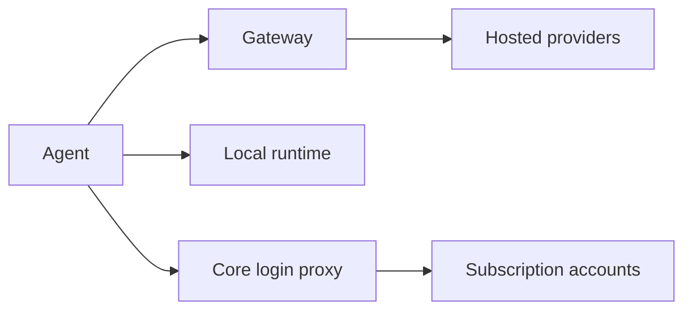

Chat is the model layer most agents use. Ryu sends an OpenAI-shaped request to the Gateway or a
node-local runtime. Provider selection is a separate setting from the model name.

## Node defaults

In **Gateway → Default agent & model**, choose two lanes:

- the **local lane**, used by plugins and utility work;
- the **cloud lane**, used by normal chats.

Each selection keeps its agent, model, thinking level, effort, and access mode. A custom model ID
stays visible even when it has no provider entry in the catalog.

### Saving defaults

Defaults belong to the selected node and connection credentials.

- Changing the node or credentials loads that connection's saved values. A previous connection's
  save cannot replace them.
- Each control waits for its save to finish before accepting another change.
- A refused write restores the saved value and allows retry.
- If the saved defaults cannot be read, use **Retry** before changing them.

### Coordinator and thread models

The **Models** card sets two roles: the coordinator model and effort for main threads, and the
thread model and effort for new sessions. **Save** writes both roles together on the selected node.

- A refused save keeps your draft for retry.
- **Reset to defaults** removes only this node-wide override. Project and bot overrides stay.
- Connection changes discard the old connection's unsaved role edits and pending results.

### Local model unloading

**Auto-unload local model** controls the llama.cpp idle timeout. **Never** keeps
the model resident; other durations let it unload and reload on the next request.
Other local engines manage their own memory.

## Hosted and managed chat providers

| Provider | ID | Model source | Notes |
|---|---|---|---|
| OpenAI | `openai` | OpenAI's model catalog or an OpenAI-compatible custom base URL | Chat, vision input where the selected model supports it, embeddings, images, STT, and TTS |
| Codex-backed ChatGPT account | `openai-codex` | The signed-in account's Codex model access | Ryu's native Codex OAuth path; this is not the separate hosted **Sign in with ChatGPT** credential flow |
| Native ChatGPT account | `chatgpt` | The signed-in ChatGPT account's model catalog | Core-owned Login with ChatGPT session and Responses transport; separate provider row and account scope from Codex |
| Self-hosted Sign in with ChatGPT | `chatgpt-plan` | The authorized account's public `/models` catalog | Dynamic registration and plan-scoped Responses access; see [ChatGPT plan on self-hosted Core](/docs/providers/chatgpt-plan) |
| ChatGPT Web | `chatgpt-web` | The signed-in ChatGPT Web account in Ryu Browser | Browser-backed ChatGPT consumer access with its own ChatGPT limits; see [ChatGPT Web](/docs/plugins/chatgpt-web) |
| Anthropic | `anthropic` | Anthropic model IDs | The Gateway translates the OpenAI-shaped request to Anthropic Messages |
| Google GenAI | `genai` | Native GenAI adapter model IDs | Gemini is the primary path; the adapter also supports configured native providers such as Groq, xAI, DeepSeek, and Cohere |
| OpenRouter | `openrouter` | OpenRouter's live model catalog | A single route to many upstream model families; see [OpenRouter](/docs/providers/openrouter) |
| Hugging Face | `huggingface` | Hugging Face Inference Providers `/models` catalog | Direct OpenAI-compatible chat and vision requests with an Inference Providers token; select a model that supports image input |
| Modal | `modal` | Models served by your Modal deployment | OpenAI-compatible serverless GPU endpoint; the deployment URL is part of configuration |
| Cloudflare Workers AI | `cloudflare` | Models exposed by the account-scoped endpoint | Registered as an OpenAI-compatible alias when configured |
| AWS Bedrock | `bedrock` | Models available in the selected Bedrock region | Claude traffic uses the Anthropic-Messages-compatible path |
| Google Vertex AI | `vertex` | Models exposed by the selected Vertex endpoint | Registered as an OpenAI-compatible chat alias when configured |

Ryu-managed delivery can also expose `managed-openrouter` or `gateway` entries; see
[Managed delivery](/docs/providers/cloud#managed-delivery).

### Vision inputs

Send images as OpenAI `image_url` content parts. Each route translates them for its upstream in
buffered and streaming requests. Ryu never downloads a public image URL itself, and the selected
model must support vision.

| Route | Accepted image sources | Limit |
|---|---|---|
| Anthropic native Messages | Public URL (passed to Anthropic) or base64 data URI with JPEG, PNG, GIF, or WebP data | 10 MiB of encoded image data |
| Bedrock Messages | Inline images only | Set by the provider |
| Mistral and Hugging Face compatible chat | Public URL or base64 data URI | Set by the provider |
| Groq and xAI (GenAI) | Base64 data URI in user messages; remote URLs are rejected | 10 MiB decoded per request |

On the Anthropic route, existing native image blocks and cache breakpoints are preserved. See the
[Anthropic vision guide](https://platform.claude.com/docs/en/build-with-claude/vision) for model
support and upstream image limits. Image generation is a separate operation.

### Hugging Face

1. Open **Gateway → API keys → Provider keys (BYOK)**.
2. Add an `hf_…` token with Inference Providers permission.
3. Select the `huggingface` route.

Saved accounts support the same names, priorities, enable controls, session affinity, and proxy
assignment as other compatible providers. Provider suffixes in a model ID remain intact, so you
can request the upstream selection supported by
[Hugging Face's chat API](https://huggingface.co/docs/inference-providers/tasks/chat-completion).

### How provider-key saves are stored

Provider-key saves persist to the selected node's Gateway. The desktop also mirrors the first key
into its OS credential store. Readback shows account metadata and masks the secret.

If the Gateway saves or removes a key but the OS credential store refuses the mirror, the row
still shows the key state the Gateway holds and reports the credential-store error. The typed key
stays in the field so you can retry. Browser hosts use the node's saved credential and do not
require desktop keychain IPC.

### Codex-backed ChatGPT accounts

Ryu can use a user's ChatGPT account through the native Codex OAuth provider.

1. Open **Gateway → AI providers**.
2. Expand **ChatGPT (Plus/Pro · login)** and choose **Login**.
3. Complete the browser flow.
4. Select the provider and a Codex model for the Ryu agent.

This is separate from both the OpenAI API-key provider and the hosted **Sign in with ChatGPT** flow.
It does not use `OPENAI_API_KEY`, does not spend Ryu credits, and does not turn a ChatGPT credential
into a shared Gateway API key.

<Callout type="warn">
Model availability, message limits, rate limits, and any extra-usage rules come from the signed-in
ChatGPT/Codex plan and can change over time. It is not unlimited OpenAI API access.
</Callout>

### OAuth accounts in the managed Pi engine

Open **Gateway → AI providers → OAuth accounts** to connect Claude Pro/Max, ChatGPT/Codex,
GitHub Copilot, Kimi Code, or Radius. OpenRouter and xAI offer both OAuth sign-in and API-key
entry on their cards.

#### Sign in

1. Ryu opens the provider's authorization page in the system browser.
2. If the browser callback cannot reach this node, paste the final redirect URL or code into the
   sign-in dialog.
3. The completed sign-in adds an account to that provider's sealed account list.

Use the account controls to switch, rename, or remove accounts. Adding a second account does not
delete the first, and renaming does not change the credentials.

While a sign-in is in progress, Escape and clicks outside the dialog do not close it; use
**Cancel**. They close it again once the sign-in finishes or shows an error.

When the provider asks you to choose an option and refuses your choice, the dialog shows the
reason and keeps the choices open. An accepted choice clears that message and the sign-in
continues.

#### Usage, Claude routing, and account pools

The usage panel reads each saved OAuth account separately. If Core cannot read a saved credential,
that account's meter reports unavailable usage rather than showing it as disconnected.

Selecting **Claude (Pro/Max · login)** keeps that choice visible in Ryu while the managed Pi engine uses
its registered `anthropic` provider and native Messages format. For OAuth logins, Pi sends the
request to local Core with a proxy credential; Core selects and refreshes the real sealed Claude
account for that request.

On a cloud node, the Claude card has a **Route through your computer** switch. It sends Claude
traffic out through your desktop, for when Anthropic refuses requests from data center addresses.
That computer must stay on while you use Claude on the node. See
[Route traffic through this computer](/docs/surfaces/desktop/user-guide/traffic-routing#route-a-model-provider-through-your-computer).

When a provider has several saved logins, Core binds each conversation to one account and retries
a rejected request with another. Binding, retries, and the account-routing strategies are on
[Account routing](/docs/providers/account-routing#core-login-pools-for-claude-and-chatgpt).

Ryu repairs older managed Pi settings that used the Claude display ID as Pi's provider ID when
the agent starts.

#### Model catalog and API-key connections

The model picker reads the installed Pi engine's model catalog for built-in API-key and OAuth
providers, so it can show models without a network catalog request. Live provider discovery takes
precedence when available. models.dev and manual model ID entry remain available when the local
catalog is absent.

Additional API-key connections include:

- Ant Ling, Baseten, MiniMax China, Moonshot China
- OpenCode, OpenCode Go, Qwen token plans, Vercel AI Gateway
- Xiaomi and its regional token plans, Z.AI Coding China

Each connection supports multiple saved accounts. Regional and subscription API-key plans have
separate provider entries so their credentials and model catalogs remain distinct. The installed Pi
adapter determines each model's request format.

When the account vault is available, an API-key save must succeed there before replacing Pi's
active key. If account storage fails, Ryu reports the error and keeps the previous key selected.
Resolve the node's storage problem and retry the save.

#### Credential slots

The OAuth choices reflect flows in the installed managed Pi engine. A provider's API key and OAuth
accounts share its Pi credential slot, so switching the active account also switches which method
the provider uses.

Subscription credentials stay on the node and are not installed as shared Gateway API keys. The
Gateway's separate API-key rotation is on [Account routing](/docs/providers/account-routing), and
its cost tiers and fallback chain are on [Provider routing](/docs/providers/routing).

The hosted browser flow used by community projects such as
[`openai-oauth`](https://github.com/EvanZhouDev/openai-oauth) is a separate credential source. It is
not Ryu's native Codex login and not the ChatGPT web-conversation backend.

### Native ChatGPT account

The **ChatGPT (native · login)** provider (`chatgpt`) is the direct provider path for a ChatGPT
account. It has its own provider row, account-vault scope, login result, account-aware model
discovery, and usage snapshot. Choosing it does not select or overwrite the `openai-codex` provider.

Requests are proxied by Core, so the selected ChatGPT session stays server-side and the agent
receives the native Responses stream.

Core captures the routed account before refreshing its credential and forwards the managed agent's
session identifier on native ChatGPT Responses requests. Session binding, the four-account retry
limit, and cooldowns follow the
[Core login pool rules](/docs/providers/account-routing#core-login-pools-for-claude-and-chatgpt).

### ChatGPT Web

For actual ChatGPT consumer access and its separate ChatGPT limits, install and enable the
[ChatGPT Web plugin](/docs/plugins/chatgpt-web). It opens ChatGPT Web in the signed-in Ryu Browser
and exposes the supported ChatGPT profiles as `chatgpt-web/*` models. This lane does not read browser
cookies, extract an API token, or use the Codex OAuth provider.

## Local chat and vision runtimes

Local Chat runs on a node-local engine such as llama.cpp, Ollama, vLLM, MLX, or an adopted
OpenAI-compatible server. Only one local Chat runtime is resident at a time. The local embedding,
reranking, speech, and media tiers are separate, so they run alongside it.

The Models browser computes compatibility for the current node. It shows a model as compatible,
partial-offload, CPU-only, or too large instead of hiding models that need a different engine.
For the runtime list, model formats, and platform requirements, see
[Local providers and engines](/docs/providers/local).

## Where model lists come from

| Surface | What it answers |
|---|---|
| Gateway model list | Which configured providers and models are routable through the OpenAI-compatible boundary |
| Provider discovery | Which models an OpenAI-compatible upstream reports now; discovery failures fall back to the provider's static entries |
| Desktop Models browser | Which local models can be found, installed, and made active on this node |
| Agent provider catalog | Which Pi or ACP provider accounts and models are available to that agent runtime |

### Hide an external agent's models

On Desktop, **Gateway → AI providers → Agent models** lets you hide an external agent's advertised
models from that agent's picker. The control reads the model list reported by the agent. It does
not remove a model from the agent runtime or change the provider catalog, and Ryu's own models
remain in the provider rows.

- If the agent list cannot load, the page shows the error and a retry action.
- To retry an agent's model probe, close and reopen its row.
- A collapsed agent row still counts the models you have hidden, without asking the agent for its
  list.
- If a switch change is refused, the switch stays as it was and the page explains the failure.

### Current model IDs

These docs do not list every model. OpenRouter, OpenAI-compatible endpoints,
Ollama, Docker Model Runner, and local model catalogs can change independently. Use the provider's
live discovery or the desktop catalog when you need the current model IDs.

## Per-request and per-model controls

Ryu separates two kinds of controls:

| Kind | Examples | Where it applies |
|---|---|---|
| Sampling | Temperature, top-p, top-k, penalties, stop sequences | Per engine, per model, per agent, or per request; local and hosted models alike |
| Launch | Context size, GPU layers, quantization, speculative decoding | Local model or runtime only; hosted providers never receive them |

Edit per-model values in **Gateway → AI providers → Model parameters**. It only shows the controls
the model's engine or provider accepts, and it can save reusable presets on the node.

See [Chat engines](/docs/surfaces/desktop/engines/chat-engines), [Models](/docs/surfaces/desktop/models),
and [Advanced inference](/docs/surfaces/desktop/engines/advanced-inference) for the operational
surfaces.

<Cards>
  <DocCard href="/docs/providers/openrouter" />
  <DocCard href="/docs/providers/local" />
  <DocCard href="/docs/providers/custom" />
  <DocCard href="/docs/gateway/routing" />
</Cards>
