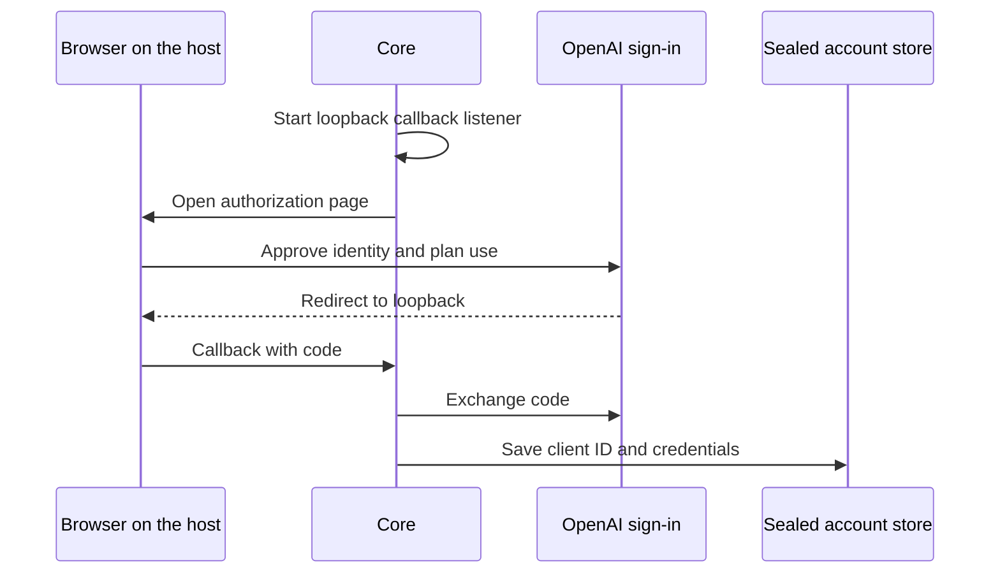

The **ChatGPT plan (self-hosted)** provider connects a local open-core host through OpenAI's
public Sign in with ChatGPT flow. Identity sign-in and permission to use your plan are separate.
Eligible plan requests use the public Responses API. See OpenAI's
[plan usage overview](https://developers.openai.com/siwc/token-sharing-open-source).

Connect accounts and choose models from [Manage Providers in Desktop](/docs/providers/manage-providers).

- The existing Codex connection keeps its own credentials and transport.
- To plan Codex weekly and banked resets by hand, see
  [Plan Codex Weekly Resets](/docs/providers/codex-reset-planning).
- OpenAI API keys remain available through the [cloud provider configuration](/docs/providers/cloud).

## Sign in

1. Open **Gateway → AI providers → OAuth accounts** and expand **ChatGPT plan (self-hosted)**.
2. Select **Continue with ChatGPT**. Complete authorization in a browser on the host running Core.
3. Review both identity information and permission to use your ChatGPT plan. An identity-only
   sign-in is saved, but it cannot run model requests. Select **Enable plan use** on that saved
   registration when you want to grant that permission.
4. Choose a model from the account's discovered list, then select **Use this provider**.
   To change a model or thinking setting while the provider is active, select **Apply changes**.

Core starts its loopback callback listener before authorization. It verifies the returned identity
and stores each account's issued client ID and credentials in the sealed account store. It keeps
OAuth tokens out of Pi's plaintext auth file. See OpenAI's
[registration and sign-in contract](https://developers.openai.com/siwc/token-sharing-open-source/sign-in).

If the code exchange reports that the code expired, Ryu starts one fresh authorization attempt
with the issued registration retained. It uses fresh state, nonce, and PKCE values for that retry.

## Accounts and usage

Add another account with **Continue with ChatGPT**, or select a saved account for yourself.

- **Reconnect selected account** renews that registration. It reuses the issued client ID and
  checks that the returned identity belongs to the selected account.
- Registrations with the same email can belong to different workspaces. Rename their labels to
  tell them apart.
- The model picker refreshes when the selected account changes. It shows the server's visible
  models in the returned order.

### Account routing

**Account routing** offers manual selection or round robin for new conversations.

- Lower-numbered priorities run first.
- Disabled accounts and registrations without plan-use permission are excluded.
- A healthy conversation keeps its account binding during the Core process's lifetime. Disabling
  its account releases that binding.
- Model availability can differ by account, so choose a model available to every account in your
  rotation.

The shared binding and strategy rules are on
[Account routing](/docs/providers/account-routing#core-login-pools-for-claude-and-chatgpt). This
connection provides no account quota observations, so quota first, fill first, and reset first are
not offered. They remain available for subscription connections that provide those observations.

### Usage limits

**Manage usage** opens [ChatGPT usage settings](https://chatgpt.com/settings/usage). Review the
app's weekly limit and credit preference there.

A usage-limit error can apply to the app's limit, and repeated sign-in does not restore usage. Ryu
does not switch that request to API-key billing. See OpenAI's
[usage and recovery guidance](https://developers.openai.com/siwc/token-sharing-open-source/errors-and-recovery).

### Remove an account

Removing an account attempts to revoke its renewable session before removing local credentials.
If remote revocation cannot be confirmed, Ryu reports that separately. You can disconnect the app
in ChatGPT settings. See OpenAI's [account and session guidance](https://developers.openai.com/siwc/token-sharing-open-source/profiles-and-sessions).

## Compatibility

<Callout type="warn">
  Plan use through Sign in with ChatGPT is a preview. OpenAI's preview limitations, linked below, apply.
</Callout>

This connection uses streaming Responses requests with server storage disabled and explicit
conversation history. Local function and custom tools are grouped into namespaces.

These hosted tools are unavailable through this flow:

- image generation
- file search
- Code Interpreter
- computer use
- hosted MCP
- Responses tool search

Embeddings, transcription, speech, and video use their own
[provider adapters](/docs/providers/routing). Review OpenAI's
[preview limitations](https://developers.openai.com/siwc/token-sharing-open-source/preview-limitations).

OpenAI documents this flow for open-source and locally hosted apps. Paid or remotely hosted
applications have a separate [partner registration path](https://developers.openai.com/siwc/request-client-id).
This guide does not describe a hosted commercial integration.
