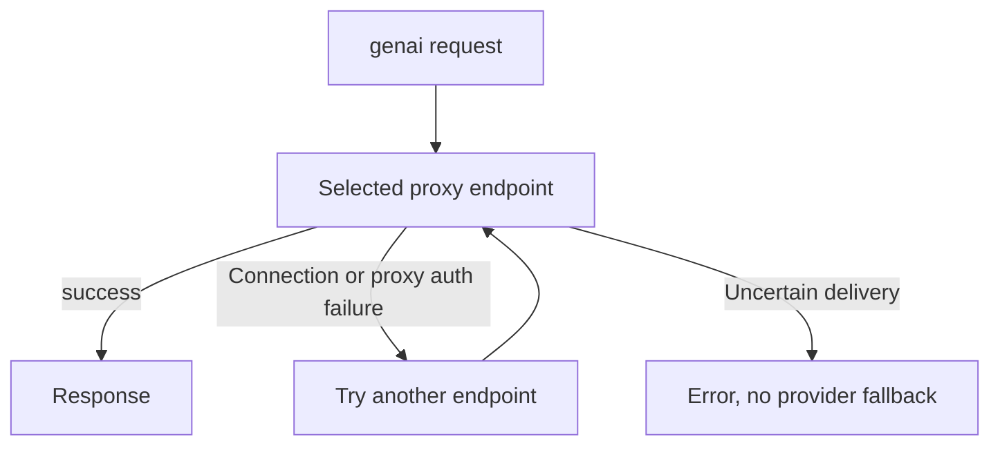

Cloud providers are hosted model APIs that the Gateway registers and calls for you. Credentials,
routing, budgets, rate limits, firewall policy, and audit stay together in the Gateway. A provider
can support chat without supporting every media or retrieval operation.

For a ChatGPT plan connection on self-hosted Core, see
[ChatGPT plan on self-hosted Core](/docs/providers/chatgpt-plan).

## Cloud provider matrix

| Provider | Stable ID | Supported Gateway operations |
|---|---|---|
| OpenAI | `openai` | Chat, embeddings, reranking, images, STT, TTS |
| Anthropic | `anthropic` | Chat through the Anthropic Messages protocol |
| Google GenAI | `genai` | Native chat adapters such as Gemini, Groq, xAI, DeepSeek, and Cohere; inline-image understanding; and Gemini image generation with a configured Gemini key and image model |
| OpenRouter | `openrouter` | Chat, embeddings, reranking, images, TTS, STT, and video jobs through a dynamic upstream catalog |
| Modal | `modal` | Chat against an OpenAI-compatible serverless deployment |
| Cloudflare Workers AI | `cloudflare` | OpenAI-compatible alias; the deployed model determines which operations are usable |
| AWS Bedrock | `bedrock` | Anthropic-Messages-compatible chat path for supported models |
| Google Vertex AI | `vertex` | OpenAI-compatible alias for supported Vertex chat endpoints |
| Fal AI | `fal` | Images, TTS, and queued video generation |
| Replicate | `replicate` | Images, TTS, and prediction-backed video generation |
| AssemblyAI | `assemblyai` | Prerecorded speech transcription through a bounded upload and polling flow |
| Qwen | `qwen` | Compatible chat and embeddings; native Qwen-ASR translation for synchronous STT |
| Inworld | `inworld` | Synchronous text-to-speech with native authentication and audio normalization |
| Cohere | `cohere` | Native Embed and Rerank v2 operations |
| Voyage AI and Jina AI | `voyage`, `jina` | Direct embeddings |
| Mistral, NVIDIA NIM, Together, Fireworks | `mistral`, `nvidia`, `together`, `fireworks` | Compatible chat and embeddings when the selected model supports them |
| Hugging Face Inference Providers | `huggingface` | Compatible chat and vision; see [Chat and models](/docs/providers/chat-and-models#vision-inputs) |
| Chutes, Hyperbolic, SiliconFlow, Venice, Featherless | `chutes`, `hyperbolic`, `siliconflow`, `venice`, `featherless` | Compatible chat against each provider's fixed OpenAI-compatible base URL |
| BFL Flux, Stability, Recraft, MiniMax | `bfl`, `stability`, `recraft`, `minimax` | Direct image generation; BFL also has queued video |
| Runway and Topaz | `runway`, `topaz` | Direct video tasks; Topaz enhances an external video source |
| Deepgram and ElevenLabs | `deepgram`, `elevenlabs` | Speech operations supported by their adapters |
| AWS Polly, Google TTS, Edge TTS, Google Translate TTS | `polly`, `google-tts`, `edge-tts`, `google-translate-tts` | Text-to-speech; Edge TTS and Google Translate TTS are anonymous consumer services that each need an explicit opt-in |

The matrix describes the Gateway contract and adapter. The selected upstream model can narrow that
set further. For example, a provider may expose an image route while a particular model only accepts
text, or an OpenAI-compatible endpoint may not implement reranking.

## Gemini image understanding

For a vision-capable Gemini model, send OpenAI-style `image_url` parts in a user message alongside
text parts. The GenAI adapter preserves their order and translates each base64 data URI into native
inline image data for buffered and streaming chat.

- Supported MIME types are `image/png`, `image/jpeg`, `image/webp`, `image/heic`, and `image/heif`.
- The Gateway limits the combined decoded image input to 10 MiB per request.
- Remote image URLs, images in system or assistant turns, invalid base64, and unsupported content
  parts return an error. Ryu does not download caller-supplied image URLs through this adapter.

See Google's [image understanding guide](https://ai.google.dev/gemini-api/docs/image-understanding)
for model capabilities. This translation does not guarantee that every model exposed through GenAI
supports images.

## GenAI proxy routing

The `genai` provider supports explicit outbound proxy assignments for native SDK chat, streaming
chat, and Gemini image generation. Its SDK and image clients share endpoint selection and cooldown.
Multi-endpoint routes bypass Gateway response caches.

Account selection is separate. A stable Gemini session keeps its key, while rejected quota or
payment conditions can select another configured key.

Endpoint failover depends on whether the request could have reached the provider:

- A connection-establishment failure or a proxy authentication rejection can try another endpoint.
- Uncertain delivery returns an error without provider fallback.

## Managed delivery

Ryu can also expose managed labels such as `managed-openrouter` and `gateway`. These identify a
managed credential and policy path rather than a new upstream protocol. A managed route can apply
provider privacy, usage, or credit policy before the request leaves the Gateway.

The `openai-credits` ID is separate from `openai` when a deployment has a billing-isolated donated
OpenAI supply. It is a money-accounting boundary, not a claim that OpenAI exposes a second API.

The desktop Gateway's modality routing editor and its Provider pools editor list it as
**OpenAI (donated credits)**, separate from **OpenAI**. What is saved is the `openai-credits` ID,
not the label.

## Configure and inspect

Provider configuration belongs in the Gateway configuration and credential surfaces. The Gateway
does not return secret values through its read APIs. Use the [Gateway configuration](/docs/gateway/configuration)
and [BYOK and provider accounts](/docs/providers/byok) pages for the setup boundary.

The live model and modality surfaces answer a narrower question than this inventory:

- `GET /v1/models` reports what configured providers expose now.
- `GET /v1/modalities` reports the configured provider and model for chat, image, TTS, STT, and
  video.
- A successful provider call is the only proof that the selected upstream accepted the exact model,
  input, and modality.

See [Gateway routing](/docs/gateway/routing) for resolution order, fallback chains, and modality
overrides.
