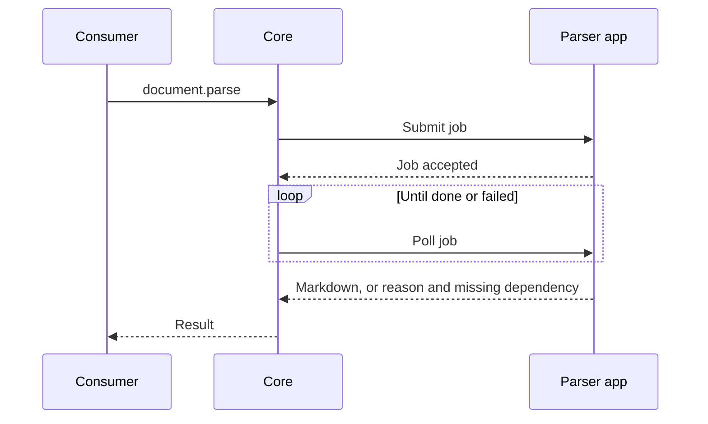

Document extraction is a route-backed provider layer. Core owns the document lifecycle and chooses
the enabled `document.parse` provider. The parser app converts the document and reports its
capabilities. All five backends run on the node, so document bytes do not go to a cloud service
you did not select.

## Parser options

| Provider | Best fit | OCR | Layout and tables | Trade-off |
|---|---|---:|---:|---|
| AnyDoc | Fast local extraction across Office, OpenDocument, RTF, EPUB, CSV, and text PDFs | No | Shared Markdown serializer; document model available in the upstream library | Small Rust service with no model download; scanned PDFs return `needs_ocr` |
| MarkItDown | Common PDF, Office, HTML, spreadsheet, email, and archive attachments | No | Markdown output; no element array | Small pure-Python install; scanned/image-only input reports an empty-document failure |
| Docling | PDFs where reading order and table structure matter | Yes | Strong layout and table reconstruction | Larger model-backed install; local inference and model caching |
| MinerU | Scientific, formula-heavy, or scanned PDFs | Yes | Layout, formulas, and tables | Heavier Python and model requirements; CPU works but can be slow |
| Unstructured | Broad format coverage, legacy Office, email, and typed elements | Yes | Element-typed output such as titles, tables, lists, and page breaks | Largest dependency surface and native tool requirements for some formats |

These are five providers behind one capability, not five Core APIs. A consumer can send the
result to Spaces, RAG, chat attachments, or another document workflow without a
provider-specific request shape.

## OCR is an explicit capability

Not every parser runs OCR:

- MarkItDown extracts embedded text and does not OCR pixels.
- AnyDoc extracts supported local formats and text-based PDFs. It does not OCR pixels or fetch
  URLs.
- Docling can use its local OCR pipeline and can optionally use a configured OCR engine.
- MinerU includes OCR in its scanned-PDF pipeline.
- Unstructured can OCR scanned content when its parser and host dependencies are installed.

When a parser cannot handle the input, the job reports the reason or the missing dependency. It
does not return an empty document as a success for a scanned file.

## Choosing a backend

| Input or goal | Start with |
|---|---|
| Fast local Office/PDF conversion or a separately deployed extraction endpoint | AnyDoc |
| Modern text PDFs and Office files with a small install | MarkItDown |
| Multi-column PDFs and tables | Docling |
| Scientific PDFs, formulas, and scanned pages | MinerU |
| Legacy Office/email formats or element-level chunking | Unstructured |
| Web page extraction | Use the `web.extract` Toolkit layer, not `document.parse` |

All five parsers use submit-then-poll jobs so a cold model download or a long OCR run does not hold
an ext-proxy request open indefinitely. Each reports its own formats, limits, dependencies, and
availability through the capability surface.

## Standalone AnyDoc service

AnyDoc also ships as `ryu-anydoc`, a versioned `POST /v1/extract` service. This is a separate
deployment mode from Core's node-authenticated provider mount.

- **Input** - raw document bytes with an `X-Filename` header, or a smaller JSON body with
  `contentBase64` (inline bytes only in standalone mode).
- **Auth** - tenant-scoped bearer keys.
- **Output** - Markdown plus format, version, hash, warnings, and truncation metadata.

<Callout type="warn">
  The standalone service is a self-hosted deployment option. The source package does not imply a
  Ryu-hosted AnyDoc deployment or billing.
</Callout>

## Related app pages

<Cards>
  <DocCard href="/docs/apps/anydoc" />
  <DocCard href="/docs/apps/markitdown" />
  <DocCard href="/docs/apps/docling" />
  <DocCard href="/docs/apps/mineru" />
  <DocCard href="/docs/apps/unstructured" />
</Cards>

See [Spaces and RAG](/docs/core/spaces-rag) for ingestion and reindexing. See [Swappable layers](/docs/core/swappable-layers)
for the difference between route-backed document providers and verb-backed Toolkit providers.
