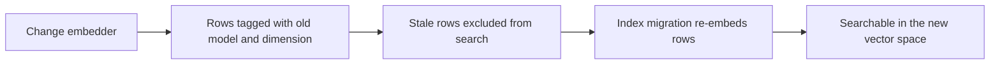

Embeddings turn text into vectors for Spaces, memory search, semantic routing, and semantic tool
ranking. Reranking is a separate operation that scores a set of retrieved documents. A provider
that supports one does not necessarily support the other.

## Provider options

| Provider path | Embeddings | Reranking | Where it runs |
|---|---:|---:|---|
| Local llama.cpp embedding tier | Yes | Local llama.cpp reranker | On the Ryu node; the default RAG path |
| OpenAI | Yes | Yes when the selected OpenAI-compatible endpoint exposes it | Through the Gateway |
| OpenRouter | Yes | Yes through its rerank route | Through the Gateway; model availability is upstream-defined |
| Voyage AI | Yes | No generic rerank adapter | Direct to Voyage through the Gateway when its key is configured |
| Jina AI | Yes | No generic rerank adapter | Direct to Jina through the Gateway when its key is configured |
| Mistral | Yes | Depends on the selected endpoint | Direct to Mistral through the Gateway when its key is configured |
| NVIDIA NIM | Yes | Depends on the selected endpoint | Direct to NVIDIA through the Gateway when its key is configured |
| Together AI | Yes | Depends on the selected endpoint | Direct to Together through the Gateway when its key is configured |
| Fireworks AI | Yes | Yes for a compatible rerank model | Direct to Fireworks through the Gateway when its key is configured |
| Cohere | Yes | Yes | Direct to Cohere Embed/Rerank v2 through the Gateway when its key is configured |
| Cloudflare Workers AI alias | OpenAI-compatible path | Depends on the selected upstream model/endpoint | Through the Gateway when configured |
| Vertex AI alias | OpenAI-compatible path | Depends on the selected upstream model/endpoint | Through the Gateway when configured |
| Custom OpenAI-compatible endpoint | If the endpoint implements embeddings | If the endpoint implements reranking | Through a configured Gateway or local endpoint |

OpenAI-compatible aliases such as Cloudflare Workers AI and Vertex keep the underlying adapter's
embedding and reranking operations when the selected upstream endpoint implements them. Configure
the corresponding model route, then test the exact model before indexing documents.

### Direct provider keys and model IDs

The Gateway's **Provider keys (BYOK)** page can install the Voyage, Jina, Mistral, NVIDIA,
Together, and Fireworks keys on a local node. These model ID prefixes route to their matching
provider:

| Model ID prefix | Provider |
|---|---|
| `voyage-` | Voyage AI |
| `jina-` | Jina AI |
| `mistral-embed`, `codestral-embed` | Mistral |
| `nvidia/` | NVIDIA NIM |
| `fireworks/` | Fireworks AI |

Together's model IDs overlap open-model namespaces, so map the exact model or a carefully chosen
prefix in **Gateway → Model routing**.

Cohere uses its own Embed/Rerank v2 adapter. Pass `input_type` (`search_document`,
`search_query`, `classification`, or `clustering`) on embedding requests to match the job. Ryu
defaults to `search_document` when it is omitted.

### Quota headers and account pools

For compatible providers with account routing enabled, successful embedding, reranking, image,
and audio responses contribute their complete quota headers to the same account pool used by
chat. Fill first can then move new chat sessions away from a drained account while keeping an
existing conversation on its bound account. Missing or partial headers do not establish usage.

### Not generic embedding providers

Anthropic, Google GenAI's native adapter, Modal, Fal, and Replicate are not presented as generic
embedding providers by the Gateway contract. A provider may have a chat model while not supporting
embeddings or reranking.

## Local-first defaults

The default local stack uses a dedicated llama.cpp embedding tier with the bundled embedding model.
It is not a Chat engine and does not appear in the Chat engine picker. Core keeps the model
and vector dimension with indexed rows so one vector space is never compared with another by
accident.

Local retrieval works without a cloud credential:

1. A document is split into bounded chunks.
2. The active embedder creates a vector for each chunk.
3. A query is embedded with the same model and dimension.
4. Vector search returns candidate chunks.
5. An optional reranker scores those candidates before the final result.

## Gateway endpoints

The Gateway exposes provider-neutral request shapes:

| Operation | Endpoint |
|---|---|
| Create embeddings | `POST /v1/embeddings` |
| Rerank documents | `POST /v1/rerank` |
| Read or change Core's embedding configuration | Core embedding settings and reindex routes |

The Gateway authenticates the request, applies policy, routes the model, and keeps the upstream
credential on the Gateway side. A custom endpoint is still subject to the same auth, limits, and
audit boundary as a built-in provider.

## Changing an embedder is an index migration

A new embedding model can have a different dimension and a different vector space, so old vectors
cannot be searched with it. Ryu tags indexed rows with the model and dimension, excludes stale rows
from mixed-space searches, and re-embeds them through the index migration path.

Portable Space packages contain source documents, not vectors. Reindex after importing them on the
target node so the target's local, cloud, or custom embedding setup becomes authoritative.

See [Spaces and RAG](/docs/core/spaces-rag), [Chat and models](/docs/providers/chat-and-models),
and [Gateway routing](/docs/gateway/routing) for the surrounding contract.

<Callout type="warn">
An embedding provider being configured does not prove that a particular model supports embeddings.
Use the provider's model discovery and run the index/retrieval checks after changing the model.
</Callout>
