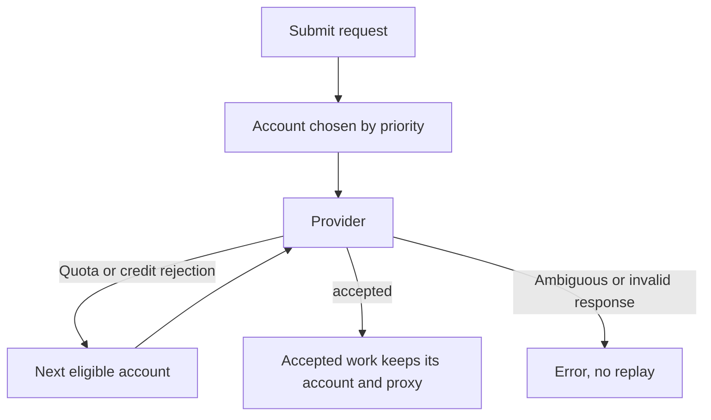

This page covers setup and limits for each direct image and video provider. For the provider matrix,
request routes, and Topaz video enhancement, see [Image and Video](/docs/providers/image-and-video).

## Configuration at a glance

Add keys in **Gateway → API keys → Provider keys (BYOK)**, or configure them headlessly. Each
`[providers.<id>]` section takes `api_key`, optional extra `api_keys`, and an optional `base_url`.
The environment variables are alternatives to the TOML keys.

| Provider | Section | Environment variables | Default `base_url` |
|---|---|---|---|
| Recraft | `[providers.recraft]` | `RECRAFT_API_KEY`, `RECRAFT_API_KEYS`, `RECRAFT_BASE_URL` | `https://external.api.recraft.ai/v1` |
| Stability AI | `[providers.stability]` | `STABILITY_API_KEY`, `STABILITY_API_KEYS`, `STABILITY_BASE_URL` | `https://api.stability.ai/v2beta` |
| Black Forest Labs | `[providers.bfl]` | `BFL_API_KEY`, `BFL_API_KEYS`, `BFL_BASE_URL` | `https://api.bfl.ai/v1` |
| MiniMax | `[providers.minimax]` | `MINIMAX_API_KEY`, `MINIMAX_API_KEYS`, `MINIMAX_BASE_URL` | `https://api.minimax.io/v1` |
| Runway | `[providers.runway]` | `RUNWAY_API_KEY`, `RUNWAY_API_KEYS`, `RUNWAY_BASE_URL` | `https://api.dev.runwayml.com/v1` |

These upstream keys are separate from Gateway client keys. Every provider below supports named
accounts with enable controls and priorities, assigned outbound proxy pools, and rotation to
another eligible account after a definitive quota or credit rejection before the job is accepted.

A lost, invalid, or ambiguous response after submission is never replayed through another account
or provider. Save returned assets promptly if you need durable storage.

## Recraft

The direct `recraft` provider uses Recraft's JSON image-generation API. Use a `recraftv` model ID
such as `recraftv4_1` with `/v1/images/generations`.

- The model catalog reports the documented V2, V3, V4, and V4.1 generation variants as image
  models. Chat, embeddings, video, editing, and raw multipart results are not advertised.
- Results can be `url` or `b64_json`, with a total JSON response limit of 64 MiB.
- Native style, size, seed, and image-format fields are forwarded in the JSON body. Recraft
  enforces model-specific constraints.
- Local validation requires a nonempty prompt, checks its model-specific length, and limits `n`
  to 1-6.

See Recraft's [endpoint reference](https://www.recraft.ai/docs/api-reference/endpoints)
and [model limits](https://www.recraft.ai/docs/api-reference/appendix).

## Stability AI

The direct `stability` provider translates `/v1/images/generations` JSON into Stability's native
multipart API. Supported generation IDs are `stable-image-ultra`, `stable-image-core`,
`sd3.5-large`, `sd3.5-large-turbo`, `sd3.5-medium`, and `sd3.5-flash`.

- One text-to-image generation per request (`n: 1`).
- Returns `b64_json`, with a 32 MiB image response limit. The default output is PNG;
  `output_format` also accepts JPEG or WebP.
- Use Stability's `aspect_ratio`, `negative_prompt`, and `seed` options. SD3.5 supports
  `cfg_scale`; Core and SD3.5 support `style_preset`.
- Gateway sizes `1024x1024`, `1536x1024`, and `1024x1536` map to `1:1`, `3:2`, and `2:3`. These
  select aspect ratios rather than promising exact output dimensions.
- Conflicting sizes or ratios and unsupported inputs are rejected before submission.
- Editing, hosted URL results, audio, and video are not advertised by this adapter.

Use one API key for each provider account, following Stability's
[API reference](https://platform.stability.ai/docs/api-reference).

## Black Forest Labs

The direct `bfl` adapter submits FLUX image tasks and polls the returned task URL inline. It also
exposes queued `flux-3-video` text-to-video jobs.

### Images

- Inline image polling defaults to 500 ms with a 180-second limit. The operator settings
  `poll_interval_ms` and `poll_timeout_secs` adjust that wait.
- Configured model discovery reports the documented FLUX.2 and legacy image endpoints.
- Generate one asset per request. Image output uses `url`; `b64_json` and local asset rehosting
  are not implemented.
- Signed delivery URLs expire, so download assets promptly. Browser CORS access to BFL delivery
  URLs is not guaranteed.
- Native model options are forwarded, while `size` maps to width and height. Model-specific
  resolution limits remain upstream constraints.

### Video

The video operation defaults to `t2v`. Other video modes, edit tools, webhooks, and audio-only
operations are not advertised by this adapter.

### Polling and replay

- After acceptance, queued polling keeps its original account and actual selected HTTP client.
- Video references include an opaque credential fingerprint, preserving account identity after key
  reordering.
- Poll URLs are restricted to the configured origin or trusted HTTPS BFL API hosts, and the
  returned task ID is checked.
- Invalid accepted responses, poll failures, and inline timeouts stop generation replay.
- Gateway API clients do not follow redirects implicitly; configure the final upstream URL.

See BFL's [generation guide](https://docs.bfl.ai/quick_start/generating_images) and
[FLUX 3 API](https://docs.bfl.ai/api-reference/utility/generate-a-video-with-flux-3).

<Callout type="warn">
  Live model, asset-delivery, and video output validation require a BFL test key. Test with your
  own key before you depend on this adapter.
</Callout>

## MiniMax images

MiniMax connects directly to its native image-generation API. Configure keys under
**Gateway → API keys → Provider keys (BYOK) → MiniMax**, then use model **image-01** with the
OpenAI-compatible image-generation endpoint.

| Input | Accepted values |
|---|---|
| `n` | 1 to 9 |
| `prompt` | Nonempty, up to 1500 characters |
| `response_format` | `url` or `b64_json` |
| `size` | `WIDTHxHEIGHT`, both dimensions from 512 to 2048 in multiples of 8 |
| Native options | `aspect_ratio`, `seed`, `prompt_optimizer` |

Choose size, native dimensions, or an aspect ratio without combining them. URL outputs expire after
24 hours.

MiniMax returns native error codes even with HTTP 200. Definitive quota and insufficient-balance
errors can try another eligible account. Accepted or ambiguous failures, invalid output, and
moderation stop automatic replay.

Successful responses are normalized to OpenAI image objects and bounded to 64 MiB. This adapter
supports text-to-image only; other MiniMax services require their own operation-specific adapters.
See the [MiniMax image API](https://platform.minimax.io/docs/api-reference/image-generation-t2i)
for supported native options and account requirements.

## Runway videos

Connect Runway directly under **Gateway → API keys → Provider keys (BYOK) → Runway**. The adapter
sends API version `2024-11-06`.

### Models and inputs

Use `gen4.5` for text-to-video or image-to-video and `gen4_turbo` for image-to-video.

- Requests use `prompt` (or native `promptText`), a native `ratio` (or `size` such as
  `1280x720`), and `duration` in seconds.
- Gen-4.5 requires a duration from 2 to 10; Gen-4 Turbo accepts the same range when supplied.
- Prompts are limited to 1000 UTF-16 code units. Submit one video per request.

`promptImage` selects image-to-video. It accepts an HTTPS image URL, an existing Runway upload URI,
or a JPEG, PNG, or WebP base64 data URI up to 5 MiB. A single native first-frame image object is
also supported.

| Mode | Accepted ratios |
|---|---|
| Text-only Gen-4.5 | `1280:720`, `720:1280` |
| Image mode | The text-only ratios plus `1104:832`, `832:1104`, `960:960`, `1584:672` |

Native options are forwarded to Runway for model-specific checks.

### Jobs

The video endpoint returns a queued job. Poll the returned Gateway job ID for status and output URLs.

- Live account metadata changes preserve accepted jobs, including when an account is disabled.
- An assigned proxy remains bound to the job while Gateway is running.
- Ambiguous submission or polling failures never start another generation.
- Output URLs expire within 24-48 hours; retrieve the job again for fresh URLs.

<Callout type="warn">
Credential changes restart Gateway and discard its in-memory job handles. Retrieve pending results
before adding, replacing, or removing credentials.
</Callout>

See [Runway's API reference](https://docs.dev.runwayml.com/api/) for native options.
