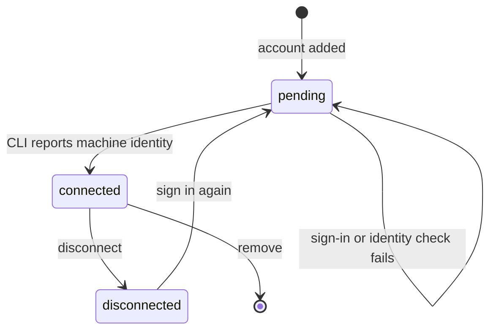

Native Kiro accounts are saved sign-ins for the official Kiro CLI when Ryu runs it as an agent. Each
account gets its own isolated CLI profile. For the separate HTTP chat provider, see
[Kiro HTTP provider](/docs/providers/kiro).

<Callout type="warn">
Native Kiro account support is a preview.

- Isolated storage has been checked with the official Windows CLI.
- Signed-in identity, renewal, model access, and independent authorization for two real accounts
  are not live-verified.
- Account custody does not provide an OpenAI-compatible endpoint or managed Pi model support. See
  [provider routing](/docs/providers/routing) for the supported provider transports.
</Callout>

A saved account label alone does not confirm authorization. A new connection stays pending until
the official CLI completes sign-in and reports a machine identity in that account's isolated
profile. If identity verification fails, the account cannot launch a chat.

## Account custody

Each account has its own CLI home, configuration directories, and vendor credential database. Ryu
does not copy your global Kiro login into another account. The official CLI owns the authorization
files inside that private profile. Ryu keeps its account registration and connection state in the
sealed account store.

Agent launches keep the selected profile and explicitly scoped session credentials.

- Core and Gateway administrative credentials from the parent environment are withheld from the
  agent process.
- The installation directory of a shared runtime does not change which agent is launched or apply
  another agent's process restrictions.
- Your chosen data-directory name does not change an ACP agent's backend identity.

Account labels are for display. Connecting two accounts with the same label creates separate
profiles. Selecting an account affects new launches. A launch captures its account before
execution, so changing the picker while it runs cannot substitute a different account's
credentials.

Connecting, exporting, removing, or optimizing native provider accounts requires node-owner
authority (the `/api/agents/:id/native-accounts` routes are owner-only).

## Conversation affinity

A native conversation belongs to the account and profile that created it. Resume requires the same
account identity. Credential rotation can keep that identity. Disconnecting invalidates the old
launch and resume binding.

A disconnected or removed account cannot silently hand an existing conversation to another
account. Reconnect the intended account or start a new conversation. Removing an account stops Ryu
from dispatching through it. Vendor logout is a separate operation and must complete before its
authorization can be considered revoked.

Gateway conversation affinity is scoped to the verified caller as well as its tenant, so two users
who send the same conversation id do not share an account binding. Saved accounts are not affected by this scoping.
