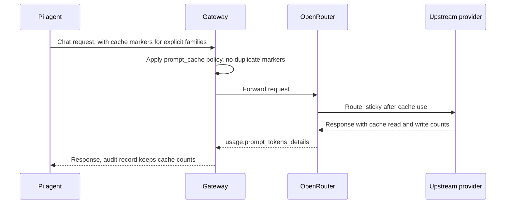

Prompt caching lets a provider reuse an unchanged prefix of a prompt, such as system instructions,
tool definitions, or earlier conversation context. A cache hit can reduce input cost and latency.

Prompt caching is separate from Ryu's exact and semantic response caches. Those can return a prior
answer without asking the model again.

## OpenRouter behavior

OpenRouter documents automatic prompt caching for many supported model and provider combinations.
Some model families need an explicit cache breakpoint in the request. Its current guide documents
explicit cache-control support for Anthropic Claude, selected Qwen models, and DeepSeek V3.2.
Support can vary by model and upstream endpoint.

Check the [OpenRouter prompt caching guide](https://openrouter.ai/docs/guides/best-practices/prompt-caching)
for the current model list and routing details.

### Claude and endpoint selection

For Claude, OpenRouter's top-level automatic marker routes to Anthropic and excludes Bedrock and
Vertex endpoints. Ryu's default `auto` policy uses that marker for Claude.

If you need per-block control across compatible endpoints, set the Gateway's
[explicit mode](/docs/gateway/prompt-caching#choose-a-mode) and confirm the selected provider
supports those breakpoints.

OpenRouter routes a conversation back to the same provider after it detects cache use. Its
[sticky-routing guide](https://openrouter.ai/docs/guides/best-practices/prompt-caching#provider-sticky-routing)
describes that default and its tradeoffs.

### Explicit caching prices

For explicit caching, OpenRouter reads cache-control markers in the prompt. Cache creation and
cache reads may have different prices from ordinary input tokens, so compare the selected model's
current pricing before changing cache behavior.

The current OpenRouter guide lists these multipliers of the input price:

| Family | Cache write | Cache read |
|---|---|---|
| Qwen (explicit) | 1.25x | 0.1x |
| Claude, 5-minute TTL | 1.25x | 0.1x |
| Claude, 1-hour TTL | 2x | 0.1x |

<Callout type="warn">
These rates and model eligibility can change. Check the linked guide and model pricing before
relying on them.
</Callout>

### Explicit Qwen and DeepSeek IDs

The currently documented explicit Qwen and DeepSeek V3.2 IDs are:

- `deepseek/deepseek-v3.2`
- `qwen/qwen3-max`
- `qwen/qwen-plus`
- `qwen/qwen3.6-plus`
- `qwen/qwen3-coder-plus`
- `qwen/qwen3-coder-flash`

The documented Qwen 3.5 snapshot IDs do not support explicit caching. OpenRouter can update this
list as providers add or remove support.

## Ryu and Pi

Pi supports explicit cache markers through `compat.cacheControlFormat: "anthropic"` on its OpenAI
Chat Completions adapter. See Pi's [custom provider guide](https://pi.dev/docs/latest/custom-provider)
and [Chat Completions adapter](https://github.com/earendil-works/pi/blob/main/packages/ai/src/api/openai-completions.ts).

Ryu-managed Pi agents set that format, and use the Chat Completions request path, for model
families that require explicit breakpoints: Claude, the Qwen and DeepSeek V3.2 IDs above, and
Gemini versions before 2.5. Other managed models stay on the Responses path, and OpenRouter handles
implicit caching where the selected upstream supports it.

The managed behavior is automatic for eligible models. Cache creation still depends on the
upstream provider's support and routing. A request does not guarantee a hit.

## Read cache activity

| Surface | What it shows |
|---|---|
| Agent observability | Request-level cache hits, writes, and misses when Gateway has usage details. |
| Agent context meter | Cache activity alongside context-window occupancy and remaining tokens when the agent reports those values. |
| Gateway audit | Read and write token counts on the request record when the provider reports them. |

Cache tokens describe provider billing and reuse. Context-window occupancy describes how much
conversation fits in the model's working context.

### Usage fields

| Usage shape | Cache reads | Cache writes |
|---|---|---|
| Chat Completions (OpenRouter) | `usage.prompt_tokens_details.cached_tokens` | `usage.prompt_tokens_details.cache_write_tokens` |
| Responses | `usage.input_tokens_details.cached_tokens` | `usage.input_tokens_details.cache_write_tokens` |

These are token counts, not request counts, and OpenRouter reports them when available. Ryu
normalizes both shapes for the audit record and context views. See
[Gateway audit](/docs/gateway/audit) and [Core observability](/docs/core/observability).

### How misses are derived

OpenRouter does not report misses directly:

- The Gateway derives OpenRouter misses as input tokens minus cache reads and writes.
- ACP context stats derive misses from total input and the reported cache subtotals only when both
  read and write counts are present. See the
  [ACP usage fields](https://agentclientprotocol.github.io/typescript-sdk/types/Usage.html) for the
  input, cache-read, and cache-write counts.
- When a required count is missing, Ryu leaves misses unavailable rather than assuming zero.

## Gateway policy

The Gateway adds cache markers under its `[prompt_cache]` policy, `auto` by default. Pi-managed
requests that already carry compatible breakpoints keep them without duplicates. Modes, per-family
markers, TTL, request overrides, and OpenRouter `session_affinity` are documented once in
[Gateway prompt caching](/docs/gateway/prompt-caching).

## Improve prefix reuse

- Keep stable instructions and tool definitions early in the prompt, and put turn-specific
  information later.
- Reuse the same conversation and avoid changing the beginning of a prompt unnecessarily.
- Routing to a different upstream provider, or to a model without the same cache behavior, can
  reduce reuse.

For OpenRouter's provider selection and Ryu-managed versus BYOK routing, see
[OpenRouter](/docs/providers/openrouter).
