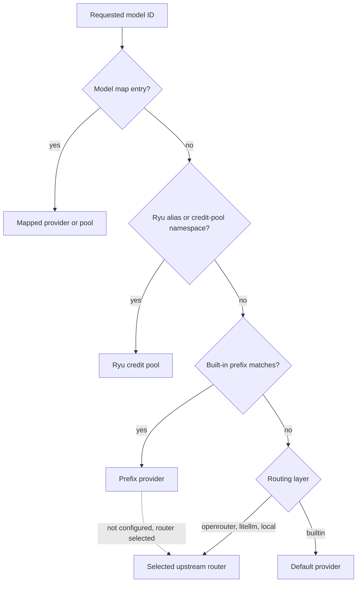

The Gateway chooses a provider for each request from the requested model, the modality slot, node
defaults, and the configured fallback policy. This page is for operators who configure that
routing.

<Figure name="routing" />

## Model routing precedence

The Gateway resolves a requested model ID in this order:

1. The model map (exact keys, then the longest prefix key).
2. Ryu model aliases and credit-pool namespaces.
3. Built-in prefix rules.
4. The default provider, which the routing layer owns.

The canonical order and the built-in prefix table are in
[Gateway routing](/docs/gateway/routing#resolution-order). Operation-specific prefixes are listed
with their providers on [Embeddings and reranking](/docs/providers/embeddings-and-reranking),
[Speech](/docs/providers/speech), and
[Image and video provider guides](/docs/providers/image-video-provider-guides).

An explicit model map can remap a name to another provider. Use stable model IDs. Do not rely on
an array position or a mutable display label.

### The default provider and the routing layer

The last step, the default provider, belongs to the [routing layer](/docs/providers/upstream-routers):

- With the default `builtin` layer, it is the configured default provider.
- With OpenRouter, LiteLLM, or the local engine as the routing layer, unclaimed models and every
  router-neutral `router/<model>` ID go to that router instead.
- Model-map entries always keep their destination.
- A built-in prefix keeps its provider while that provider is configured. Otherwise the selected
  router serves it.

See [what a router does not take over](/docs/providers/upstream-routers#what-a-router-does-not-take-over).

## Enabled provider models

Each provider model has an availability switch in **Gateway → AI providers**. See [Manage Providers in Desktop](/docs/providers/manage-providers#enable-or-hide-models).

## Direct chat provider pools

Provider pools bind new sessions to a configured chat provider and model, with optional balancing
and fallback. Existing sessions keep their member binding to preserve upstream prompt-cache reuse.

Pool strategies do not change the separate per-provider [account routing](/docs/providers/account-routing).
See [Chat provider pools](/docs/providers/provider-pools) for selection strategies, configuration,
and retry behavior.

## Modality slots

Chat, image, TTS, STT, and video can have separate provider/model mappings. Embeddings,
reranking, web search, and web fetch have their own Gateway operation routes.

A chat provider is not automatically used for another operation. A per-agent slot can override the
node's modality map.

| Modality | Example provider choices |
|---|---|
| Chat | OpenAI, Anthropic, GenAI, OpenRouter, local, Modal, Vertex, Bedrock, Cloudflare, Mistral, Hugging Face, NVIDIA NIM, Together, Fireworks |
| Image | OpenAI, OpenRouter, Gemini (`genai` image models), Fal, Replicate, BFL Flux, Stability, Recraft, MiniMax, stable-diffusion.cpp |
| Embeddings | OpenAI, OpenRouter, Voyage, Jina, Cohere, Mistral, NVIDIA NIM, Together, Fireworks, local, custom OpenAI-compatible endpoints |
| Reranking | Cohere, OpenRouter, compatible OpenAI-style endpoints, local llama.cpp reranker |
| TTS | OpenAI, OpenRouter, Deepgram, ElevenLabs, Inworld, AWS Polly, Google TTS, Edge TTS, Fal, Replicate, local Ryu Audio, OuteTTS |
| STT | OpenAI, OpenRouter, Deepgram, AssemblyAI, Qwen ASR, compatible Gateway endpoints, local whisper.cpp, optional Parakeet |
| Video | OpenRouter, Fal, Replicate, BFL Flux, Runway, Topaz enhancement, stable-diffusion.cpp |
| Web search | Tavily, Brave, Serper, Exa, Linkup, Perplexity, Google PSE, SearchAPI |
| Web fetch | Tavily, Exa, Firecrawl, Jina Reader |

Each listed provider needs its own supported model and configured account.

<Callout type="info">
Topaz accepts an externally hosted S3 source for enhancement. It does not accept a local file
upload.
</Callout>

For operation-specific limits, see [Embeddings and reranking](/docs/providers/embeddings-and-reranking),
[Speech](/docs/providers/speech), and [Image and video](/docs/providers/image-and-video).
[Gateway web services](/docs/gateway/web-services) documents search and fetch separately from
plugin-provided web tools.

## Fallback and health

Fallback chains try another configured provider when the primary provider is unavailable, rate
limited, or otherwise eligible for demotion. The response keeps a degraded signal when the request
did not use its preferred provider.

A provider being present in configuration does not mean it is healthy. Credentials, upstream model
support, and local process state are checked separately.

Gateway routing settings let an operator mark each fallback as **Subscription**, **Low cost**, or
**Free**:

- The Gateway tries lower numbered tiers first (Subscription, then Low cost, then Free).
- Within a tier, it keeps the displayed order.
- The primary provider stays first regardless of its tier.

Fallback moves a request to another provider. When one provider has several saved accounts, the
choice among them, with its session binding, cooldowns, and retries, is
[account routing](/docs/providers/account-routing).

## Inspect the current state

Each live Gateway and Core surface answers a different question:

| Surface | What it tells you |
|---|---|
| Provider health | Whether the registered backend responds |
| `GET /v1/models` (Gateway) | Which models the provider reports |
| `GET /v1/modalities` (Gateway) | The configured provider and model for each modality slot |
| `GET /api/capabilities` (Core) | Which Toolkit and document providers are enabled, available, or bound |
| A provider round-trip | Only that the exact request sent succeeded |

See [Gateway routing](/docs/gateway/routing), [Gateway configuration](/docs/gateway/configuration),
[Cloud providers](/docs/providers/cloud), and [Toolkits](/docs/providers/toolkits).
