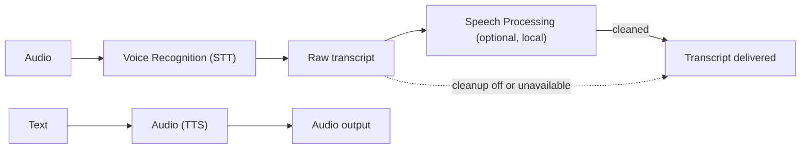

Ryu has three separate speech layers. You can pick a local transcriber, a cleanup model, and a
cloud or local voice independently. One provider choice does not start a chain of network calls.

## The three layers

| Layer | Input | Output | Supported provider paths |
|---|---|---|---|
| Voice Recognition / STT | Audio bytes | Raw transcript text | Local whisper.cpp, audio.cpp, or optional Parakeet; OpenAI, OpenRouter, Deepgram, AssemblyAI, Qwen ASR, or an OpenAI-compatible Gateway endpoint |
| Speech Processing | Raw transcript text | Cleaned transcript text | Local S1-mini by Superwhisper through the dedicated llama.cpp speech tier |
| Audio / TTS | Text | Audio | Local Ryu Audio (Kokoro, KittenTTS, Pocket TTS), OuteTTS, or audio.cpp; OpenAI, OpenRouter, Deepgram, ElevenLabs, Inworld, AWS Polly, Google Cloud TTS, Fal, Replicate, opt-in anonymous Edge TTS or Google Translate TTS, or a compatible endpoint |

Speech Processing is not a second name for STT. Voice Recognition transcribes what was said.
Speech Processing optionally turns that raw transcript into the requested style and structure.



## Voice Recognition / STT

### Local

- **whisper.cpp** is the local fallback and the default path for the desktop voice flow.
- **audio.cpp** is an optional native runtime that can host both Parakeet-TDT STT and PocketTTS
  TTS in one managed server. Ryu provisions its pinned Q8 packages. This integration does not
  enable the upstream project's broader model catalog.
- **Parakeet** is an optional in-process alternative. The feature and model must be present before
  it can serve requests.
- Subtitles, meetings, dictation, and the desktop microphone flow can use the same Core voice seam.

### Cloud or custom

#### OpenAI and compatible endpoints

The Gateway's OpenAI provider implements the OpenAI transcription shape. A custom
OpenAI-compatible endpoint can serve STT when it implements the same audio-transcription route.
The Gateway still owns authentication, routing, and audit. The selected upstream owns the
transcription model.

#### Deepgram

Deepgram is a direct Gateway provider.

1. Add its API key in **Gateway → API keys**, or configure `[providers.deepgram]` in `gateway.toml`.
2. Route a `nova-*` model to it.

The Gateway accepts its usual base64 audio request, sends audio bytes to Deepgram's Listen API, and
returns the transcript in the usual `text` field. Multiple keys can be supplied with `api_keys`.
Rate-limited keys are cooled down before rotation.

#### AssemblyAI

AssemblyAI is another direct STT provider.

1. Add its API key in **Gateway → API keys**, or configure `[providers.assemblyai]`.
2. Route a supported prerecorded speech model, such as `universal-3-pro`, to `assemblyai`.

Ryu uploads the audio bytes, submits a transcription job, and polls for the result within the
configured timeout. It then returns the usual `text` field.

- The selected account and outbound proxy stay bound through the upload, submit, and poll
  sequence.
- A rate limit before the upload succeeds can move the next request to another configured key.
- The OpenAI-style `language` field is forwarded as AssemblyAI's `language_code`.
- `prompt` is forwarded for Universal-3 models.

#### Qwen ASR

Qwen ASR uses the direct `qwen` provider and a synchronous `qwen3-asr-flash` model. Ryu translates
the transcription request into an audio-bearing chat request, then returns its transcript as
`text`.

- The encoded audio must fit within 10 MB.
- Supply a supported audio filename so Ryu can set the data URI's MIME type.
- JSON text output is supported. Timestamped response formats and the asynchronous `*-filetrans`
  model are rejected.

The key editor's Qwen endpoint defaults to Singapore. Use a Singapore Model Studio API key with
that endpoint. For another region, configure `providers.compatible.qwen.base_url` with the
matching official endpoint and key. Region-specific keys cannot be mixed.

See Alibaba's [Qwen ASR reference](https://help.aliyun.com/en/model-studio/qwen-asr-api-reference)
and [region endpoints](https://help.aliyun.com/en/model-studio/base-url).

#### Fal and Replicate

Fal and Replicate are media providers in the Gateway contract. They expose TTS and media
generation paths, not a generic STT path.

## Speech Processing cleanup

S1-mini by Superwhisper is a small local cleanup model. It is optional and lazy:

- New Dictation setups can enable cleanup by default.
- An explicit disabled setting keeps the raw transcript.
- The cleanup request carries style, structure, and context controls.
- If cleanup is unavailable, Dictation fails open to the raw transcript.

This stage is not routed through the normal Chat model picker. It is a dedicated local layer so a
cleanup request cannot accidentally become a general conversation or a cloud call.

## Audio / TTS

| Provider | Engines or models | Boundary |
|---|---|---|
| audio.cpp | PocketTTS + Parakeet-TDT | Optional native server managed by Core; one runtime can serve local TTS and STT |
| Ryu Audio | Kokoro 82M, KittenTTS, Pocket TTS | Optional local Python sidecar with a data-driven engine registry |
| OuteTTS | OuteTTS plus WavTokenizer | Local llama.cpp `llama-tts` path |
| OpenAI | OpenAI-compatible speech synthesis | Gateway provider; selected voice/model decides upstream behavior |
| OpenRouter | Speech models and audio-output chat models from the OpenRouter catalog | Gateway provider; speech models return MP3 or PCM, and audio-output chat models are streamed and returned as one file. See [OpenRouter](/docs/providers/openrouter) |
| Deepgram | Aura voices | Direct Gateway adapter to Deepgram's Speak API; returns WAV audio through the Gateway audio envelope |
| ElevenLabs | Eleven speech models with a voice ID | Direct Gateway adapter to ElevenLabs speech API; `voice` must be an ElevenLabs voice ID and output is MP3 |
| Inworld | Inworld TTS models with a voice ID | Direct Gateway adapter; MP3, WAV, Opus, FLAC, or PCM output |
| Fal | Queue-backed audio generation | Gateway provider; model and voice are upstream-defined |
| Replicate | Prediction-backed audio generation | Gateway provider; model and input schema are upstream-defined |
| AWS Polly | Polly voices | Direct Gateway adapter with explicitly configured AWS credentials and SigV4 signing; no ambient AWS profile or instance credentials |
| Google Cloud TTS | Google Cloud voices | Direct Gateway adapter using explicitly supplied, currently valid OAuth bearer tokens and quota projects; Ryu does not mint or refresh them |
| Edge TTS | Microsoft consumer voices | Unofficial anonymous consumer service, not Azure Speech; off unless `[providers.edge_tts]` sets `anonymous_consumer_opt_in = true` |
| Custom | Any endpoint implementing the compatible speech shape | Gateway or local custom endpoint |

### ElevenLabs

1. Save an API key in **Gateway → API keys**, or configure `[providers.elevenlabs]` in
   `gateway.toml`.
2. Set the request's `model` to an `eleven_*` speech model and its `voice` to an ElevenLabs voice ID.

The Gateway returns MP3 in its normal audio envelope. Additional keys in `api_keys` rotate when an
upstream key is rate limited.

### Inworld

Inworld is a direct TTS provider.

1. Save the Base64 credentials copied from its Portal in **Gateway → API keys**, or configure
   `[providers.inworld]` with `api_key` and optional `api_keys`. Do not encode the Portal value
   again.
2. Route an Inworld speech model, such as `inworld-tts-2` or `inworld-tts-2-flash`, to `inworld`.
3. Supply its `voice` ID, for example `Ashley`.

| Request field or limit | Behavior |
|---|---|
| `input` | Up to 2,000 UTF-16 code units on the synchronous route |
| `response_format` | `mp3` (default), `wav`, `opus`, `flac`, or `pcm`. PCM is headerless audio |
| `speed` | Between 0.5 and 1.5 |
| `instructions` | Maps to Inworld's speaking-style instruction on models that support it |

The response uses Ryu's usual base64 audio envelope and preserves upstream usage.

- Quota or credit rejection can rotate to another configured key.
- Outbound proxy assignments are supported.
- Transport failures do not automatically replay a potentially billed synthesis.

See the [Inworld API reference](https://docs.inworld.ai/api-reference/ttsAPI/texttospeech/synthesize-speech)
for voice IDs, model support, and output limits.

### Ryu Audio

The local Ryu Audio registry includes Kokoro, KittenTTS, and Pocket TTS. Pocket TTS can use
reference audio on supported versions. Kokoro and KittenTTS use their fixed voice sets.

The available engine list is runtime data, not a hardcoded promise that every optional Python
dependency is installed.

## Provider-neutral request paths

The **Cloud (via gateway)** Audio engine requests MP3 and plays the Gateway's binary
audio response. It uses the selected speech provider's native voice defaults.

| Operation | Gateway surface | Core/local surface |
|---|---|---|
| Transcribe audio | `POST /v1/audio/transcriptions` | Core Voice Recognition route |
| Synthesize speech | `POST /v1/audio/speech` | Core voice speak route |
| Clean a transcript | Not a generic cloud modality | Core Speech Processing route |

See the [Gateway speech API](/docs/gateway/audio-api) for binary audio responses,
multipart uploads, supported response formats, and size limits.

## Anonymous Google Translate speech

Google Translate TTS is a separate, unofficial anonymous consumer integration.
It is disabled by default. Enable it explicitly in **Gateway → API keys → Anonymous speech**, or set:

```toml
[providers.google_translate_tts]
anonymous_consumer_opt_in = true
```

Route the `google-translate-tts` model to its matching provider and use the normal
Gateway speech request. Supply a language code through `language_code` or `voice`.
The default is English.

- The adapter returns MP3 only.
- It accepts up to 8,192 UTF-8 input bytes.
- It supports the default speed only.
- It uses the same configured outbound proxy for the consumer bootstrap and the speech request.
- An uncertain synthesis is not replayed.

This opt-in does not enable Edge TTS or replace Google Cloud TTS. The Cloud adapter
keeps its supplied bearer, project, account, and proxy controls.

See [Voice engines](/docs/surfaces/desktop/engines/voice-engines), [Voice](/docs/apps/voice), and
[Dictation](/docs/apps/dictation) for the Desktop and Companion UI behavior.

<Callout type="info">
"Cloud STT" and "cloud TTS" are not one shared provider flag. Check the capability matrix for the
specific provider and model: OpenAI and Deepgram implement both Gateway audio routes, AssemblyAI
provides STT, Fal and Replicate provide TTS/media generation, and local engines cover STT,
cleanup, and TTS independently.
</Callout>
