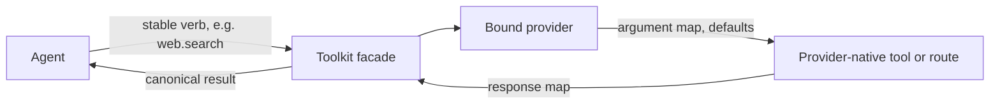

Toolkits are Ryu's swappable capability layers, listed under **Toolkits** in the Desktop node
selector's expanded view. The agent keeps a stable verb such as `web.search` or
`browser.snapshot`. Changing a provider changes who implements that verb.

## Shipped Toolkit providers

| Capability | Provider options | Notes |
|---|---|---|
| `web.search` | Exa, Ryu Cloud Search, Parallel, Tavily, Brave, Firecrawl, Serper, [DeepSeek](/docs/plugins/deepseek) | Exa is the default-enabled path. Ryu Cloud Search is pre-installed but serves searches only after you pick it, and bills your Ryu Cloud credits ([details](/docs/gateway/web-services#hosted-web-search)). The others are opt-in or BYOK depending on the provider |
| `web.extract` | Spider, Scrapling, Jina Reader, Tavily, Firecrawl, Serper, Parallel, [DeepSeek](/docs/plugins/deepseek) | Web extraction is separate from local `document.parse` |
| `web.crawl` | Spider, SpiderCloud, Firecrawl | Crawl providers may use an adapter and return partial completion explicitly |
| `memory` | `@ryu/memory`, Mem0, Honcho | The bound provider stores or retrieves memory through the canonical memory verbs |
| `browser.control` | `@ryu/browser`, Agent Browser, Cloudflare Browser Run, Kernel, [Ego Browser](/docs/plugins/ego-browser) | Hosted browser providers remain URL/session scoped according to their declared contract. Ego Browser is macOS-only and needs the Ego lite app and its `ego-browser` CLI on `PATH`. Browser Use and Steel are hidden previews that do not work as this layer yet ([details](/docs/core/swappable-layers#session-backed-cloud-browsers)) |
| `computer.control` | Ghost, Bytebot, [Codex Computer Use](/docs/plugins/codex-computer-use) | The provider declares whether it acts on this machine or a remote desktop. Codex Computer Use is an opt-in, macOS-only provider on this machine that acts on one target app you set in its settings ([details](/docs/core/swappable-layers#local-computer-use-engine)) |
| `document.parse` | AnyDoc, MarkItDown, Docling, MinerU, Unstructured | Route-backed providers return parsed documents; they do not need to expose agent tools |
| `verify.claim` | Automated Reasoning | Checks a claim against a source of truth and returns `proved`, `refuted`, `undecided`, `inconsistent`, or `unverifiable`; see [the verification layer](/docs/core/swappable-layers#verification-layer) |

## Add your own provider

The list above is what Ryu ships, not a closed set. Every Toolkit accepts third-party providers.
An app that declares the same capability in its manifest's `provides` appears in the picker once it
is installed and enabled.

- Search, extraction, crawling, browser control, computer control, and memory providers map the
  stable verbs to their own tools.
- Document parsers serve a sidecar route instead.

The [capability broker](/docs/extend/develop/extensions/capability-broker) guide covers both.

Network tunnels work the same way, in the node's VPN menu rather than Toolkits. See
[Build a Tunnel Adapter](/docs/extend/develop/extensions/tunnel-adapters).

## Provider selection

For selectable capabilities, Ryu resolves the provider in this order:

1. Your explicit capability override.
2. The only enabled provider, when there is exactly one.
3. The provider that declares itself the default.
4. The lexicographically lowest provider ID.

Ryu Cloud Search is the exception. It bills organization credits, so it binds only when you pick it
explicitly. Steps 2 to 4 skip it.

A capability can be present but unavailable, installed but disabled, or enabled without a healthy
dependency. These are separate states. An unavailable provider is not the same as a missing layer.

## Stable verbs, provider-native tools

The stable facade owns the agent-facing verb and schema. A provider declares how that verb maps to
its own operation:

| Declaration | Purpose |
|---|---|
| Argument map | Rename or drop canonical arguments for the provider |
| Defaults | Supply provider-specific defaults without overriding an explicit caller value |
| Response map | Return provider data in the stable canonical shape |
| Adapter | Handle an async job, normalization, or another shape that a field map cannot express |

A provider can be swapped without changing agent prompts, allowlists, or tool schemas.
Provider declarations do not grant execution permission. The Gateway-approved grants and the
provider's own availability still apply at call time.

### Provider settings apply on the next call

Provider settings take effect on the next call. Honcho shows how this works:

- Changing Honcho's workspace or peer changes the next memory search.
- An explicit search limit takes precedence over a saved default.
- The agent still needs permission for `memory.search`, and Honcho still needs its approved network
  grant.
- If Honcho rejects the API key, the result reports the provider as unavailable with the failure
  reason, so you can correct the key and retry.

## Inspect the live layer state

`GET /api/capabilities` reports, for each capability:

- its enabled providers;
- providers that are available but disabled;
- the bound provider;
- whether the provider serves facade verbs or a route-backed capability.

A document parser can be visible even though it has no tool name for the agent to call directly.
The `decisionModel` flag identifies typed-decision capabilities for the separate Decision Models
picker. Those providers do not appear in Toolkits.

Read [Swappable layers](/docs/core/swappable-layers) for the full selection and adapter contract,
[the unified tool catalog](/docs/core/unified-tool-catalog) for searchable tools, and [the capability
broker](/docs/extend/develop/extensions/capability-broker) for extension authors.

<Callout type="warn">
Search and discovery do not grant execution permission. Tool calls still pass through the owning
provider's allowlist, capability grant, authentication, and policy checks.
</Callout>

## Network behavior of plugin HTTP tools

Plugin HTTP tools connect directly to the addresses checked by Ryu's egress and local-network
protections.

- They do not inherit system HTTP proxy settings.
- Redirects are returned to the caller rather than followed to an unchecked destination.
