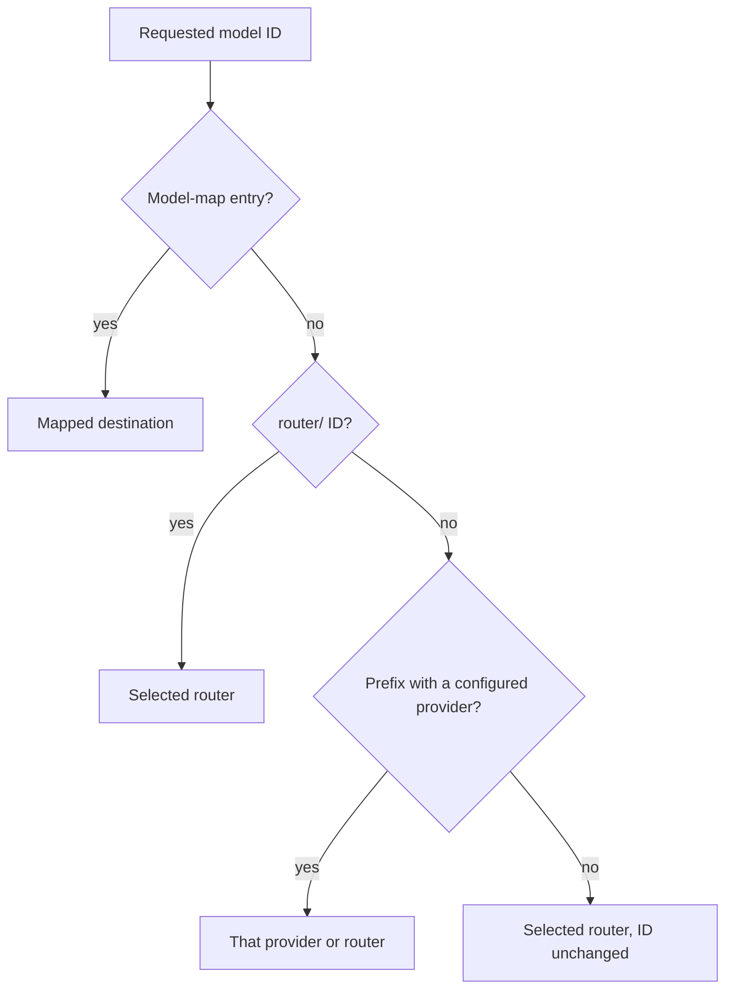

The **routing layer** decides who serves the models that no explicit rule claims. It is a
swappable layer, like a [Toolkit](/docs/providers/toolkits). The Gateway keeps one stable model
namespace, and selecting a different router changes who answers it. Agents, prompts, and
allowlists do not change.

| Routing layer | Who serves unclaimed and `router/` models |
|---|---|
| `builtin` (default) | Ryu's own routing table; unclaimed models go to the configured default provider |
| `openrouter` | OpenRouter |
| `litellm` | Your LiteLLM proxy |
| `local` | The node's local engine (Ollama, llama.cpp, LM Studio, or another local OpenAI-compatible server) |

The routing layer is separate from the [connections layer](/docs/gateway/connection-calls),
which chooses the provider for tool and account operations.

## The router-neutral model namespace

`router/<model>` targets the selected upstream router. Use it when an agent should name an
aggregator model without naming the aggregator:

| Requested model | `openrouter` selected | `litellm` selected |
|---|---|---|
| `router/anthropic/claude-sonnet-4` | `anthropic/claude-sonnet-4` on OpenRouter | `anthropic/claude-sonnet-4` on LiteLLM |
| `router/auto` | `openrouter/auto` on OpenRouter | `auto` on LiteLLM |
| `anthropic/claude-sonnet-4` (no rule matches) | OpenRouter | LiteLLM |

OpenRouter names its own meta-routers inside its namespace. An unqualified `router/` model such
as `auto` therefore becomes `openrouter/auto` there. Every other router receives the model ID
exactly as its operator configured it. Use model IDs your router actually serves.

With the default `builtin` layer there is no upstream router. A `router/` ID is not rewritten and
follows the normal routing order to the default provider.

`router/` IDs never enter eval-driven A/B routing, because an A/B candidate would receive the
literal `router/` ID.

## What a router does not take over

With an upstream router selected, a model resolves in this order:

1. A [model-map](/docs/gateway/routing#resolution-order) entry, exact or prefix, keeps its
   destination. This includes entries keyed under `router/`.
2. A `router/<model>` ID goes to the selected router.
3. A built-in vendor prefix, such as `claude-` to Anthropic or `llama` to the local runtime, keeps
   its provider when that provider is configured on the Gateway. When it is not, the selected router
   serves the ID unchanged, so a LiteLLM alias such as `gpt-4o` reaches LiteLLM on a node without an
   OpenAI key. An explicit router prefix, such as `openrouter/auto` while LiteLLM is selected, keeps
   its router the same way.
4. Any other model goes to the selected router.



Per-agent modality slots, modality-map entries, fallback tiers, and eval-driven routing for
non-`router/` IDs are unchanged.

Governance runs the same way for every router: the firewall, budgets, audit, and organization
policy apply before the request leaves the Gateway.

## Select the routing layer

The selection is the Gateway's `backends.router` setting. It applies live, so no Gateway restart
is needed.

A `backends` update is merged. Stages you omit keep their saved selection, so changing the router
does not reset the [connections layer](/docs/gateway/connection-calls).

```toml title="gateway.toml"
[backends]
router = "litellm"
```

The same setting can be changed through the [configuration API](/docs/gateway/configuration-api)
with `PUT /v1/config` and a `backends` section:

- An unknown router ID is rejected before anything is saved.
- A router that is selected but not configured behaves like an unconfigured default provider. Its
  requests take the normal provider-unavailable path and your fallback chain.

## Connect LiteLLM

LiteLLM is an operator-run proxy, so you supply its address and a virtual key or master key:

| Variable | Purpose |
|---|---|
| `LITELLM_API_KEY` | Key the Gateway sends to the proxy. Setting it enables the `litellm` provider |
| `LITELLM_API_KEYS` | Optional comma-separated extra keys for rotation |
| `LITELLM_BASE_URL` | Proxy address. Defaults to `http://127.0.0.1:4000/v1` |

The equivalent file configuration:

```toml title="gateway.toml"
[providers.litellm]
api_key = "sk-litellm-..."
base_url = "https://litellm.internal.example/v1"
```

LiteLLM holds its own upstream credentials and model list. Ryu sends the model ID unchanged, so use
the model names defined in your LiteLLM configuration, or address them as `router/<name>`. The
Gateway configuration view reports the provider with its key redacted.

### Caller routing overrides are removed

Before it forwards a request, the Gateway removes these caller-supplied LiteLLM routing overrides:

- `fallbacks`, `context_window_fallbacks`, and `content_policy_fallbacks`;
- `mock_testing_fallbacks`, `mock_testing_context_fallbacks`, and
  `mock_testing_content_policy_fallbacks`;
- `user_config`.

Those fields would let a caller reach a model that the Gateway's model allowlist and budget never
checked. Fallbacks configured in your LiteLLM deployment still apply.

<Callout type="info">
  OpenRouter-specific behavior, such as enforced zero data retention, batch requests, and
  OpenRouter's model fallbacks, applies only to OpenRouter. LiteLLM's own retention and fallback
  behavior is governed by your LiteLLM deployment.
</Callout>

## Use the local engine as the router

Selecting `local` sends router-neutral and unclaimed models to the node's local engine, so that
traffic stays on the machine. The local engine must serve the requested model ID. Otherwise the
request fails as it would for any missing local model.
