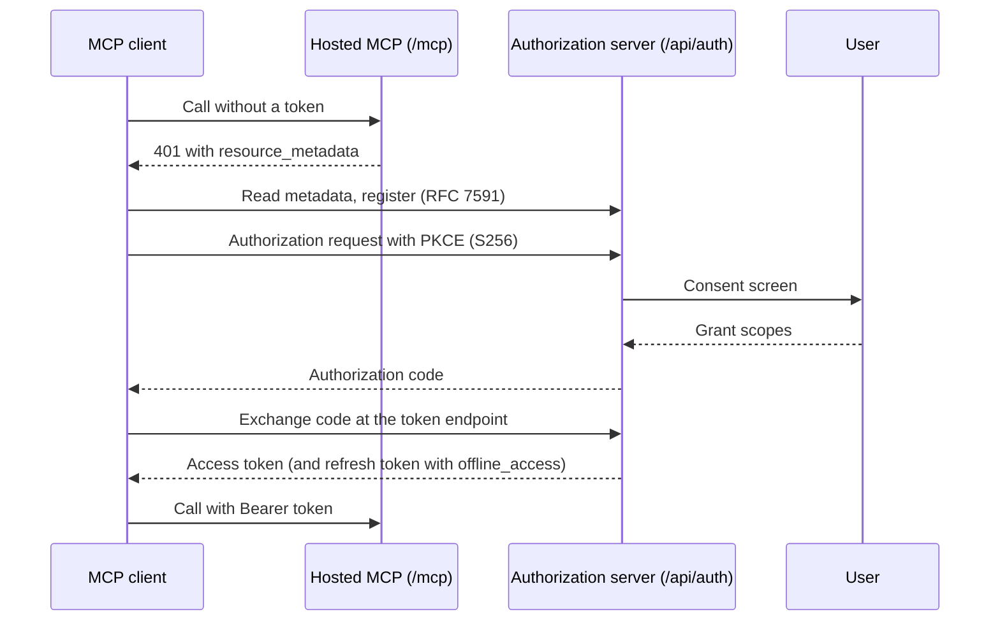

The hosted Ryu API accepts two kinds of bearer credential. Each one belongs to one resource:

| Resource | Credential | How to get it |
|---|---|---|
| `https://api.ryuhq.com/api/v1/...` | A Ryu API key, or an organization Admin API key (`ryu_admin_...`) for `/api/v1/organizations/{orgId}` | Create it in the console. See [Organization admin controls](/docs/security/organization-admin-controls). |
| `https://api.ryuhq.com/api/mail/...` (hosted Mail) | A Ryu API key with `mail:read`, `mail:send`, or `mail:manage`, or a node gateway key in `x-gateway-key` | Create the key in the console. See [Ryu Mail API](/docs/standalone/mail-api#hosted-mail-api-keys). |
| `https://api.ryuhq.com/api/control-plane/orgs/{orgId}/prompts/...` (organization prompt registry) | A Ryu API key with `prompts:read` or `prompts:manage` in `x-api-key`, or a signed-in session | Create the key in the console. See [Prompts](/docs/extend/develop/sdk/prompts#registries). |
| `https://api.ryuhq.com/mcp/...` (hosted MCP) | An OAuth access token from the Ryu authorization server | OAuth authorization code flow with PKCE. See [MCP authentication](/docs/security/authentication-mcp). |

Send either credential as `Authorization: Bearer <token>`. Some routes add header rules of their
own:

- The `/api/v1` and `/api/mail` routes also accept an API key in the `x-api-key` header.
- The organization prompt registry accepts an API key only in `x-api-key`. A personal key also
  needs `X-Ryu-Organization` to name the organization.
- The `/api` routes do not accept OAuth access tokens.

## Discovery documents

| Document | URL | Standard |
|---|---|---|
| Authorization server metadata | `https://api.ryuhq.com/.well-known/oauth-authorization-server/api/auth` | RFC 8414 |
| OpenID Connect discovery | `https://api.ryuhq.com/api/auth/.well-known/openid-configuration` | OpenID Connect Discovery 1.0 |
| Hosted MCP resource metadata | `https://api.ryuhq.com/.well-known/oauth-protected-resource/mcp` | RFC 9728 |
| API resource metadata | `https://api.ryuhq.com/.well-known/oauth-protected-resource/api` | RFC 9728 |
| Agent authentication guide | `https://ryuhq.com/auth.md` | Markdown |

The issuer identifier is `https://api.ryuhq.com/api/auth`. Because the issuer has a path, its
RFC 8414 metadata is at the path-inserted URL in the table. Always check that the `issuer` member
matches before you trust a document.

These other URLs return the same authorization server metadata, for clients that probe the root:

- `https://api.ryuhq.com/.well-known/oauth-authorization-server`
- `https://api.ryuhq.com/.well-known/openid-configuration`, and its `/api/auth` path-inserted form
- `https://ryuhq.com/.well-known/oauth-authorization-server` (a mirror)

The root `https://api.ryuhq.com/.well-known/oauth-protected-resource` is the hosted MCP
resource's document. Its `resource` is `https://api.ryuhq.com/mcp`.

The API resource document has these members:

| Member | Value |
|---|---|
| `resource` | `https://api.ryuhq.com/api` |
| `bearer_methods_supported` | `["header"]` |
| `resource_documentation` | `https://ryuhq.com/auth.md` |

It names no `authorization_servers`, because the API does not accept OAuth access tokens. This
member is optional in RFC 9728.

## The 401 challenge

A `401` from a route under `https://api.ryuhq.com/api/` (except `/api/auth/`) carries:

```http
WWW-Authenticate: Bearer resource_metadata="https://api.ryuhq.com/.well-known/oauth-protected-resource/api"
```

A route that sets its own challenge keeps it. The hosted MCP server sends its own RFC 9728
challenge that names the MCP resource metadata. Browsers can read `WWW-Authenticate` cross-origin
because the API exposes it through CORS.

## OAuth client registration

The authorization server supports dynamic client registration (RFC 7591), the authorization
code grant with PKCE (`S256` only), refresh tokens with the `offline_access` scope, and token
revocation at the advertised `revocation_endpoint`. Registration alone grants no access. A user
grants access in the interactive consent step. [auth.md](https://ryuhq.com/auth.md) gives the
full sequence.



### The mail:manage scope

`scopes_supported` lists the scopes a client can request by default. It leaves out
`mail:manage`, which a client gets only by naming it:

- A registered client may request `mail:manage`, but registration grants nothing.
- An authorization request without a `scope` asks for the client's registered scopes without
  `mail:manage`, whether it is sent as a GET query or a POST form.
- On the consent screen `mail:manage` is off until the user chooses it.
- A hosted MCP call that needs it returns `insufficient_scope` with `scope="mail:manage"`. See
  [hosted Mail tools](/docs/standalone/sdk/mcp-hosted-mail).

<Callout type="info">
The metadata carries no `agent_auth` block. Ryu does not implement the WorkOS auth.md agent
identity endpoints, identity assertions, or claim-token grants, so there is no anonymous agent
identity for a user to claim.
</Callout>

## Related

<Cards>
  <DocCard href="/docs/reference/api/errors" />
  <DocCard href="/docs/security/authentication-mcp" />
  <DocCard href="/docs/security/authentication-tokens" />
</Cards>
