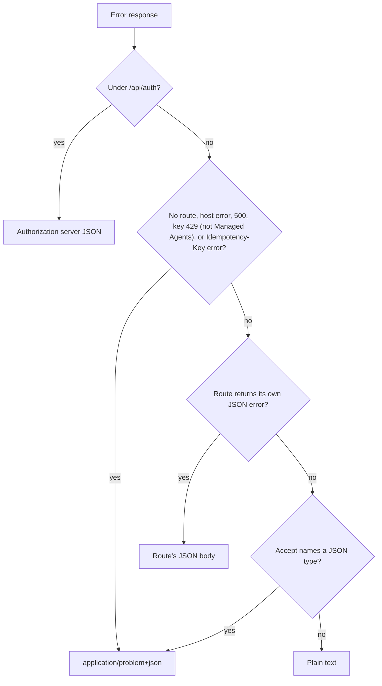

The hosted Ryu API reports errors as RFC 9457 problem details (`application/problem+json`). Each
problem has a stable machine-readable `code`. The `type` and `docs` members link to the heading for
that code on this page.

For the request headers and versioning rules, see the [hosted API overview](/docs/reference/api).
Standalone services document their own error bodies, for example
[Ryu Gateway errors](/docs/standalone/gateway-api#errors-and-request-ids).

## Problem object

```json
{
  "type": "https://docs.ryuhq.com/docs/reference/api/errors#not_found",
  "title": "Not Found",
  "status": 404,
  "detail": "No route matches GET /v1/models.",
  "instance": "/v1/models",
  "code": "not_found",
  "hint": "Check the path. The API catalog is published at https://ryuhq.com/.well-known/api-catalog.",
  "docs": "https://docs.ryuhq.com/docs/reference/api/errors#not_found",
  "error": "No route matches GET /v1/models."
}
```

| Member | Type | Meaning |
|---|---|---|
| `type` | URI | Identifies the problem type. It is this page with the `code` as the fragment. |
| `title` | string | Short summary of the status. |
| `status` | integer | The HTTP status code. |
| `detail` | string | Explanation of this occurrence. |
| `instance` | string, optional | The request path. |
| `code` | string | Stable machine-readable code. Branch on this member. |
| `hint` | string, optional | What to try next. |
| `docs` | URI | Same value as `type`. |
| `error` | string | Same value as `detail`. Kept for clients that read the older `{ "error": "..." }` body. |

## When you receive problem details

| Situation | Format |
|---|---|
| A path that matches no route on `api.ryuhq.com` (for example `/v1`, `/v1/models`, `/api/unknown`) | Always `application/problem+json` |
| Errors raised by the API host itself | Always `application/problem+json` |
| An unhandled server error on any `/api/...` route (`500` `internal_error`) | Always `application/problem+json` |
| An API key that reached its own request limit (`429` `rate_limited`), except on Managed Agents routes | Always `application/problem+json`, with `Retry-After` and the RateLimit fields |
| `Idempotency-Key` errors | Always `application/problem+json` |
| A plain-text error from an `/api/...` route | `application/problem+json` when `Accept` names `application/json`, `application/problem+json`, or `application/*`; otherwise plain text |
| Routes that already return a JSON error body | That route's JSON body, unchanged |
| `/api/auth/...` | The authorization server's own JSON error format |



A bare `Accept: */*` keeps the plain-text body, so send `Accept: application/json` to always get
JSON. Responses whose format depends on `Accept` carry `Vary: Accept`.

Some `/api/v1` routes still return a JSON body with only `error` (and sometimes `code`). The
[OpenAPI document](https://ryuhq.com/openapi/v1.json) lists the media types each response can use.

The website origin answers the same way for API-shaped paths that do not exist:
`https://ryuhq.com/api/...` and `https://ryuhq.com/v1/...` return a `not_found` problem whose
`hint` names the API host.

## Request IDs

Every response from `https://api.ryuhq.com` carries an `X-Request-ID` header, errors included,
and browsers can read it cross-origin. Quote it, with the time, when you contact support.

| Request | `X-Request-ID` in the response |
|---|---|
| Sends no `X-Request-ID` | A new id: `req_` followed by 32 lowercase hex characters |
| Sends an id of up to 128 characters that starts with a letter or digit and uses only letters, digits, `.`, `_`, `:`, and `-` | The same id |
| Sends any other id, or one that starts with `req_` in any letter case | A new `req_` id. The prefix is reserved for ids the server assigns. |
| Calls a Managed Agents route | Always a server-assigned `req_` id, which the error body repeats as `requestId` |

The server's error logs record the same id, so an id you send can tie a failure to your own logs.

## Error codes

### `bad_request`

`400`. The request body, parameters, or headers are not valid. Check them against the OpenAPI
document.

### `unauthenticated`

`401`. No credential, or the credential is not valid. The `WWW-Authenticate` header names the
resource metadata. See [Authentication and discovery](/docs/reference/api/authentication).

### `forbidden`

`403`. The credential is valid but lacks the permission or scope for this request.

### `insufficient_scope`

`403`. The API key is valid but does not carry the scope the route needs. Hosted Mail names the
scope in `requiredScope` and in the `WWW-Authenticate` header. Create a key with that scope.

### `not_found`

`404`. No route matches the path, or the resource does not exist.

### `method_not_allowed`

`405`. The route exists but does not accept this HTTP method.

### `conflict`

`409`. The request conflicts with the current state of the resource.

### `gone`

`410`. The route was removed.

### `payload_too_large`

`413`. The request body is larger than the route accepts.

### `unsupported_media_type`

`415`. The request `Content-Type` is not supported by the route.

### `unprocessable_content`

`422`. The request is well formed but cannot be processed.

### `rate_limited`

`429`. Too many requests. Wait for the number of seconds in `Retry-After`. When an API key reaches
its own requests-per-minute limit, the response also carries `RateLimit-Policy` and `RateLimit`
for the `key` policy. See [Rate limits](/docs/reference/api/rate-limits#api-key-limits).

### `internal_error`

`500`. The server failed. The body is always problem details with `instance` set to the request
path. Retry later. If the error persists, contact support with the time of the
request.

### `bad_gateway`

`502`. An upstream service returned an invalid response.

### `service_unavailable`

`503`. The service is temporarily unavailable. Retry later and honor `Retry-After` when present.

### `gateway_timeout`

`504`. An upstream service did not answer in time.

### `client_error`

Any other `4xx` status without a more specific code.

### `server_error`

Any other `5xx` status without a more specific code.

### `idempotency_key_invalid`

`400`. The `Idempotency-Key` value is empty, longer than 255 characters, or contains characters
outside printable ASCII. See [Idempotency keys](/docs/reference/api/idempotency).

### `idempotency_key_reused`

`422`. The key was already used with a different request (query string, `Content-Type`, or body).
Use a new key for a new request.

### `idempotency_in_progress`

`409`. The first request with this key is still running. Wait for the number of seconds in
`Retry-After` (one second) and retry with the same key.
