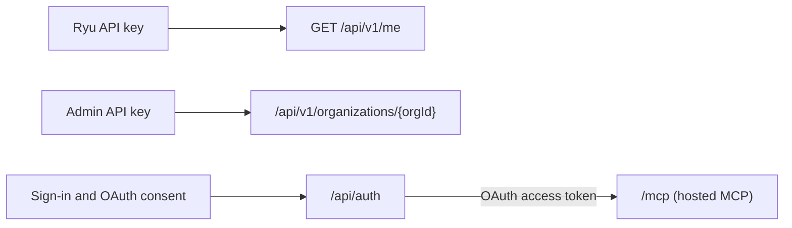

The hosted Ryu API is the control-plane HTTP API at `https://api.ryuhq.com`. It serves:

- the `/api/v1` routes: the key identity route and the organization Admin API;
- account sign-in and OAuth under `/api/auth`;
- the hosted MCP server at `/mcp`.

It is a different API from the HTTP API that every Ryu node serves locally. That one is
documented in the [Core and Gateway API reference](/docs/extend/develop/api-reference).

## Machine-readable description

| Document | URL |
|---|---|
| OpenAPI 3.1 for `/api/v1` | `https://ryuhq.com/openapi/v1.json` |
| API catalog (RFC 9727) | `https://ryuhq.com/.well-known/api-catalog` |
| Resource metadata for `/api` (RFC 9728) | `https://api.ryuhq.com/.well-known/oauth-protected-resource/api` |

The OpenAPI document lists `GET /api/v1/me` and the Admin API routes under
`/api/v1/organizations/{orgId}`. Each route has its response fields and an example for every
JSON request body and JSON success response. Creating an invitation through the Admin API is
listed but always answers `501`.

Besides `/api/v1`, the API catalog lists:

- the public and documentation MCP servers;
- the local Ryu Core API;
- the hosted MCP endpoint at `https://api.ryuhq.com/mcp`;
- the standalone services that have a documented Ryu-hosted URL: Managed Agents (preview), Mail
  and Messaging on this origin, and Notify and Box (both early access) on their own hosts.

Each service has its own OpenAPI document; see
[Service OpenAPI documents](/docs/standalone/sdk/openapi). Admin API keys and their permissions
are described in [Organization admin controls](/docs/security/organization-admin-controls).

## Conventions

| Topic | Summary | Page |
|---|---|---|
| Credentials | `/api/v1` takes a Ryu API key as a bearer token. OAuth access tokens are for the hosted MCP server. | [Authentication and discovery](/docs/reference/api/authentication) |
| Errors | RFC 9457 problem details with a stable `code`. | [Errors](/docs/reference/api/errors) |
| Request IDs | An `X-Request-ID` header on every response, errors included. | [Request IDs](/docs/reference/api/errors#request-ids) |
| Rate limits | `RateLimit-Policy`, `RateLimit`, and `Retry-After` header fields. | [Rate limits](/docs/reference/api/rate-limits) |
| Retries | `Idempotency-Key` on Admin API `POST` and `PATCH` writes. | [Idempotency keys](/docs/reference/api/idempotency) |
| Versioning | Major version in the path; `Deprecation` and `Sunset` header fields. | [Versioning and deprecation](/docs/reference/api/versioning) |
| Changes | Behavior changes an existing integration can notice, with what to do. | [API changes](/docs/reference/api/changelog) |

<Cards>
  <DocCard href="/docs/reference/api/authentication" />
  <DocCard href="/docs/reference/api/errors" />
  <DocCard href="/docs/reference/api/rate-limits" />
  <DocCard href="/docs/reference/api/idempotency" />
  <DocCard href="/docs/reference/api/versioning" />
  <DocCard href="/docs/reference/api/changelog" />
</Cards>
