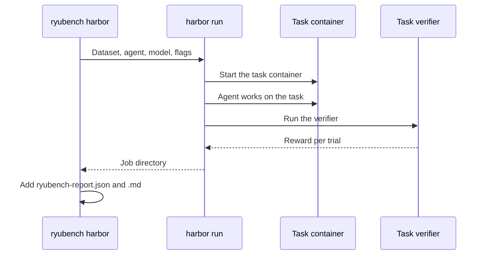

Public agent benchmarks measure whether an agent can finish general software and terminal tasks.
RyuBench itself measures how well a model or harness operates Ryu. `ryubench harbor` runs the public suites through [Harbor](https://harborframework.com), the
evaluation framework from the team behind Terminal-Bench, and writes a report alongside the
RyuBench scorecards.

Harbor provides each task's container, the agent installation, and the task's own verifier.
RyuBench chooses the dataset, agent, and model, starts `harbor run`, and reads the job
directory back. A trial passes when the task's verifier awards a reward of 1. RyuBench does not
re-grade trials.



<Callout type="info">
  Harbor results are an **external track**. They are reported on their own and are never folded
  into the RyuBench Tier-A headline, the same rule that keeps Tier B separate.
</Callout>

## Install Harbor

Harbor is a Python CLI (Python 3.12 or later). It runs tasks in Docker by default, so Docker must
be running on the machine.

```bash
uv tool install harbor     # or: pip install harbor
harbor dataset list        # browse the registry
```

If `harbor` is not on your `PATH`, set `RYUBENCH_HARBOR_BIN` to the binary's location.

## Run a benchmark

```bash
# Terminal-Bench 2.0 with the Ryu scaffold and a local Ollama model served by your node
bun run --cwd apps/benchmark run:harbor --dataset terminal-bench --model qwen2.5:7b-instruct

# a 10-task SWE-bench Verified smoke run, 3 attempts per task for pass^k
bun run --cwd apps/benchmark run:harbor --dataset swe-bench --model qwen2.5:7b-instruct --limit 10 --k 3

# compare a Harbor built-in agent on the same dataset
bun run --cwd apps/benchmark run:harbor --dataset terminal-bench --agent claude-code --model anthropic/claude-opus-4-8

# list the dataset aliases
bun run --cwd apps/benchmark src/index.ts harbor datasets

# re-read an existing Harbor job directory
bun run --cwd apps/benchmark src/index.ts harbor score ./.ryubench/harbor/<job-name>
```

### Dataset aliases

`--dataset` accepts a short alias or any Harbor registry id in `name@version` form, so a new
registry entry works without a RyuBench change.

| Alias | Harbor dataset |
| --- | --- |
| `terminal-bench` | `terminal-bench@2.0` |
| `terminal-bench-sample` | `terminal-bench-sample@2.0` |
| `terminal-bench-pro` | `terminal-bench-pro@1.0` |
| `swe-bench`, `swe-bench-verified` | `swebench-verified@1.0` |
| `swe-bench-multilingual` | `swebench_multilingual@1.0` |
| `swe-bench-pro` | `swebenchpro@1.0` |
| `swe-lancer` | `swe-lancer-diamond@all` |
| `aider-polyglot` | `aider-polyglot@1.0` |
| `livecodebench` | `livecodebench@6.0` |
| `hello-world` | `hello-world@1.0` |

To run a local Harbor task or dataset directory, pass `--path <dir>` instead of `--dataset`.

## Agents

| `--agent` | What runs |
| --- | --- |
| `ryu` (default) | The Ryu scaffold: a single `bash` tool loop over your node's OpenAI-compatible `/v1/chat/completions` |
| `claude-code`, `codex`, `terminus-2`, `openhands`, `mini-swe-agent`, and other Harbor agents | A Harbor built-in agent, installed into the task container by Harbor |
| `oracle` | The task's reference solution, useful for checking that a dataset runs on your machine |
| `module.path:ClassName` | Your own Harbor agent class |

For every agent, `$/trial` comes from what the agent reports, or from the RyuBench price table
when it reports nothing.

### The ryu agent

The `ryu` agent runs on the host inside the Harbor process. It reaches a local node at
`RYU_NODE_URL` (default `http://127.0.0.1:7980`) with `RYU_NODE_TOKEN`, the same settings the
RyuBench model track uses. Each command the model runs executes inside the task container.

| Environment variable | Default | Meaning |
| --- | --- | --- |
| `RYU_HARBOR_MAX_STEPS` | `60` | Maximum loop steps per trial |
| `RYU_HARBOR_COMMAND_TIMEOUT_SEC` | `600` | Timeout for one command in the container |

The agent sends chat to the node's OpenAI-compatible `/v1/chat/completions`, the same endpoint
the `direct-tool` driver uses. That endpoint is a direct proxy on the node, not the Gateway, so
`--model` must name a model the node can serve. See
[how the node routes a model id](/docs/reference/benchmark/local-models#how-the-node-routes-a-model-id).

`RYU_NODE_URL` is only a base URL, so you can also point it at any other OpenAI-compatible server
that serves `/v1/chat/completions`. `RYU_NODE_TOKEN`, when set, is sent as a Bearer token.

### Built-in agents

Built-in agents call their provider directly, using Harbor's own model format (`provider/model`)
and the provider API keys in your environment. Those calls do not go through your node or the
Gateway.

## Flags

| Flag | Meaning |
| --- | --- |
| `--dataset <alias\|name@ver>` | Registry dataset to run |
| `--path <dir>` | Local Harbor task or dataset directory |
| `--agent <name>` | See [Agents](#agents) (default `ryu`) |
| `--model <id>` | Model under test (default `RYUBENCH_MODEL`) |
| `--k <n>` | Attempts per task (default 1) |
| `--concurrency <n>` | Concurrent trials (default 4) |
| `--env <name>` | Harbor environment, such as `docker` (default), `daytona`, `modal`, or `e2b` |
| `--limit <n>` | Maximum number of tasks after filters |
| `--include <glob>` / `--exclude <glob>` | Task-name filters (repeatable) |
| `--ak <key=value>` / `--ae <KEY=VALUE>` | Harbor agent kwargs and agent environment (repeatable) |
| `--jobs-dir <dir>` / `--job-name <name>` | Output location (default `./.ryubench/harbor/ryubench-<timestamp>`) |
| `--dry-run` | Have Harbor validate the job without running it |
| `--yes` | Skip Harbor's confirmation of host environment variables that task definitions pass into task containers (off by default) |
| `-- <args>` | Pass any remaining arguments to `harbor run` unchanged |

<Callout type="warn">
  Harbor runs with your full environment, including your node token and provider API keys, and a
  task definition can copy host variables into its containers. Harbor asks you to approve those
  variables before the run starts, and RyuBench keeps that prompt by default. Use `--yes` only for
  unattended runs of tasks you trust.
</Callout>

## The report

Harbor writes its usual job directory. RyuBench adds `ryubench-report.json` and
`ryubench-report.md` to that directory. The report contains:

- **Resolved**: the fraction of trials whose verifier reward reached 1, with a Wilson 95%
  confidence interval.
- **pass^k**: the fraction of tasks that passed on every attempt. A task with fewer attempts
  than the job planned is marked incomplete and does not count as passing.
- **Mean reward**: Harbor's mean reward, with errored trials counted as 0, as Harbor counts them.
- **Tokens/trial** and **$/trial**: the agent's reported cost, or an estimate from the RyuBench
  price table when the agent does not report one.
- A per-task table of rewards and errors.
- **Completeness**: trials completed against the number Harbor planned. A trial whose
  `result.json` is missing, is not valid JSON, or does not match Harbor's result format is listed
  under skipped trials with the reason, and the headline is marked incomplete.

<Callout type="warn">
  Public suites are large and slow. Terminal-Bench 2.0 has 89 tasks and SWE-bench Verified has
  500; each task builds a container. Start with `--limit` or `terminal-bench-sample`, and use a
  cloud environment (`--env daytona`, `modal`, `e2b`) for full runs.
</Callout>

Continue with [RyuBench](/docs/reference/benchmark), [scoring and governance](/docs/reference/benchmark/scoring), [local model track](/docs/reference/benchmark/local-models), and [benchmark tasks](/docs/reference/benchmark/tasks).
