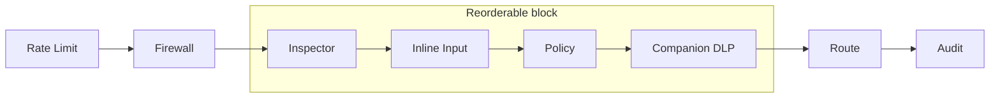

Every surface in Ryu starts with a default model. Each value is a replaceable default. The model
id resolves through the provider registry (`apps/core/src/registry`),
Pi's managed config (`apps/core/src/pi_config`), or a per-app constant, and each has an
environment override.

## The managed desktop agent

The managed desktop agent (Pi, routed through the Gateway) is configured in `~/.ryu/runtimes/pi-agent`. The
default depends on how you connect:

| Connection | Default provider | Default model | Override |
|---|---|---|---|
| Local (zero keys) | `gateway` (built-in `openai` pinned at the local Gateway) | `gemma-4-E2B-it-Q4_K_M` (local llama.cpp) | `RYU_LOCAL_CHAT_MODEL_ID` |
| Managed subscription | `managed-openrouter` | `openrouter/auto` (OpenRouter auto-router, metered to your Ryu wallet) | Pick a model in Settings |
| Direct (your own key) | Your configured provider | Your configured default | - |

`openrouter/auto` is OpenRouter's Auto Router: it picks a model per prompt at no extra fee.
For code, the model picker also offers `openrouter/pareto-code` (shown as **Auto Code**), which
delegates coding-model selection to OpenRouter's Pareto Router.

Both are model IDs, so the managed provider is always Gateway-routed and its egress is governed
and metered. In local mode the model is the same GGUF that powers the `@ryu/engines` Chat runtime.

<Callout type="info">
  On a computer with too little memory for Gemma 4 E2B, Core installs the smaller
  `gemma-3-1b-it-Q4_K_M` as the local chat default instead, and side jobs that use the local
  model follow it. `RYU_LOCAL_CHAT_MODEL_ID` overrides both.
</Callout>

## Defaults for projects and bots

Saving or resetting a model default applies only to the selected project, bot, or
bot within a project. Resetting restores inheritance; these actions do not change
conversation sharing or access permissions. Bot identifiers containing punctuation,
such as `acp:kiro`, retain their identity when defaults are saved.

**Gateway → Default agent & model** sets the node-wide model: the cloud or local default agent,
or the coordinator and thread models. Changing one of them first asks you to confirm, because:

- every chat without a closer default switches model on its next message;
- that chat re-sends its conversation once without the prompt cache.

Changing only the effort saves without asking. **Cancel** keeps the current default.

## Utility and sub-agent completions

Work that runs without a full conversation (side models, workflow steps, sub-agents, evals) uses a
low-cost remote default:

| Purpose | Default model | Override |
|---|---|---|
| Clean-context utility / sub-agent completions | `gpt-4o-mini` | `RYU_DEFAULT_LLM_MODEL` |
| ACP adapter fallback (no model configured) | `gemma2` | `RYU_FALLBACK_LLM_MODEL` |
| Predict / autocomplete brain | `gpt-4o-mini` | `RYU_DEFAULT_LLM_MODEL` |
| Evals via the API (no `model` field) | `gpt-4o-mini` | per-eval `model` field |
| Evals, security sweep, and online scoring in the desktop | The agent's model, else the node default model | the panel's model field, or **Gateway → Default agent & model** |

Every app or plugin `model_picker` preference you do not set falls back to this node-wide default
(the local engine when that is the node default, else `gpt-4o-mini`).

## The Gateway

| Setting | Default | Override |
|---|---|---|
| `routing.default_provider` | `openai` | `gateway.toml` |
| `routing.default_model` (smart-routing fallback) | keep the requested model | `gateway.toml` |
| Smart routing (Inspector) | **off** (opt-in) | `gateway.toml` |
| Classify / inspector model | `gemma-3-270m-it-qat-Q4_0` | `RYU_CLASSIFY_MODEL_ID` |
| Tool and Agent Skill discovery selector | Needle 3 (`cactus-needle` runtime) | `tools.active_ranker` (`needle2`, `bm25`, or `semantic` opt out) |
| Embedding model (rules, semantic routing) | `nomic-embed-text-v1.5` | `RYU_EMBED_LLM_URL` / `RYU_EMBED_MODEL` |
| Channel bot model (all channels) | `gpt-4o` | per-bot `model` field |
| Managed bot URL | `https://bot.ryuhq.com` | `gateway.toml` |
| Anthropic upstream | `https://api.anthropic.com` | `gateway.toml` |
| Codex upstream | `https://chatgpt.com/backend-api/codex` | `gateway.toml` |
| Evaluator pass threshold | `0.5` | per-evaluator config |

The Gateway pipeline runs its stages in this order by default:

`gateway.toml` can reorder or disable the four stages in the middle block. Rate Limit and
Firewall always run first, and Route and Audit always run last.

## Local inference engines

These are the engines Core starts and the models they serve by default. Ports are release-profile
values. Other profiles add their offset (`+1000` dev, `+2000` canary, `+3000` nightly, `+4000`
beta); see [release channels](/docs/start-here/release-channels).

| Engine | Default model | Port | Purpose |
|---|---|---|---|
| llama.cpp (`llamacpp`) | `gemma-4-E2B-it-Q4_K_M` (+ `mmproj` vision adapter) | 8080 | Local chat |
| llama.cpp embed (`llamacpp-embed`) | `nomic-embed-text-v1.5` (768-dim GGUF) | 8081 | Embeddings for RAG, memory, search |
| llama.cpp rerank | `BAAI/bge-reranker` | 8082 | RAG reranker |
| llama.cpp classify | `gemma-3-270m-it-qat-Q4_0` | 8083 | Smart-routing / inspector |
| llama.cpp Speech Processing (`llamacpp-speech`) | `s1-mini-q4_k_m` (S1-mini by Superwhisper) | 8088 | Optional local Voice Recognition cleanup |
| whisper.cpp | `ggml-base.en.bin` | 8090 | Voice Recognition |
| parakeet | `parakeet-v3-int8` (ONNX, in-process) | - | Alternative Voice Recognition (feature-gated) |
| sd.cpp | `qwen_image_2.1-Q4_K.gguf` + Qwen3-VL Q4_K_M encoder + Qwen 2.1 VAE | 8101 | Image generation |
| ryutts (Audio) | Kokoro 82M v1.0 (`kokoro-v1.0.onnx`), voice `af_heart` | 8085 | Audio (default engine) |
| outetts | `OuteTTS-0.2-500M-Q4_K_M.gguf` | - | Audio (alternate) |
| MLX | model passed at spawn | 8086 | Apple Silicon chat |
| MLX-VLM | model passed at spawn | 8084 | Apple Silicon vision |
| vLLM / OMLX | model passed at spawn | 8000 | Heavy remote-style serving |
| SGLang | model passed at spawn | 30000 | Heavy serving |
| Ollama (managed sidecar) | `ollama serve` (no default model) | 11434 | Ollama-compatible runtime |
| Mesh LLM | Mesh LLM's configured model(s) | 9337 | Distributed OpenAI-compatible local inference |

<Callout type="info">
  **Voice defaults.** `whisper.cpp` and Parakeet are Voice Recognition engines; S1-mini by
  Superwhisper is the separate Speech Processing cleanup engine. S1-mini is downloaded on first
  run with the other default local models and loaded lazily when Dictation cleanup is enabled.

  Parakeet inference is gated behind the off-by-default `voice-parakeet` build feature. See
  [Voice engines](/docs/surfaces/desktop/engines/voice-engines).
</Callout>

The default model downloads are all owned by one routine (`install_local_stack` in
`apps/core/src/sidecar/onboarding.rs`); see [Batteries included](/docs/start-here/architecture/batteries-included)
for the install order. Each download is non-fatal and independent: a failure never blocks chat.

Default weights are immutable, checksum-pinned artifacts keyed by model ID. When a future release
changes the bundled default (for example, Gemma 4 to Gemma 5):

1. The next startup downloads and verifies the new ID beside the old file.
2. The registry points new turns at it.
3. Existing custom model selections are left alone, and old weights are not deleted
   automatically.

## Shadow's context model

Shadow, the ambient context monitor, uses an OpenAI-compatible model for summarization. The
default depends on how Shadow starts:

| How Shadow starts | Default base URL | Default model | Override |
|---|---|---|---|
| Started by Core | The local Gateway's `/v1` | `default` (the Gateway maps it to the active local engine) | `node-config.json` `shadow.llmBaseUrl`, `shadow.llmModel` |
| Run on its own | `http://localhost:11434/v1` (Ollama) | `qwen2.5:7b` | `SHADOW_LLM_BASE_URL`, `SHADOW_LLM_MODEL` |

When `shadow.llmBaseUrl` is set, Core does not send its Gateway token. Set `SHADOW_LLM_API_KEY` for
that endpoint.

## App side models

Several apps route a background step (translation, notes, judging, diagnosing) through a side
model. Most share the local default, so the step runs on the machine with no API key:

| App | Step | Default model | Override |
|---|---|---|---|
| Subtitles | Translation | `gemma-4-E2B-it-Q4_K_M` | `RYU_DEFAULT_LLM_MODEL` |
| Meetings | Meeting notes | `gemma-4-E2B-it-Q4_K_M` | `RYU_DEFAULT_LLM_MODEL` |
| Quests | Quest judging | `gemma-4-E2B-it-Q4_K_M` | `RYU_DEFAULT_LLM_MODEL` |
| Healing | Diagnose / self-heal | `gemma-4-E2B-it-Q4_K_M` | `RYU_DEFAULT_LLM_MODEL` |
| News | News briefs | fast model (`model_picker`, no hard default) | app settings |
| Reasoning | Extraction / authoring | fast / strong (`model_picker`) | app settings |
| RLM | Planner / reader | strong / cheap (`model_picker`) | app settings |
| Tuition | Generation / grading | `model_picker` (objective items graded deterministically) | app settings |
| Mission Control | Side summaries | `hook:side-model` (node default) | node settings |
| Social | Side summaries | `hook:side-model` (node default) | node settings |

The `gemma-4-E2B-it-Q4_K_M` default in these apps is the same local GGUF as Chat and ships with
the install.

## CLI, terminal client, mobile, and web

These surfaces do not pick their own default model. They inherit the node's configured default
through the Core API: `ryu-cli` shows the agent's configured model, the terminal client renders
`routing.default_model` from the Gateway's effective config, and the mobile and web apps ask Core
(`model: null` means "use the node default").

## See also

<Cards>
  <DocCard href="/docs/start-here/architecture/providers" />
  <DocCard href="/docs/start-here/architecture/batteries-included" />
  <DocCard href="/docs/surfaces/desktop/engines/chat-engines" />
  <DocCard href="/docs/surfaces/desktop/engines/voice-engines" />
  <DocCard href="/docs/surfaces/desktop/models" />
  <DocCard href="/docs/reference/benchmark/local-models" />
</Cards>
