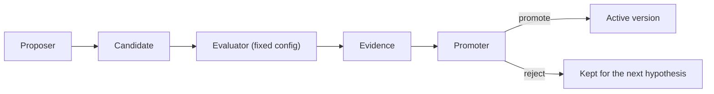

These guardrails apply to every recursive-improvement loop. They let Ryu improve its skills, tools,
and apps without widening what it is allowed to do.

## The quality bar

A change belongs in the RSI loop when Ryu can answer these questions before and after promotion:

1. What user or system objective was being improved?
2. What baseline was measured, on which fixed task set or trace sample?
3. What changed, and who or what proposed it?
4. Which tests, evaluators, policy checks, and browser or host checks ran?
5. Why was this candidate promoted, and what is the rollback target?
6. Did the next uses improve without violating privacy, security, cost, latency, or reliability limits?

If one of these answers is missing, the change is automation, not a verified improvement loop. The
[improvement record](/docs/rsi/operating-model#the-improvement-record) holds the answers.

## The non-negotiable rules

1. **No self-approval.** The proposer, evaluator, and promoter are separate decisions, even when
   one agent coordinates the workflow.
2. **No unbounded recursion.** Every run has a depth, time, token, cost, and side-effect budget.
3. **No hidden data expansion.** Learning is consented, exclusions are enforceable, and secrets or
   Passport identity data never become training or evaluation input.
4. **No score without a baseline.** A number without a fixed task set and versioned context is not
   evidence of improvement.
5. **No promotion without rollback.** The previous active version and the restore operation are
   part of the promotion record.
6. **No trust by proximity.** A manifest, skill, prompt, evaluator, document, or model response is
   untrusted data until its owning boundary validates it.

The first rule splits one improvement into three separate decisions:

## The promotion ladder

This ladder is the single list of change classes for every RSI page. Move up one rung only when
the lower rung has reliable proof. The higher the rung, the more authority stays with a human owner.

| Rung | Change | Safe default | Required before promotion |
|---|---|---|---|
| 1 | Skill or prompt | Draft and approval-gated | Human review, provenance, redaction, regression task set, and reversible activation. |
| 1 | Memory or retrieval rule | Scoped to the owner and space | Consent, access check, retrieval-quality test, and delete path. |
| 2 | Workflow or agent configuration | Bounded run | Schema validation, budget, permission, approval, replay, and failure-state coverage. |
| 3 | Deterministic tool | Not callable after authoring | Pure-input contract scan, case table, repeated deny-all sandbox runs, and explicit install. |
| 4 | Companion or Ryu App | Disabled candidate | Valid manifest, self-contained UI bundle, shared UI primitives and bridge contract, rendered host or browser proof, and owner approval. |
| 5 | Sidecar or service | Isolated process | Typed, authenticated lifecycle boundary, resource limits, migrations, integration tests, and an operational owner. |
| 6 | Core, Gateway, security, or release | Human-owned | Full repository gates, security review, compatibility checks, and an explicit release decision. |

## Evaluator safety

A candidate can learn to please the evaluator instead of the user. Use these protections:

- keep development and holdout cases separate;
- include negative cases for policy, privacy, and failure behavior;
- keep a fixed judge configuration when comparing candidates;
- inspect raw examples, not only aggregate scores;
- measure cost, latency, retries, and user correction rate alongside quality;
- periodically review whether the evaluator still matches the user's objective; and
- never let a candidate edit or disable the evaluator that decides its promotion.

Add new measurements to the shared [evaluator catalog](/docs/gateway/evaluators).
Keep inline safety enforcement and offline quality evaluation separate, even when they use the same
evaluator definition.

## Privacy and consent

Learning creates a durable record, so the user must be able to understand and control it:

- make global learning opt-in where the data posture requires it;
- support an exclusion at the smallest meaningful scope, including a conversation or task;
- redact credentials, identity data, private keys, and sensitive fields before synthesis;
- keep user content separate from system-generated evidence and metadata;
- make deletion and exclusion retroactive for future scoring and training; and
- expose what artifact used the data without exposing the private data itself.

Do not use a public benchmark or Marketplace package as a back door for private traces. Share the
artifact and its bounded evidence, not the user's raw conversation.

## Operational brakes

Every autonomous or scheduled loop needs:

- a maximum run duration and spend;
- a maximum number of candidate attempts;
- a stop condition for regressions or repeated failures;
- a kill switch that does not require the loop to cooperate;
- a canary or narrow scope before wider activation;
- rate limits and concurrency limits;
- an audit trail with correlation ids; and
- a clear unavailable state when a provider, sidecar, or evaluator is missing.

An unavailable dependency must never be represented as a successful experiment or a promoted result.

## Evidence is layered

Use the smallest sufficient proof for the change, but do not collapse different evidence into one
status:

1. parser, schema, or unit test;
2. contract or cross-language fixture;
3. service integration with authorization and persistence;
4. host, browser, native, or desktop proof for the user-facing projection;
5. build, release, registry, or deployment verification when those surfaces changed.

A healthy endpoint does not prove a fresh deployment. A passing eval does not prove safe promotion. A
screenshot proves the rendered state shown in that screenshot and no more.

## The failure posture

When an improvement run fails, preserve the candidate, evidence, and failure reason. Do not silently
retry forever, delete the workspace, or fall back to demo data. A failed run is useful input for the
next hypothesis. It is not evidence that the system learned.
