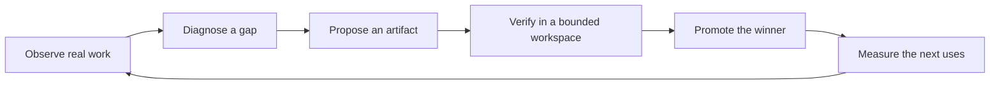

**Recursive improvement** (RSI) is the loop in which Ryu captures what worked, finds a reusable
pattern, tests a change against a baseline, and makes the winner available for the next task.

<Figure name="rsi" />

RSI is an operating model. It does not let Ryu rewrite its own security boundary or publish
unreviewed code. A complete loop has:

- an objective and a baseline;
- bounded experiments and independent evaluation;
- provenance, approval, and rollback.

## The loop

The artifact can be a skill, prompt, memory rule, workflow, deterministic tool, app, provider
route, or model adapter. The loop is the same for each. The proof requirements get stricter as the
change surface grows.

## Guides

<Cards>
  <DocCard href="/docs/rsi/operating-model" />
  <DocCard href="/docs/rsi/learning-loop" />
  <DocCard href="/docs/rsi/experiment-loop" />
  <DocCard href="/docs/rsi/self-building" />
  <DocCard href="/docs/rsi/guardrails" />
  <DocCard href="/docs/rsi/roadmap" />
</Cards>

## Ryu surfaces in this loop

| Layer | Current Ryu surface | Role in the loop |
|---|---|---|
| Start | [Onboarding](/docs/surfaces/desktop/user-guide/onboarding) | Get a new node to its first useful task and first feedback signal. |
| Learn | [Learning](/docs/apps/learning) | Capture feedback and experience, then propose reusable skills through approval. |
| Experiment | [Research / Experiments](/docs/apps/research) | Run durable, bounded campaigns, compare variants, keep winners, and record reasoning. |
| Measure | [Gateway Evals](/docs/gateway/evals) and [Audit](/docs/gateway/audit) | Score behavior, retain attribution, and separate quality evidence from operational health. |
| Compose | [Skills and tools](/docs/learn/academy/operator/skills-and-tools) | Turn a successful procedure into a reusable capability. |
| Build | [Author a Ryu App](/docs/extend/develop/extensions/ryu-apps) | Package a tool and UI using the shared manifest and host contracts. |
| Drive Ryu | [Self-API](/docs/extend/develop/extensions/self-api) | Let an agent inspect and operate Ryu through an explicit, bounded interface. |

The RSI loop connects these surfaces with one [improvement record](/docs/rsi/operating-model#the-improvement-record),
one [promotion ladder](/docs/rsi/guardrails#the-promotion-ladder), and one
[quality bar](/docs/rsi/guardrails#the-quality-bar) that every change must pass before and after
promotion.
