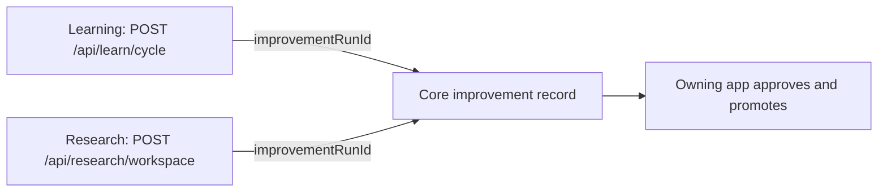
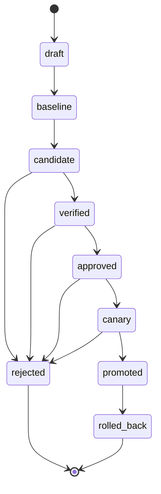

Learning and Experiments share an improvement contract, not an implementation. Each part of the
loop has one owner (see [Where each responsibility belongs](#where-each-responsibility-belongs)),
and Core stores the improvement record that links them.

This follows Ryu's [platform consistency rules](/docs/start-here/architecture/platform-consistency):
one owner, one canonical contract, explicit projections, and evidence that says what actually ran.

## The improvement record

The improvement record joins a proposal, an experiment, and a later promotion without making
either app the authority for the other. Its fields:

| Field | Why it matters |
|---|---|
| Objective | Names the user or system outcome being improved. |
| Scope | Identifies the artifact kind: `skill`, `prompt`, `memory_rule`, `workflow`, `tool`, `app`, `sidecar`, `provider_route`, or `model_adapter`. |
| Baseline | Pins the current artifact, task set, model/provider context, and starting score. |
| Candidate | Records the proposed diff, parent version, and input snapshot digest. |
| Evaluation | Links deterministic tests, offline evals, safety checks, and host/browser proof. |
| Guardrails | Sets cost, latency, privacy, capability, and regression limits. |
| Decision | Records the explicit decision and the lifecycle state (see [Promotion states](#promotion-states)). |
| Provenance | Records the user, agent, campaign, skill set, and source traces that produced it. |
| Rollback | Points to the last known-good version and the operation that restores it. |

The record should be append-only for decisions and evidence. Mutable settings can be updated through
their owning app, but a past score or approval must not silently change underneath an old result.

## Core record API

The record is stored node-locally in Core (`apps/core/src/server/improvement_api.rs`) and requires
the node bearer token like other protected Core routes:

| Route | Purpose |
|---|---|
| `POST /api/improvements` | Create a draft record |
| `GET /api/improvements` | Read newest-first history (`limit` query, default 50, capped at 100) |
| `GET /api/improvements/{id}` | Read one record |
| `POST /api/improvements/{id}/transition` | Apply one guarded lifecycle transition |

The transition body names the target state in `to` and carries the `candidate`, `evaluation`,
`guardrails`, `decision`, and `rollback` fields that the transition needs. Send `evaluation` and
`guardrails` together; a body with only one of them is rejected with `400`.

Core validates the whole resulting record before the SQLite update, so a rejected transition cannot
leave a half-promoted record behind. The API stores records and enforces the lifecycle. It does not
run an experiment or approve a change.

## Correlating Learning and Research

`POST /api/learn/cycle` (Learning) and `POST /api/research/workspace` (Research) accept an optional
opaque `improvementRunId`. It lets an owner join experience, experiment, evidence, and promotion
history without copying private conversation content between stores.

Research rejects an invalid id with `400` (`invalid_improvement_run_id`) before it starts a
workspace.

<Callout type="info">
`improvementRunId` is a correlation id, not an approval mechanism. It does not promote anything by
itself. The owning app still controls approval, activation, and rollback.
</Callout>

## Where each responsibility belongs

| Responsibility | Owner | Example projection |
|---|---|---|
| Execute a task, workflow, tool, or experiment | Core or the owning app | A campaign attempt or a tool call. |
| Store workspaces and the improvement record | Core | An improvement record and its lifecycle state. |
| Hold the artifact's domain state | The owning app | The active version, its history, and its rollback path. |
| Decide whether it is allowed and how much it may spend | Gateway | Grants, budgets, firewall, evaluator policy, measurement, and audit. |
| Capture a user experience and propose a skill | Learning | Experience log and approval request. |
| Generate candidates and compare variants | Research | Campaign, proposal lease, attempt, and winner. |
| Render progress and decisions | Desktop, Web, Mobile, or Companion | A bounded view of the same run. |
| Publish the public contract | Fumadocs | Usage, authoring, safety, and evidence guidance. |

Learning has no policy engine of its own, and Research has no skill store of its own. Both apps link
to the same run and keep their separate product boundaries.

## Promotion states

Promotion is a one-way, inspectable path. Core accepts only these transitions:

`rejected` and `rolled_back` are terminal. A skipped or backward transition fails, and repeating
the current state is a no-op. Each target state has entry requirements:

| Target state | Required on the record |
|---|---|
| `candidate` | A candidate artifact reference. |
| `verified` | Evaluation with metrics and evidence, plus guardrails that passed. |
| `approved`, `canary` | A `promote` decision, plus the candidate and passing evaluation from `verified`. |
| `promoted` | A rollback reference and a `promote` decision. |
| `rejected` | A `reject` decision. |
| `rolled_back` | A rollback reference and a `rollback` decision. |

The storage can change; these semantics do not. A candidate that has only been generated
is not verified. A candidate that passed an offline score is not automatically safe to run. A canary
that improved one benchmark is not a global promotion until its guardrails and holdout checks pass.

## A useful separation

Keep three signals separate:

- **Learning signal:** a human reaction, correction, successful procedure, or repeated failure.
- **Experiment signal:** a controlled comparison against a baseline.
- **Promotion signal:** an authorized decision that the artifact may affect future work.

A thumbs-up does not become an automatic code release, and a model judge is not the sole authority
for its own improvement.

## Applying the model

When a campaign or design note uses the model, follow the
[complete campaign](/docs/rsi/roadmap#a-complete-campaign) steps and attach the result to the
Learning entry or Research campaign it came from.

The [guardrails](/docs/rsi/guardrails#the-promotion-ladder) page defines the minimum evidence by change class, and the
[RSI maturity model](/docs/rsi/roadmap) describes how the pieces fit together.
