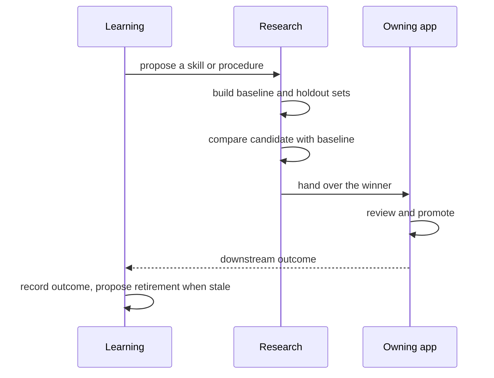

RSI is a sequence of small, durable contracts that make each improvement easier to measure and
safer to promote. It is not one autonomous agent.

<Callout type="warn">
These stages are a quality model, not a release plan or a promise about a release date.
</Callout>

## Stage 1: connect the evidence

Make every Learning proposal and Research campaign answer the same
[quality bar](/docs/rsi/guardrails#the-quality-bar) questions: objective, baseline, change,
checks, approval, and rollback.

Use the [improvement record](/docs/rsi/operating-model#the-improvement-record) as the shared contract. Keep the contract
and its projections separate from any dashboard or service that renders them.

## Stage 2: create a Ryu golden set

Extend [RyuBench](/docs/reference/benchmark), the versioned task set, to cover the work Ryu must do
reliably:

- onboard a new node and reach a first useful task;
- create or refine an agent with the correct tools and permissions;
- turn a successful procedure into a reviewed skill;
- run an Experiment and correctly keep or reset a candidate;
- author and verify a deterministic tool;
- build an app with the shared shell and bridge;
- diagnose an unavailable dependency without claiming success; and
- update public docs without inventing unsupported behavior.

Keep task completion, safety, cost, latency, accessibility, and documentation correctness as
separate dimensions. A single blended score hides the failure that matters.

## Stage 3: bridge Learning and Experiments

Add explicit handoffs:

1. Learning proposes a skill or procedure.
2. Research creates the baseline and holdout task sets.
3. Experiments compare the candidate and baseline.
4. The owning app reviews and promotes the winner.
5. Learning records the downstream outcome and proposes retirement when the skill becomes stale.

The same handoff should work in the other direction: an Experiment that discovers a reusable
procedure can submit it to Learning instead of writing directly into the active skill set.

## Stage 4: make self-building repeatable

Standardize the gates of the [promotion ladder](/docs/rsi/guardrails#the-promotion-ladder) so
each rung runs the same checks every time, from review plus replay for a skill to the full
repository and security gates for Core and Gateway.

The build should generate its evidence pack as part of the run, not ask someone to reconstruct it
after the fact.

## Stage 5: apply the loop to product work

Choose a narrow, reviewable target and run the whole loop for it. Good targets include documentation
completeness, app contract migrations, or a recurring test-triage workflow. Keep security and release
policy outside an unattended loop.

For every candidate, keep the diff, task-set digest, scores, screenshots or recordings where needed,
approval, and rollback target. Publish only the reusable artifact and public evidence; keep private
traces private.

## Stage 6: share safe evidence

Once the local loop is reliable, add:

- Marketplace provenance and compatibility checks for shared skills and apps;
- opt-in sharing of redacted task sets and evaluator definitions;
- cross-node comparisons that preserve tenant and privacy boundaries;
- scheduled idle-window campaigns with explicit budgets; and
- release notes that identify the improvement evidence without overstating deployment proof.

Model fine-tuning (the [Fine-tune](/docs/apps/finetune) app) can be part of this stage. Keep it
downstream of the skills, evaluation, and promotion loop. A better skill or workflow often compounds faster and with less risk
than changing model weights.

## A complete campaign

This is the canonical step sequence for an RSI campaign. The learning, experiment, and
self-building pages link here instead of repeating it.

1. Pick one real Ryu task and write its success and safety criteria.
2. Snapshot the current artifact and run the baseline set.
3. Capture a failure or improvement signal in Learning.
4. Create a Research campaign with development, regression, and holdout cases.
5. Let Ryu propose exactly one bounded candidate.
6. Run tests, evals, policy checks, and the appropriate rendered proof.
7. Review the evidence and promote or reject the candidate.
8. Exercise rollback, then run the next task with the promoted version.
9. Record whether the downstream outcome improved.

When this works for a skill, repeat it for a deterministic tool, then an app.
