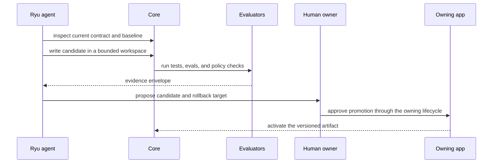

Ryu has the pieces an agent needs to operate on Ryu: an agent-facing
[Self-API](/docs/extend/develop/extensions/self-api), shared app and plugin contracts, and an
authoring path for [Ryu Apps](/docs/extend/develop/extensions/ryu-apps). The quality
gates below keep a generated change from being mistaken for a shipped change.

## The capability ladder

Self-built changes climb the [promotion ladder](/docs/rsi/guardrails#the-promotion-ladder), from
skills and prompts at rung 1 to Core, Gateway, security, and release behavior at rung 6. Move up one
rung only when the lower rung has reliable proof. The ladder lets Ryu build more of the product
while the highest-impact authority stays outside an unattended model loop.

## The self-building loop

For a new app, the practical sequence is: describe the domain, reuse the Ryu App shell and controls,
declare the manifest, build a single self-contained UI, test the bridge and states, run a real host
proof, and only then install or publish it. The [app reuse standard](/docs/extend/develop/extensions/app-reuse-standard)
defines the ownership and host-consistency rules.

## Build bounded capabilities

Self-built tools work best as small, testable capabilities that make the next improvement loop
cheaper and easier to verify. Examples worth building:

- **Task-set builder:** turn a real failure or repeated request into a redacted replay case.
- **Baseline runner:** run the current artifact against the same task and guardrail sets.
- **Evidence packer:** attach diffs, test results, scores, screenshots, and rollback information.
- **Regression miner:** find a representative case when a change breaks a prior task.
- **App contract checker:** validate manifests, capability declarations, shared UI usage, and bundle shape.
- **Release assistant:** prepare notes and checklists while leaving publication and signing to the owner.
- **Doctor:** explain an unavailable provider, sidecar, grant, or dependency without fabricating success.

Each of these tools should have a narrow input schema, bounded side effects, deterministic cases
where possible, and an explicit owner.

## What Ryu must not self-approve

An agent may propose a change to Ryu, but it must not be the sole authority that:

- grants itself access to credentials, identity, or another tenant;
- loosens Gateway policy, firewall, budgets, or approval requirements;
- changes the trust boundary or sandbox;
- promotes code that has not passed its declared tests and host proof;
- publishes a package, release, or mirror without the owning release decision; or
- deletes the evidence or rollback target for an earlier change.

The [platform consistency contract](/docs/start-here/architecture/platform-consistency) and
[security documentation](/docs/security) remain the authority for these boundaries.

## Apply the same standard to Ryu changes

When an agent helps change Ryu, run the [complete campaign](/docs/rsi/roadmap#a-complete-campaign)
with two additions. The agent inspects the current product through the Self-API and existing build
tools before it writes a candidate, and a human promotes the candidate through the owning app or
repository. The result becomes a new baseline only after activation.

The process keeps Core and Gateway changes reviewable and leaves a reusable evidence trail for the
next change.
