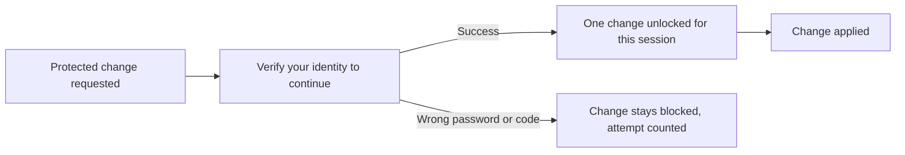

Part of the [Authentication and pairing](/docs/security/authentication-and-pairing) guide. To delete
your account, see [Deleting your account](/docs/security/authentication-account#deleting-your-account).

## Verify identity before account-security changes

These changes require a fresh identity check first:

- changing a password or email address;
- managing passkeys;
- unlinking an account.

The full-page **Verify your identity to continue** screen offers the methods available to that
account:

| Account state | Accepted methods |
|---|---|
| 2FA off | Current password or emailed link |
| 2FA enabled | Authenticator code, emailed code, or backup code |

### How a check behaves

- **One change per check.** A successful check is bound to the current session and authorizes one
  protected change. It is not remembered for future sign-ins.
- **No device-memory bypass.** The sign-in **Remember this device for 30 days** choice never skips
  an account-security check.
- **Every password path is covered.** This includes a direct request to the authentication API's
  change-password endpoint. The current password it asks for is checked as well, but it never
  replaces the identity check. With 2FA enabled, only an authenticator code, emailed code, or backup
  code satisfies it.
- **Emailed codes and links work once.** If the same code or link is submitted twice at the same
  moment, only one submission succeeds and only one protected change is unlocked.
- **A wrong password changes nothing.** Password confirmation waits for the password verifier to
  succeed before it opens a security window. A wrong password keeps account changes blocked and
  counts toward the verification attempt limit. It cannot change the password or revoke other
  sessions.

## Set a password or change your email address

### Set or change a password

An account that signs in with emailed codes or links can set a password after confirming by emailed
link. A new password follows the sign-up rules:

- 8 to 128 characters;
- at least one uppercase letter, one number, and one symbol;
- never trimmed or normalized.

The same rules, and the same refusal message, apply wherever you choose a password: signing up,
setting one, changing it, and recovering it. The change-password forms in the web app, the desktop
app, the browser extension, and the command line, and the web password-recovery form, check a new
password against the rules before they send it.

A password the rules refuse is turned away before your identity check is used. You can correct it
and try again without verifying again, within the few minutes the check stays valid.

Setting or changing a password signs out your other sessions but keeps the one you used. You can
then sign in with the password.

### Change your email address

1. Ryu mails a link to your current address and one to the new address.
2. Confirm both, in either order, within 24 hours. You can cancel the change until then.
3. After the change, you sign in with the new address only.

Ryu refuses a new address that belongs to another account, including another spelling that sign-in
treats as the same mailbox (such as a Gmail address with dots or a plus tag added). The confirmation
is sent even if Ryu emailed you an identity-check link a moment earlier.

A request that is turned away does not use up your identity check. You can correct or retry these
without verifying again, within the few minutes the check stays valid:

- an address that is not valid;
- your current address, or one that belongs to another account;
- a new request while one is still pending.

Only the request that goes ahead uses the check.

### After an email change

- The old address no longer signs in, and a sign-in code requested with it does not reach your
  account.
- If the confirmation emails cannot be sent, your address is not changed and you can start again
  straight away.
- If someone else takes the new address before you confirm the last link, the change is cancelled.
  Your address stays as it was, and you can start again with another address.
