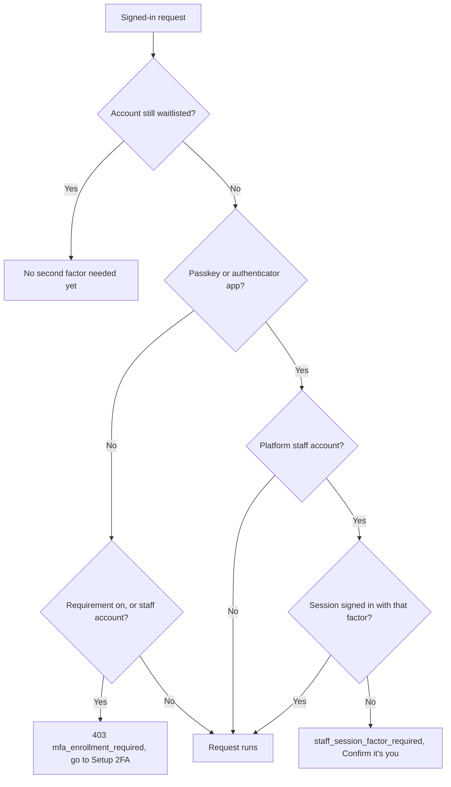

Part of the [Authentication and pairing](/docs/security/authentication-and-pairing) guide. For the
order in which factors are checked at sign-in, see
[Account sign-in](/docs/security/authentication-account#second-factor-order-at-sign-in).

## Which factors count

Ryu requires every account to hold a strong second factor:

- an **authenticator app** (TOTP), or
- at least one **passkey**.

Email codes do not count, because they rely on the same inbox as password resets and magic links. A
self-hosted Ryu service can turn the requirement off.

## Staff accounts

Ryu platform staff (service administrators and marketplace moderators) are always under this
requirement, even when the service has not switched it on for everyone. Their accounts can see and
change data across every workspace.

An unenrolled staff account is sent to **Setup 2FA** like any other. Its requests, including the
account administration endpoints, answer with `mfa_enrollment_required` until a passkey or an
authenticator app is in place.

### The session must use the factor

For staff, holding a factor is not enough. The session itself must have used it.

| Staff session signed in with | Result |
|---|---|
| Passkey, authenticator code, or recovery code | Works normally |
| Emailed code, magic link, social or single sign-on login, or a password on a remembered device | Requests get `staff_session_factor_required` until the session is confirmed |

An unconfirmed staff session also cannot approve desktop or CLI sign-ins or add another factor. The
website shows a **Confirm it's you** prompt. Confirm with your authenticator app, or sign out and
sign in again with your passkey. Desktop and CLI sign-ins approved from a confirmed staff session
count as confirmed.

### Fresh code for staff changes

Staff changes ask for a fresh authenticator or recovery code before they run. One code covers the
next 30 minutes of staff work in that session. This applies to marketplace moderation:

- approving or rejecting submissions;
- setting the Ryu-reviewed mark and choosing Staff Picks;
- hiding or restoring reviews and triaging reports;
- yanking or deprecating a listing as a moderator.

Resolving a seller-visible report on a listing your organization publishes is a seller action, so it
is not asked for this code, even for staff. Publishers who yank or deprecate their own
releases are not asked either, but a staff account always acts as a moderator there, so it is.

## Organization two-factor policy

An organization can also [require two-factor authentication](/docs/security/organization-admin-controls#access-policy)
for its members. That page owns the organization rules: either an authenticator app or a passkey
satisfies the policy, and a session that signed in without its factor gets `org_mfa_session_required`
until it is confirmed.

## Enrolling with Setup 2FA

While the requirement is on and an account has neither factor, signing in still works. The website
then sends you to **Settings → Setup 2FA** before any account page opens. Account requests answer
with a `403` response whose `code` is `mfa_enrollment_required`.

On that page you can:

- **Add a passkey.** This works for passwordless accounts (Google, GitHub, or magic-link sign-in)
  too. Ryu first asks you to verify your identity, the same check it uses for other security
  changes.
- **Set up an authenticator app.** This needs an account password. A passwordless account can add a
  passkey first, then set a password in **Profile → Account** and add an authenticator app.

Once either is in place, you go back to the page you were opening.

### Credentials refused until you enroll

Until the account is enrolled, Ryu refuses to issue new credentials for it. Each refusal answers with
the same `mfa_enrollment_required` code:

- personal API keys;
- desktop and CLI sign-in approvals;
- tokens for your own nodes;
- OAuth and MCP client authorizations;
- new workspaces and workspace invitations.

Approving a desktop or CLI sign-in on the website takes you to **Setup 2FA** and then back to the
approval. API keys created before the requirement was turned on keep working with the scopes they
were given.

### App checks

The apps check the same requirement after sign-in. Desktop, the browser app, Mobile, the CLI
workspace, and the browser extension's popup and New Tab show a **Set up two-factor authentication**
screen in place of the workspace.

- The screen opens **Settings → Setup 2FA** on the website. Sign in there with the same account if
  it asks.
- **Check again** opens the workspace as soon as a passkey or authenticator app is in place.
- When an app cannot reach Ryu to check, it keeps the workspace open and checks again later.
- A one-shot `ryu-cli` command that Ryu refuses for this reason prints the setup page address and
  exits with status 1.

### Waitlisted accounts

Accounts still on the waitlist do not need a second factor. When an account is approved, setting one
up is the first onboarding step: the approval sends you to **Setup 2FA** before the dashboard opens.

## Removing a factor

While the requirement is on, you cannot remove your last second factor. Ryu refuses both of these
actions with the `mfa_last_factor` error code:

- disabling the authenticator app while you have no passkey;
- deleting your only passkey while the authenticator app is off.

Add the replacement first, then remove the old one.

## Enable two-factor authentication

When two-factor authentication is off, the signed-in website can show a reminder on the Console
and Account Settings pages. **Enable 2FA** opens setup. Dismissing the reminder hides it on both pages
for that account in the current browser; enabling 2FA removes the reminder automatically. The prompt
does not change your account's security settings until you complete setup.

## Billing verification

When a billing action asks for fresh identity verification, use the current authenticator code from
your enrolled two-factor account. Email and backup codes cannot satisfy that billing check.

A refused code does not authorize the action; check the code and retry explicitly. Verification
applies to the current signed-in session, so another device must complete its own check.
