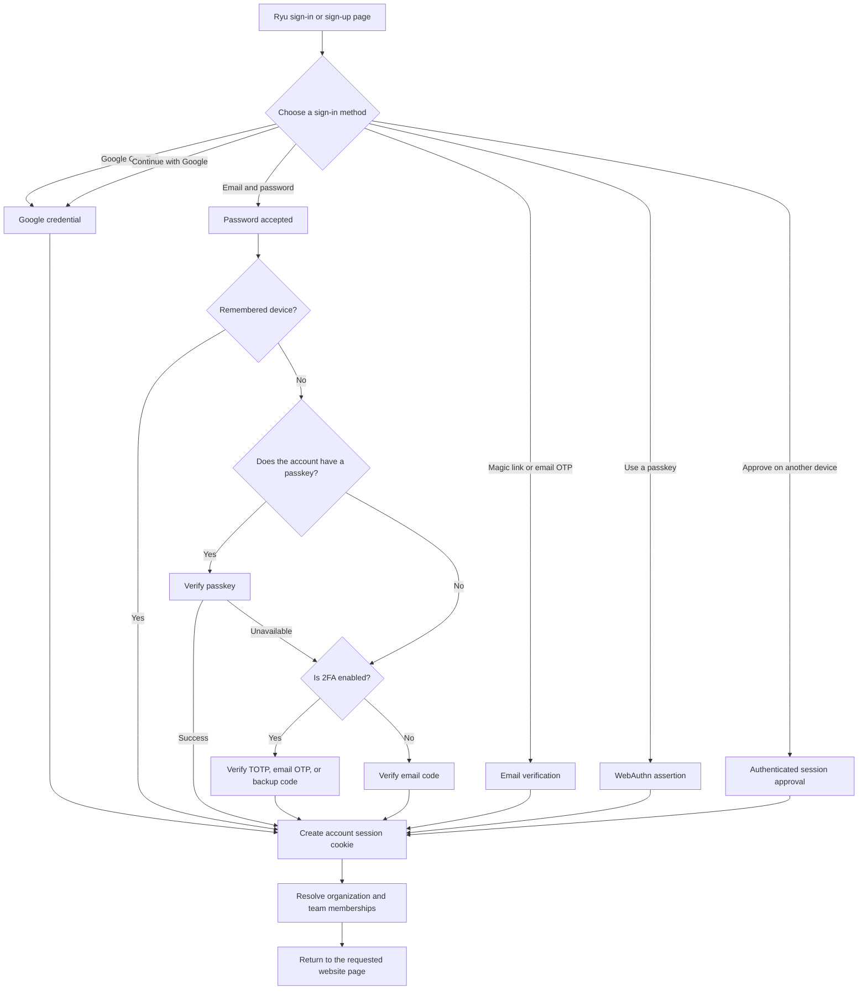
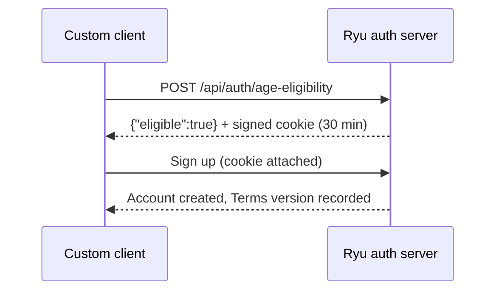

Part of the [Authentication and pairing](/docs/security/authentication-and-pairing) guide. This page
covers how you sign in to your Ryu account and how its sessions behave. Related account pages:

<Cards>
  <DocCard href="/docs/security/authentication-account-mfa" />
  <DocCard href="/docs/security/authentication-account-changes" />
  <DocCard href="/docs/security/authentication-account-restrictions" />
</Cards>

<Figure name="authentication" />

## Sign-in methods

Every sign-in method uses the same Better Auth account flow. The same account-linking, waitlist,
organization-provisioning, and session rules apply to each one:

- **Continue with Google** and Google One Tap
- Email and password
- Magic link and email OTP (one-time password)
- Passkey
- **Approve on another device**

Google One Tap is shown only on the website. It is a convenience around the normal Google sign-in,
not a separate identity system. App flows never start a browser prompt automatically. They use
explicit device authorization or an explicitly requested app handoff.

Configure the public Google client ID and authorized JavaScript origins as described in
[environment variables](/docs/start-here/environment-variables). See
[Account security](/docs/surfaces/desktop/user-guide/account-security) for passkeys, One Tap, 2FA,
and backup-code recovery.

## Approve on another device

Desktop, mobile, the browser extension, and CLI do not ask for your email. They open the website and
show a short approval code. Enter the email on the website and choose **Approve on another device**.
Ryu sends a live approval request to a session where you are already signed in.

The full flow, including the Ryu Mobile QR scanner, is in
[Device and node pairing](/docs/security/authentication-devices#website-centered-approval-for-every-client-surface).

- **Errors stay visible.** If the website cannot start or finish an approval request, its waiting
  dialog keeps the error on screen. Choose **Cancel** before you retry, or return to the sign-in
  form and use another method.
- **The code is alphanumeric.** Desktop shows the user code in grouped OTP cells. The current
  device-authorization default is eight characters, not eight digits, and the display follows the
  length of the actual code.
- **Copy sign-in link** copies the verification page with that code prefilled.
- **Codes match across screens.** The website uses the same OTP control for manual entry, and the
  approval screen repeats the code so you can confirm that the browser and desktop show the same
  request.

## Guest access

The browser app's former **Try Ryu without an account** path is disabled while the waitlist is
active:

- The auth server rejects new anonymous sign-ins.
- The browser build does not render the guest action.
- Legacy anonymous browser sessions are removed instead of being admitted as approved accounts.

The browser app therefore requires a normal account sign-in and the same server-authoritative
waitlist approval as the website portal. The separate public anonymous read-only surfaces in
[MCP authentication boundaries](/docs/security/authentication-mcp) are not affected.

## Creating an account

The hosted browser sign-up (used by the website and mobile enrollment) checks your age before it
collects account details. Hosted accounts require a minimum age of 13, subject to higher local
requirements and any required guardian permission. Google sign-up becomes available after the
check. Ryu does not save the date of birth to the account.

### Age check for custom clients

A custom self-service client must run the check itself before registration:

1. Send `POST /api/auth/age-eligibility` with a JSON body that holds `dateOfBirth` (`YYYY-MM-DD`)
   and `acceptedTerms: true`, the person's acceptance of the current [Terms](/docs/legal/terms).
2. Keep the returned signed cookie for registration and any OAuth round-trip. A successful check
   returns `{"eligible":true}`.
3. Register the account. The new account records the accepted Terms version and time.

| Result | When |
|---|---|
| `{"eligible":true}` | The check passed. The cookie records the accepted Terms version and expires after 30 minutes |
| `AGE_NOT_ELIGIBLE` | The person is under the minimum age. Ryu does not enroll children through parental consent |
| `AGE_ELIGIBILITY_REQUIRED` | Registration had a missing, invalid, or expired cookie, or a cookie issued for an earlier Terms version |

Existing accounts do not repeat the check at sign-in. Authenticated administrative and SCIM
provisioning, and a first sign-in through an organization's verified-domain SSO provider, skip the
check. Eligibility for those accounts is the organization's responsibility.

## Sessions and devices

The website, Desktop, Extension, and CLI list sessions with the newest sign-in first.

- **This device** marks the session that authenticates the request, even when another device
  signed in more recently.
- You can revoke a newer remote session without signing out this device.
- **Revoke all others** keeps the authenticated session.
- A native sign-in that is missing from the browser-session list does not mark another browser as
  this device.
- Session responses never include sign-in tokens.

## Session revocation

Account-authorizing requests check the live session store, including native authentication
mutations. A revoked session cannot regain authority from its short-lived browser cache.

Live update streams that stay open after sign-in check the session again every 15 seconds, whether
or not updates arrive. This covers conversation, document and settings sync, billing status,
organization credit balance and low-balance alerts, and relayed Composio webhooks.

Within about 15 seconds of any of these events, the stream closes and stops sending updates:

- the session is revoked or expires;
- the member is removed from the organization;
- the organization's access policy (IP allowlist, required two-factor authentication, or session
  age limit) changes so that it refuses the session.

A client that reconnects has to sign in and pass the access checks again.

## Browser session caching

Ordinary browser session reads use a signed cookie cache for up to 60 seconds, to avoid repeated
session database reads. Signing protects the cached data from tampering; it does not encrypt it.
Signing out clears the current browser's session cookies.

<Callout type="warn">
A session revoked on another device can remain visible in cached session reads until that minute
expires.
</Callout>

These requests always validate the live server session, not the cache:

- authentication operations;
- account and organization changes;
- billing, permissions, and support access;
- API mutations, and any route that has not explicitly opted into presentation-read caching.

Session cookies refresh after organization changes and SSO organization selection, so cached reads
use the updated organization and team context at once. Session caching does not turn an OAuth
access token into an account session.

## Email address policy

Ryu validates email addresses at the Better Auth server boundary.

- **No disposable mailboxes.** They are refused on sign-up, email sign-in, verification, magic-link,
  and password-recovery routes. Existing accounts remain usable.
- **Aliases resolve to one identity.** Provider-aware aliases, such as Gmail dots or plus tags,
  resolve to the same normalized identity for email sign-in and recovery. Ryu keeps the address you
  registered as the account address. The normalized value is an internal lookup key and is never
  returned as a profile field.
- **No account disclosure.** Signing up again with an alias of an existing mailbox returns the same
  check-your-email response as any other registration. It does not reveal the registered address or
  create a second account.
- **One error for every password failure.** Email-and-password sign-in gives the same invalid email
  or password error for an unknown address, a wrong password, and an account without a password.

If you created your account with Google or a magic link, sign in with that method. You can then set
a password as described in
[Set a password or change your email address](/docs/security/authentication-account-changes#set-a-password-or-change-your-email-address).

Use a durable mailbox you control if an address is rejected. This policy applies to email
authentication; it does not enable phone-number authentication.

## Second-factor order at sign-in

After an email-and-password sign-in accepts the password, Ryu checks enrolled factors in a fixed
order:

1. **Passkey.** A passkey account is asked for its passkey even when 2FA is also enabled.
2. **2FA**, if the account has no passkey or the passkey is unavailable.
3. **Email verification code**, the last fallback when 2FA is not enabled.

Password sign-in by username follows the same checks as password sign-in by email.

**Remember this device for 30 days** is offered for password, passkey, and magic-link sign-in. For a
magic link, open it in the same browser to remember that browser. Ryu records the choice only after
sign-in verification succeeds. Until the trust window expires, that browser skips the follow-up
passkey, 2FA, and email-code challenges.

On the emailed-code page, a check that is rate-limited for your network tells you to wait a minute;
it does not call your code invalid. A code stops working after three wrong tries or when it expires.
The page then asks you to choose **Resend code** for a new one.

## Waitlist approval

A valid session is not enough while an account is still waitlisted.

**Website portal.** The live `/chat` and `/apps` surfaces check approval again on every API request.
The server then forwards the caller's signed Better Auth identity to Core with the node admission
credential, so organization and team policy remains enforced.

If the waitlist control plane cannot answer, protected portal surfaces fail closed. Only an
explicitly configured admin account bypasses that check.

**Desktop, CLI, Mobile, and browser extension.** The same server-authoritative gate applies to
signed-in clients. A server-owned rollout flag sets its scope:

| Scope | Gated nodes |
|---|---|
| All-node (current default) | Any active node, including local, self-hosted, or previously connected nodes |
| Managed-only | Only nodes explicitly listed as reachable Ryu Cloud nodes |

If the scope value is missing or unavailable, clients fall back to all-node scope. When approval
cannot be verified for a gated node, a client without an earlier confirmed approval keeps that
workspace locked until it can check again.

**Handle reservations.** On the browser waitlist, **Reserve your handle** shows your current
reservation. **Unreserve** releases it only after the server accepts the request. If release fails,
an error appears beneath the actions, the handle stays reserved, and you can retry. A successful
release returns the field to its empty state, including after a page reload.

## Account chooser

When a browser already has one or more Ryu account sessions, `/login` opens an account chooser first.

- Choose an account to return to the requested page.
- **Log in to another account** continues through the normal sign-in form.
- **Create account** opens the same form in sign-up mode.
- Each saved account can be removed from the browser after a confirmation step.
- **Log out of all accounts** is also confirmed before every browser session is revoked.

## Password recovery

Forgot-password recovery uses Better Auth's Email OTP flow.

1. Enter your account email on the sign-in page.
2. Enter the six-digit code sent to your inbox. Codes expire after five minutes; use **Resend code**
   if the first message does not arrive.
3. Choose and confirm a new password. It follows the sign-up rules, and both fields must match.
4. Finish. The code and password are sent together.

A password the rules refuse does not use up the code, so you can correct it and send it again. If
the code is invalid or expired, return to the code step and enter a current code. Older
password-reset links still work while valid; if one has expired, start password recovery again.

## Single sign-on

Enterprise organizations also have a **Continue with SSO** path. The employee enters a work email,
Ryu resolves the organization's verified OIDC or SAML provider, and the identity provider completes
the sign-in.

Organization admins configure this under **Organizations → Security**; see
[Enterprise SSO and SCIM](/docs/security/enterprise-identity). Directory lifecycle management is a
separate SCIM integration and is not implied by SSO.

## Transactional email coverage

Ryu renders every current Better Auth email template with a branded React Email renderer. Each
message is sent only for its matching action, so a sign-in code is never presented as a
password-reset or email-verification code.

| Better Auth template | Ryu behavior |
|---|---|
| `verify-email` | Link sent after account creation to confirm the email address |
| `reset-password` | Compatibility renderer for older password-recovery links |
| `change-email` | New-address confirmation in Ryu's two-address email-change flow |
| `sign-in-otp` | One-time code for passwordless sign-in |
| `verify-email-otp` | One-time code for email verification |
| `reset-password-otp` | One-time code used by the current password-recovery flow |
| `magic-link` | One-click sign-in link |
| `two-factor` | One-time code for a second-factor challenge |
| `invitation` | Organization invitation |
| `application-invite` | Ryu application invitation, including an approved waitlist applicant |
| `delete-account` | Confirmation link for a self-serve account deletion, valid for 24 hours |
| `stale-account-user` | Security alert after a sign-in following at least 90 days of inactivity |
| `stale-account-admin` | Informational alert to configured Ryu administrators for the same dormant-account reactivation |

Stale-account alerts include the sign-in time and available device and IP details, and recommend
reviewing sessions if the access was not expected. Ryu never asks you to reply with a password or
one-time code by email.

## Deleting your account

You can delete your Ryu account from **Settings → Account → Delete Account**. If your account has
no authenticator app or passkey yet, add one in **Settings → Setup 2FA** first (see
[Required two-factor authentication](/docs/security/authentication-account-mfa)).

1. Ryu checks for anything that would be left without an owner. Before deleting, you must:
   - cancel an active subscription;
   - give another member ownership of (or empty) a shared workspace you solely own;
   - turn off family sharing and remove cloud nodes;
   - unpublish Marketplace listings and wait for pending earnings to be paid.
2. You confirm it is you with a password, second factor, or emailed code.
3. Ryu emails a confirmation link to your address. Nothing is deleted until you open that link and
   choose **Permanently delete my account** within 24 hours.

If deletion stops partway, for example during a brief outage, open the same link again to finish it.

| Data | What happens |
|---|---|
| Sessions and sign-in methods | Signed out everywhere; sign-in methods removed |
| Personal data | Profile, synced chats and documents, shared links, public agents, reviews, likes, personal mail, and stored avatar are removed |
| Workspaces where you are the only member | Deleted with their settings, secrets, and content; unused credit in them is forfeited |
| Shared workspaces | You leave; content you saved there stays with the workspace |
| Billing, tax, and abuse-prevention records | Kept without your name or contact details |
| Data on Core nodes you run yourself | Not touched; delete it from that node |

## Required second factor

Every account must hold an authenticator app or a passkey unless a self-hosted service turns the
requirement off. Enrollment, staff session rules, and the `mfa_enrollment_required` and
`mfa_last_factor` codes are on [Required two-factor authentication](/docs/security/authentication-account-mfa).
