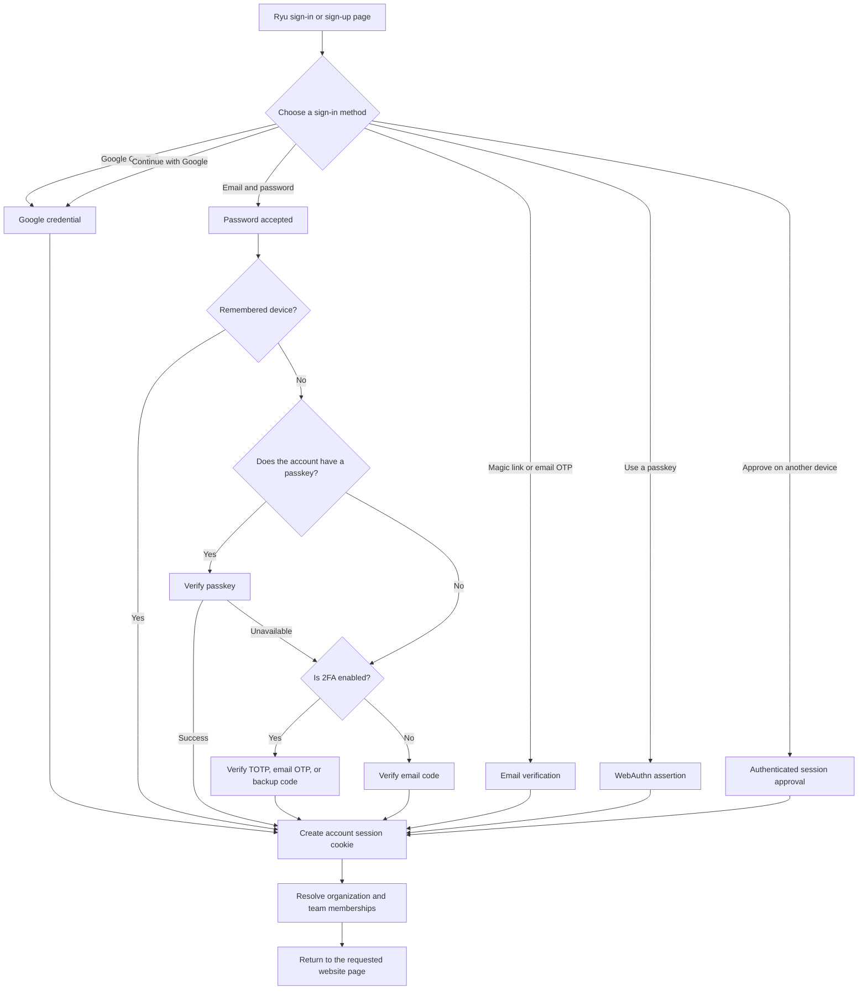

Part of the [Authentication and pairing](/docs/security/authentication-and-pairing) guide. This page
covers how you sign in to your Ryu account and how its sessions behave. Related account pages:

<Cards>
  <DocCard href="/docs/security/authentication-account-mfa" />
  <DocCard href="/docs/security/authentication-account-changes" />
  <DocCard href="/docs/security/authentication-account-restrictions" />
</Cards>

## Sign-in methods

The website is the only place where Google One Tap is shown. It is a convenience around the normal
Better Auth account flow, not a separate identity system. The same account-linking, waitlist,
organization-provisioning, and session rules apply to the normal Google button, email/password,
magic link, email OTP, passkey, One Tap, and **Approve on another device**.

## Approve on another device

Desktop, mobile, the browser extension, and CLI do not ask for your email. They open the website and
show a short approval code. Enter the email on the website and choose **Approve on another device**.
Ryu sends a live approval request to a session where you are already signed in. The full flow,
including the Ryu Mobile QR scanner, is in
[Device and node pairing](/docs/security/authentication-devices#website-centered-approval-for-every-client-surface).

If the website cannot start or finish an approval request, its waiting dialog keeps the error visible.
Choose **Cancel** before retrying approval, or return to the sign-in form and use another method.

Desktop sign-in shows the returned alphanumeric user code in grouped OTP cells. The current
device-authorization default is eight characters, not eight numeric digits, and the display follows
the length of the actual code. **Copy sign-in link** copies the verification page with that code
prefilled. The website uses the same OTP control when you enter a code manually, and the approval
screen repeats it so you can confirm that the browser and desktop show the same request.

## Guest access

The browser app's former **Try Ryu without an account** path is disabled while the
waitlist is active. New anonymous sign-ins are rejected by the auth server, the browser build does
not render the guest action, and legacy anonymous browser sessions are removed instead of being
admitted as approved accounts. The browser app therefore requires normal account sign-in and the
same server-authoritative waitlist approval used by the website portal. This does not change the
separate public anonymous read-only surfaces described in [MCP authentication boundaries](/docs/security/authentication-mcp).

## Creating an account

The hosted browser signup used by the website and mobile enrollment checks your age before collecting account details. Hosted accounts require a minimum age of 13, subject to higher local requirements and any required guardian permission. Google signup becomes available after the check. Ryu does not save the date of birth to the account.

Custom self-service clients must first send `POST /api/auth/age-eligibility` with a JSON body containing `dateOfBirth` in `YYYY-MM-DD` format and `acceptedTerms: true` (the person's acceptance of the current [Terms](/docs/legal/terms)), and retain the returned signed cookie for registration and any OAuth round-trip. Successful checks return `{"eligible":true}`. The cookie records which Terms version was accepted and expires after 30 minutes. Missing, invalid, or expired eligibility, or a cookie issued for an earlier Terms version, causes registration to fail with `AGE_ELIGIBILITY_REQUIRED`; the new account records the accepted Terms version and time. Ineligible checks return `AGE_NOT_ELIGIBLE`; they do not enroll children through parental consent.

Existing account sign-in does not require repeating the check. Authenticated administrative and SCIM provisioning, and first sign-in through an organization's verified-domain SSO provider, are the organization's eligibility responsibility and skip the check.

## Sessions and devices

The website, Desktop, Extension, and CLI list sessions with the newest sign-in first.
**This device** identifies the session authenticating the request, even when another
device signed in more recently. You can revoke a newer remote session without
signing out this device. **Revoke all others** preserves the authenticated session.
A native sign-in that is absent from the browser-session list does not mark another
browser as this device. Session responses never include sign-in tokens.

## Session revocation

Account-authorizing requests check the live session store, including native authentication mutations. A revoked session cannot regain authority from its short-lived browser cache.

Live update streams that stay open after sign-in (conversation, document and settings sync, billing status, organization credit balance and low-balance alerts, and relayed Composio webhooks) check the session again every 15 seconds while they are open, whether or not updates are arriving. Within about 15 seconds of a session being revoked or expiring, of the member being removed from the organization, or of a change to the organization's access policy (its IP allowlist, required two-factor authentication or session age limit) that refuses the session, the stream closes and stops sending updates. A client that reconnects has to sign in and pass the access checks again.

## Browser session caching

Ordinary browser session reads use a signed cookie cache for up to 60 seconds to
avoid repeated session database reads. Signing protects the cached data from
tampering; it does not encrypt the data. Signing out clears the current browser's
session cookies. A session revoked on another device can remain visible in cached
session reads until that minute expires.

Authentication operations, account and organization changes, billing, permissions,
and support access validate the live server session. API mutations and routes that
have not explicitly opted into presentation-read caching also use live checks.
Session cookies refresh after organization changes and SSO organization selection,
so cached reads immediately use the updated organization and team context.
Session caching does not turn an OAuth access token into an account session.

## Email address policy

Ryu validates email addresses at the Better Auth server boundary. Disposable mailboxes are not
accepted on account sign-up, email sign-in, verification, magic-link, and password-recovery routes.
Existing accounts remain usable, and provider-aware aliases such as Gmail dots or plus tags resolve
to the same normalized identity for email sign-in and recovery. Ryu keeps the address you registered
as the account address; the normalized value is an internal lookup key and is never returned as a
client profile field.

Signing up again with an alias of an existing mailbox returns the same check-your-email response
as other registrations. It does not disclose the account's registered address or create a second account.

Email-and-password sign-in gives the same invalid email or password error for an unknown address, an
account without a password (for example, one created with Google or a magic link), and a wrong
password. If you created your account with Google or a magic link, sign in with that method; you can
then set a password as described in [Set a password or change your email address](/docs/security/authentication-account-changes#set-a-password-or-change-your-email-address).

Use a durable mailbox you control if an address is rejected. This policy applies to email
authentication; it does not enable phone-number authentication.

## Second-factor order at sign-in

For email-and-password sign-in, Ryu checks enrolled factors in a fixed order after the password is
accepted: **passkey**, then **2FA**, then an **email verification code**. A passkey account is asked
for its passkey even when 2FA is also enabled. If the passkey is unavailable, the user can continue
with 2FA; email is the last fallback when 2FA is not enabled. **Remember this device for 30 days**
is offered for password, passkey, and magic-link sign-in. For a magic link, open it in the same
browser to remember that browser. The choice is recorded only after sign-in verification succeeds
and then suppresses the follow-up passkey, 2FA, and email-code challenges on that browser until the
trust window expires. Password sign-in by username follows the same factor checks as password
sign-in by email.

On the emailed-code page, a code check that is rate-limited for your network says to wait a minute
instead of calling your code invalid. A code can no longer be used after three wrong tries or once it
expires; the page then asks you to choose **Resend code** for a new one.

## Waitlist approval

The authenticated website portal applies the same boundary to its live `/chat` and `/apps`
surfaces: a valid session is not enough while an account is still waitlisted. The server checks
approval again on every API request, then forwards the caller's signed Better Auth identity to
Core alongside the node admission credential so organization and team policy remains enforced.
If the waitlist control plane cannot answer, protected portal surfaces fail closed; only an
explicitly configured admin account bypasses that control-plane check.

The server-authoritative waitlist gate applies to signed-in Desktop, CLI, Mobile, and browser
extension clients. Its server-owned rollout flag currently defaults to all-node scope, so a queued
account is checked on any active node, including local, self-hosted, or previously connected nodes.
The server can switch to managed-only scope; then only nodes explicitly listed as reachable Ryu
Cloud nodes are gated. If the scope value is missing or unavailable, clients fall back to all-node
scope. When approval cannot be verified for a gated node, clients without an earlier confirmed
approval keep that workspace locked until they can check again.

On the browser waitlist, **Reserve your handle** shows your current reservation.
**Unreserve** releases it only after the server accepts the request. If release fails, an
error appears beneath the actions and your handle remains reserved; you can retry
**Unreserve**. A successful release returns the field to its empty state, including after
reloading the page.

## Account chooser and sign-in flow

When a browser already has one or more Ryu account sessions, `/login` opens an account chooser
first. Choose an account to return to the requested page, or select **Log in to another account**
to continue through the normal sign-in form. **Create account** opens that same form in sign-up
mode. Each saved account can be removed from the browser after a confirmation step; **Log out of
all accounts** is also confirmed before every browser session is revoked.

One Tap is website-only. App flows do not start a browser prompt automatically: they use explicit
device authorization or an explicitly requested app handoff. Configure the public Google client ID
and authorized JavaScript origins as described in [environment variables](/docs/start-here/environment-variables).
See [Account security](/docs/surfaces/desktop/user-guide/account-security) for passkeys, One Tap,
2FA, and backup-code recovery.

## Password recovery

Forgot-password recovery uses Better Auth's Email OTP flow. Enter your account email on the sign-in
page, then enter the six-digit code sent to your inbox. On the next step, choose and confirm a new
password. It follows the sign-up rules, and both password fields must match. The code and password
are sent together when you finish. A password the rules refuse does not use up the code, so you can
correct it and send it again. If the code is invalid or expired, return to the code step and enter a
current code. Codes expire after five minutes; use **Resend code** if the first message does not
arrive. Older password-reset links remain supported while valid; if one has expired,
return to sign-in and start password recovery again.

## Single sign-on

Enterprise organizations also have a **Continue with SSO** path. The employee enters a work email,
Ryu resolves the organization's verified OIDC or SAML provider, and the identity provider completes
the sign-in. Organization admins configure this under **Organizations → Security**; see
[Enterprise SSO and SCIM](/docs/security/enterprise-identity). Directory lifecycle management is a
separate SCIM integration and is not implied by SSO.

## Transactional email coverage

Ryu keeps the current Better Auth email-template vocabulary covered with branded React Email
renderers. The messages are sent only for the matching action, so a sign-in code is never presented
as a password-reset or email-verification code.

| Better Auth template | Ryu behavior |
|---|---|
| `verify-email` | Link sent after account creation to confirm the email address |
| `reset-password` | Compatibility renderer for older password-recovery links |
| `change-email` | New-address confirmation in Ryu's two-address email-change flow |
| `sign-in-otp` | One-time code for passwordless sign-in |
| `verify-email-otp` | One-time code for email verification |
| `reset-password-otp` | One-time code used by the current password-recovery flow |
| `magic-link` | One-click sign-in link |
| `two-factor` | One-time code for a second-factor challenge |
| `invitation` | Organization invitation |
| `application-invite` | Ryu application invitation, including an approved waitlist applicant |
| `delete-account` | Confirmation link for a self-serve account deletion, valid for 24 hours |
| `stale-account-user` | Security alert after a sign-in following at least 90 days of inactivity |
| `stale-account-admin` | Informational alert to configured Ryu administrators for the same dormant-account reactivation |

Stale-account alerts include the sign-in time and available device/IP details, and recommend
reviewing sessions if the access was not expected. Ryu never asks you to reply with a password or
one-time code by email.

## Deleting your account

You can delete your Ryu account from **Settings → Account → Delete Account**. If your account has
no authenticator app or passkey yet, add one in **Settings → Setup 2FA** first (see
[Required two-factor authentication](/docs/security/authentication-account-mfa)).

1. Ryu first checks for anything that would be left without an owner. You must cancel an active
   subscription, give another member ownership of (or empty) a shared workspace you solely own, turn
   off family sharing, remove cloud nodes, unpublish Marketplace listings, and wait for pending
   earnings to be paid before deleting.
2. You confirm it is you with a password, second factor, or emailed code.
3. Ryu emails a confirmation link to your address. Nothing is deleted until you open that link and
   choose **Permanently delete my account** within 24 hours.

If deletion stops partway, for example during a brief outage, open the same link again to finish it.

Deletion signs you out everywhere and removes your sign-in methods, profile, synced chats and
documents, shared links, public agents, reviews, likes, personal mail, and stored avatar. Workspaces
where you are the only member are deleted with their settings, secrets, and content, and any unused
credit in them is forfeited. You leave shared workspaces, and content you saved there stays with the
workspace. Billing, tax, and abuse-prevention records are kept without your name or contact
details. Data on Core nodes you run yourself is not touched; delete it from that node.

## Required second factor

Every account must hold an authenticator app or a passkey unless a self-hosted service turns the
requirement off. Enrollment, staff session rules, and the `mfa_enrollment_required` and
`mfa_last_factor` codes are on [Required two-factor authentication](/docs/security/authentication-account-mfa).
