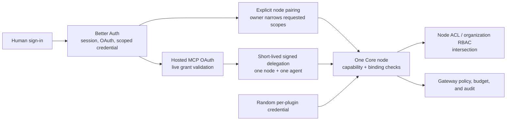

Each Ryu credential is valid at one boundary. An account session is not a node credential, a node
bearer is not a hardware token, and an MCP (Model Context Protocol) grant is not an
organization-wide permission.

For each flow, the guides below answer four questions: who proves their identity, what credential is
issued, which resource enforces it, and how it is revoked.

## Credential map

| Credential or policy | Used by | Authorizes | Enforced by |
|---|---|---|---|
| **Account session** | Website, desktop, mobile, CLI, extension | A signed-in Ryu account and its memberships | Better Auth and the Ryu control plane |
| **Anonymous guest session** | Browser app | Temporarily disabled while the waitlist is active | Better Auth guest policy |
| **Device-grant bearer** | Desktop, mobile, CLI, extension fallback | A client session without a browser cookie | Better Auth's device authorization endpoint |
| **App handoff token** | Explicit website-to-extension handoff | One exchange for a client session bearer | Better Auth One-Time Token plugin |
| **Node bearer** | Core clients, remote desktop, local MCP bridge | One particular Core node | Core's node-auth and pairing layer |
| **Managed user JWT** | Desktop on an organization-bound managed node | The user's role plus organization, team, or personal-node scope | Core's JWKS verifier and route capabilities |
| **Hardware device token** | Paired Ryu hardware | One hardware device's relay connection | Core's hardware registry and relay |
| **Organization and team policy** | Cloud services and organization-bound nodes | Membership, roles, scopes, entitlements, budgets | Ryu control plane, Core ACLs, and Gateway |
| **Personal access token (classic or fine-grained)** | Scripts, integrations, and service clients | The Ryu capabilities minted onto that token | Better Auth API-key storage plus Ryu resource policy |
| **OAuth app or Ryu App grant** | User-owned OAuth clients or marketplace apps | The consented OAuth scopes or approved app grants | Better Auth OAuth plus Core app permissions |
| **Official MCP grant** | Remote MCP clients | Consented scopes for the official Ryu resource | Better Auth OAuth, hosted MCP, and Core delegation |
| **Plugin provider grant** | A plugin's remote MCP connection | One declared provider resource | Core OAuth broker and Passport |

These credentials are not interchangeable. Signing in to Ryu does not pair a
local node, and pairing a node does not grant access to every organization or every other node. The
MCP endpoint choice and its credential are documented in [Ryu MCP](/docs/extend/mcp).

These pairs are most often confused:

- **One-Time Token and hardware QR:** an OTT bridges an already-authenticated account session to an
  app; a hardware QR bootstraps a device-specific token.
- **Account session and node bearer:** the account belongs to the control plane; the node bearer
  admits a client to one Core instance.
- **Official MCP OAuth, direct Core MCP, and the stdio bridge:** hosted OAuth is
  exchanged for an exact-node delegation; direct managed Desktop requests use a
  short-lived `userJwt`; local/self-hosted direct MCP and the stdio bridge use a
  node bearer or pairing.
- **Plugin provider token and Ryu account session:** the provider token is sealed and sent only to
  its declared provider resource.
- **Organization membership and resource permission:** membership supplies context, while roles,
  scopes, entitlements, ACLs, and Gateway policy decide the requested action.

## The authorization chain

Ryu uses one human identity system and several separate workload credentials:

Better Auth is the authority for people, memberships, consented OAuth grants, and scoped credentials. It is
not a universal bearer for Core. A normal account session or OAuth access token cannot directly
control an unbound local or self-hosted node. A direct client must use the node's bearer or pair the
client. For an organization-bound managed node, Core also accepts the short-lived user JWT minted
from the current Better Auth session. A hosted MCP request instead exchanges its live OAuth grant
for a short-lived delegation bound to the exact destination.

Core then applies two independent filters: the credential's capability grant and the destination's
ACL or organization role. Effective access is their intersection. A broad organization role does
not widen a narrow client token, and a broad token does not bypass a node ACL.

### Browser WebSockets

Browser clients do not put node or user credentials in a WebSocket URL. They first exchange their
normal HTTP credentials for a short-lived, single-use ticket bound to the exact room or extension
path, then use only that opaque ticket during the upgrade. Core rejects replayed, expired, rotated,
or mismatched tickets and closes an established user session when its validated JWT expires.

### Paired capability bearers

Pairing requests declare scopes, optional identity/resource bindings, and an optional expiry. The
owner sees those values before approval and may remove scopes or shorten the expiry, but cannot
widen the request. New grants are restrictive by default; the node-owner bearer remains a separate
recovery and administration credential.

Core maps protected routes to a positive capability policy. Known read and mutation families use
different capabilities, MCP requests are also checked by JSON-RPC method, and unknown protected
routes fall back to owner-only. Revocation is per paired client, so removing one integration does
not require rotating the node-owner credential.

## Guides

<Cards>
  <DocCard href="/docs/security/authentication-account" />
  <DocCard href="/docs/security/authentication-account-mfa" />
  <DocCard href="/docs/security/authentication-account-changes" />
  <DocCard href="/docs/security/authentication-account-restrictions" />
  <DocCard href="/docs/security/authentication-devices" />
  <DocCard href="/docs/security/authentication-mcp" />
  <DocCard href="/docs/security/authentication-organizations" />
  <DocCard href="/docs/security/authentication-tokens" />
</Cards>
