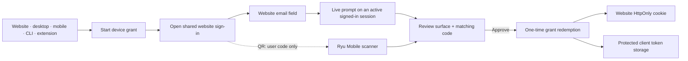
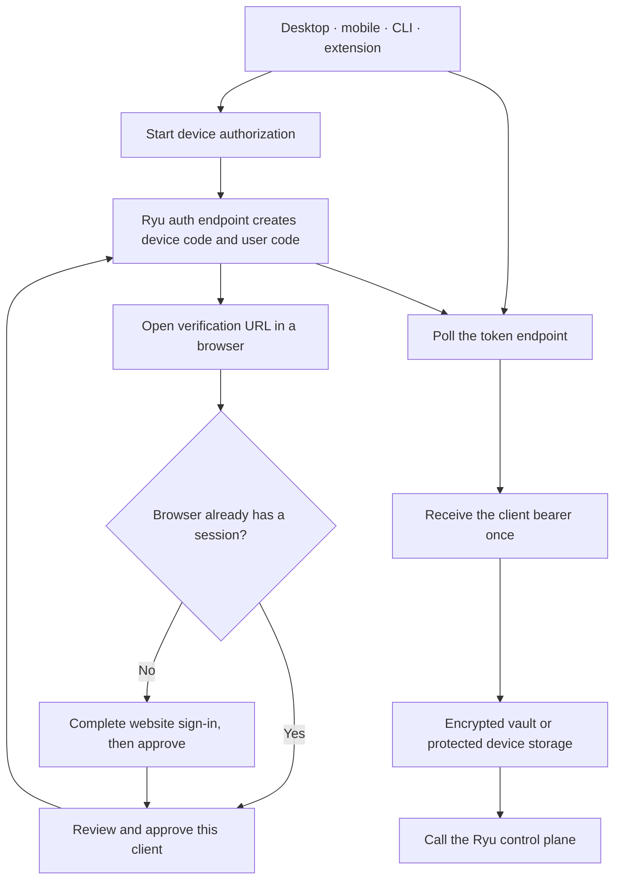
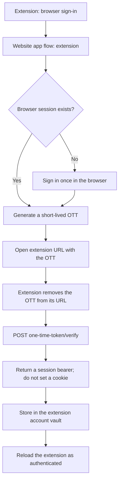
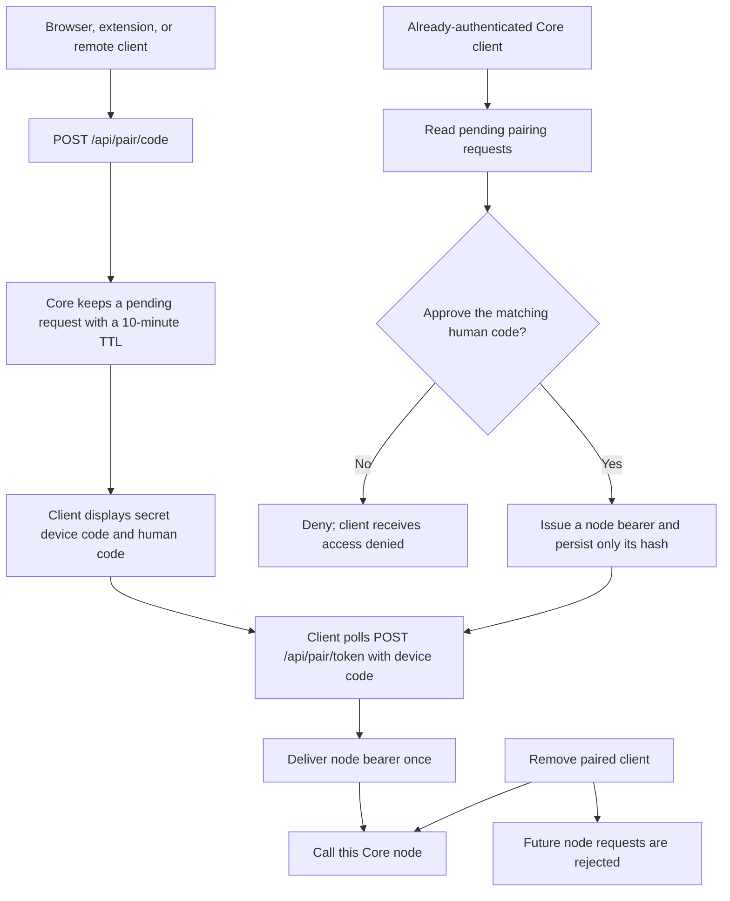
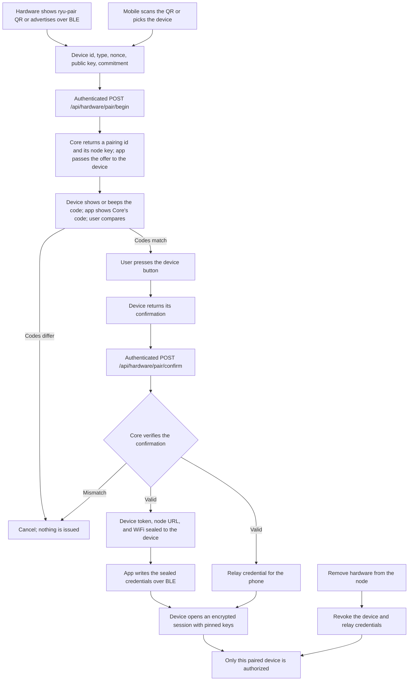

Part of the [Authentication and pairing](/docs/security/authentication-and-pairing) guide.

## Website-centered approval for every client surface

The website is the shared human sign-in surface for desktop, mobile, the browser extension, and
CLI. Those clients do not duplicate the email field in their shells. They start a Better Auth device
grant, open the website with the client context, and show a short matching code while they wait.

If the account already has an active Ryu session, the website, desktop shell, extension, or foreground
mobile session receives an account-level approval prompt. The user reviews the requesting surface,
device label, and matching code before approving. The requester then receives a one-time session
grant. The website redeems its grant into the normal HttpOnly cookie; non-browser clients store their
bearer in protected local storage.

Closing a prompt leaves that request pending in the current session without approving or denying it;
it stays hidden there through stream reconnects, while newly arriving requests still open. Choose
**Not now** to deny the request.

On a website sign-in, the waiting dialog also shows a QR generated from Better Auth's
`verification_uri_complete`. In Ryu Mobile, an already-signed-in account can open **Settings → Scan
sign-in QR**, scan that code, review the requesting surface, device label, and matching code, and tap
**Approve sign-in**. Scanning only loads the pending request; it never approves it by itself. The
short-lived QR contains the user code, not the raw device grant, and the mobile app only reveals a
matching pending request for the account currently signed in on that phone. The matching code remains
available as a fallback for cameras or environments where QR scanning is unavailable.

The prompt is account-scoped, not node-scoped: a new client may not have a Core
node yet, and any already-signed-in session for the account can approve it. If no active session is
available, use the normal website sign-in methods or return to the code page later. Every request is
short-lived, one-time, and bound to its client id and account; an approval cannot pair a Core node or
authorize a different account.

On the website, confirm the displayed device code and requesting app before selecting **Approve
device**. The approval page warns that the client receives full account access. If the server declines
approval or the connection fails, the page displays an error and enables the approval button for
retrying the same code. It shows activation and follows a permitted return link only after the server
confirms success. A different signed-in account cannot approve the request.

If several browser accounts are signed in, you can switch accounts on the device page before
approval. **Add account** opens the sign-in flow and returns to the same pending device code, so you
can continue without restarting device authorization.

## Device authorization for desktop, mobile, CLI, and extension fallback

Device authorization is the shared sign-in path for clients that cannot use the website's cookie.
The desktop, MCP bridge, and extension can call the Ryu auth service directly. Mobile can start the
same flow through its connected Core node. In every case, the browser is where the human signs in
and reviews the client. The website approval page shows the user code, names the requesting client
when known, and explains the access being granted before the user chooses **Approve device**.

An unfamiliar client is shown by its identifier; if client details are unavailable, the page keeps
the generic device label. The client then polls for its own bearer and stores it locally. This
bearer identifies the user to Better Auth. It does not replace the node bearer used by direct Core
MCP. Desktop may then exchange that signed-in session for the short-lived managed `userJwt` returned
by the control-plane node list; that derived credential is a separate, scope-checked managed-node
path.

For identity-token exchanges (`GET /api/auth/token`), Desktop checks the currently selected account
session. When a check observes an account switch or signout, pending results from the old session
supply no identity token and cannot replace the current session's cached token. Requests for the
same current session share an exchange. If it fails, the next request can retry.

The device bearer identifies the client session. It is not the Core node bearer. Signing out or
revoking the session stops future control-plane calls, while removing a paired node client is the
separate action that stops access to that node.

## Browser extension auto-authentication

The extension's primary sign-in button opens the website with an explicit extension app flow. If
the browser already has a valid session, the website skips another login and asks Better Auth for a
short-lived One-Time Token (OTT). If it does not, the user signs in once in the browser and the same
handoff continues.

The OTT is single-use, expires after a short window, and is stored hashed by the server. The raw
session bearer is not placed in the extension URL. If browser handoff is unavailable, **Use an
approval code instead** runs the device-authorization flow.

The OTT is implemented by Better Auth's [One-Time Token plugin](https://better-auth.com/docs/plugins/one-time-token).

## Mobile sign-in has no website token handoff

Mobile signs in with [device authorization](#device-authorization-for-desktop-mobile-cli-and-extension-fallback):
the user approves the phone and its matching code on the website. The website does not mint a
one-time token for the mobile app or open a `ryu://` link with one. Any installed app can register a
custom URL scheme, so a token sent that way could reach an app other than Ryu. A website sign-in
link that names the mobile app is treated as an ordinary website sign-in.

Any web page or message can still open a `ryu://auth/callback` link, so the app never switches
accounts from such a link on its own, even to an account that is already on the device. It shows
the email address of the account the link signs in to, and adds that account and makes it active
only after you choose **Sign in**. Choose **Cancel** if you did not start the sign-in yourself;
cancelling revokes the session the link redeemed.

Mobile hardware setup is separate from account sign-in. It uses the press-to-confirm device pairing
and per-device credentials below.

## Core node pairing

Core owns node pairing, not Better Auth. Pairing works locally and does not need an account or a
network round trip. A client that cannot read the node's own token requests a
short-lived pairing code (`POST /api/pair/code`, valid for 10 minutes). An already-authenticated
client approves or denies the human-visible code (`POST /api/pair/approve` or `POST /api/pair/deny`),
and `DELETE /api/pair/clients/:id` revokes a paired client.

Approval is itself authenticated. Pairing lets a trusted client vouch for another client; it does
not turn an unauthenticated request into an organization grant. Revoking the paired client removes
the node credential without changing the user's cloud account session.

In the web app, a node credential belongs to the signed-in account that paired it. Switching
accounts loads only the new account's paired nodes; switching back restores the original account's
nodes. Signing one account out removes that account's node credentials from the browser, and
signing out of every account removes all of them. This also applies to other open web app tabs:
when one tab switches accounts or signs out, every other tab stops using the previous account's
node credentials immediately, without a reload. If you switch accounts while a pairing code is
waiting for approval, the approved credential is discarded and you pair again from the account
you want to use. Nodes saved by earlier web app versions keep their name and address but need to be
paired again, because the browser cannot tell which account they belonged to.

## Hardware QR and BLE pairing

Hardware pairing uses device-specific keys, not an account OTT. The mobile app must already have
node access to register the hardware. The device and the node each contribute fresh randomness, the
user compares a 6-digit code (shown on the watch or desk, beeped by the necklace) and presses the
device button, and Core issues nothing until the device's confirmation verifies. Core then seals the
device token, node URL, and optional WiFi credentials so that only the device can open them, and
gives the phone a separate relay credential that can only open that device's encrypted relay
connection. The device pins the node's key and connects over an end-to-end encrypted session.

Devices paired with older firmware keep using the earlier nonce-and-token flow until they are
re-paired, and are marked as legacy in the app. That legacy flow has no code compare or button
press, so it does not prove the caller controls the device; keep the node on a LAN or tailnet while
legacy pairing is in use.

An account session, device-grant bearer, or app OTT must never be substituted for the hardware
device token. The device token can be revoked without signing the user out everywhere.
