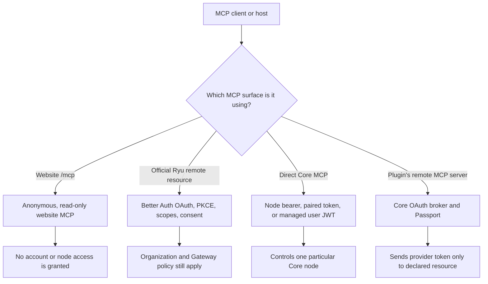
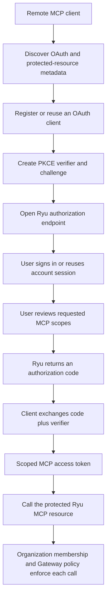
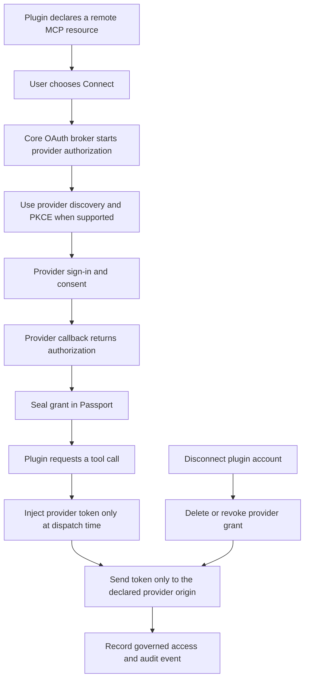

Part of the [Authentication and pairing](/docs/security/authentication-and-pairing) guide.

## Choose an MCP authentication boundary

Ryu has several MCP-shaped surfaces. They do not all need the same credential.

| Surface | Credential |
|---|---|
| Website `/mcp` | None. It is anonymous and read-only, is not the official Ryu control plane, and grants no account or node access |
| Official Ryu MCP resource | A scoped OAuth access token ([below](#official-ryu-mcp-oauth)) |
| Direct Core MCP, local or self-hosted | That node's bearer or a paired token |
| Direct Core MCP, managed node selected by Desktop | The short-lived managed `userJwt`, after Core checks organization, team, or personal ownership |
| A plugin's remote MCP server | A provider grant held by the Core OAuth broker ([below](#plugin-remote-mcp-oauth)) |

## Official Ryu MCP OAuth

Use the official server-side MCP authorization service for a remote MCP client that needs consented
access to protected Ryu resources. The client discovers the authorization metadata, uses PKCE,
obtains user consent, and receives a scoped access token.

External MCP hosts should use this OAuth path. The hosted service exchanges the grant for a
short-lived exact-node delegation and does not forward the original OAuth token to Core. See
[MCP security](/docs/extend/mcp/security) and the
[Better Auth MCP plugin documentation](https://better-auth.com/docs/plugins/mcp).

### Mail scopes

An OAuth client can request `mail:read`, `mail:send`, and `mail:manage` for the hosted Mail tools
that Ryu's MCP endpoint serves when the request names no node (see
[hosted Mail tools](/docs/standalone/sdk/mcp-hosted-mail)).

- On the consent screen they appear under **Mail**, and you can lower or remove them before
  authorizing.
- A grant holds only the scopes the client requested, so a client that sends and reads mail should
  request both.
- Your consent does not by itself open an organization's mail. Each organization must also allow the
  app by its client id (an owner or admin adds it on the organization's Security page). None is
  allowed by default.
- A hosted MCP token never reaches Mail's HTTP API or Managed Agents directly.

`mail:manage` lets the client create Mail inboxes, and nothing else it covers for an API key. Ryu
never grants it by default:

- Ryu's OAuth metadata does not list it, and an authorization request with no `scope` leaves it out.
- A client asks for it by name after `mail_create_inbox` answers with an `insufficient_scope`
  challenge that names `mail:manage`.
- The consent screen describes it as "Create Mail inboxes in your organization (each counts toward
  its inbox allowance)" and leaves it off until you choose it.

OAuth clients cannot request any `messaging:*` or `prompts:*` scope. For those, create a Ryu API key
with the scope in the console.

### The consent screen

- Each level is labelled by what it grants, with a plain description under **Mail**. A client that
  requests only `mail:send` is shown **Send**.
- An app Ryu has not reviewed is marked **Unverified app**.
- When the app returns you to a web address, the screen names that address. An app that returns you
  to a program on your device shows none.
- Review the application and requested scopes, then choose Authorize or Deny. Ryu returns you to the
  application's callback with the result.

The server checks the signed request and your account session before it completes authorization.
If the request is incomplete, return to the application and start authorization again.

If you are signed out when the application opens Ryu's authorization page, Ryu asks you to sign in
first. After your password and any emailed or authenticator code, Ryu continues to the consent screen
for the same request instead of opening your dashboard.

### Reauthorization and token lifetime

When an MCP client you already approved authorizes again for the same permissions (for example, to
reconnect), Ryu issues a new access token without showing the consent screen. A request for new
permissions shows the consent screen again.

At Ryu's hosted MCP endpoint, earlier access tokens keep working until one of these happens:

- they expire;
- you revoke the application, which also ends its refresh tokens;
- the Ryu session you approved them from ends (you sign out of it, it expires, or it is revoked).

They are refused while the application is disabled. Signing out of a different Ryu session does not
end them. If a client asks for sender-constrained (DPoP) tokens, Ryu accepts such a token only with
a valid DPoP proof from that client's key.

## Plugin remote MCP OAuth

When a plugin connects to another company's remote MCP server, the provider credential belongs to
that provider connection. It is not the Ryu account session and not the node bearer.

The model never receives the provider token. Removing the plugin connection revokes this provider
grant; it does not sign the user out of Ryu or revoke unrelated node clients.
