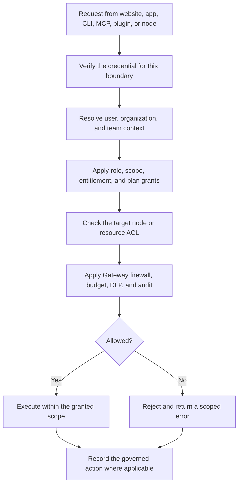
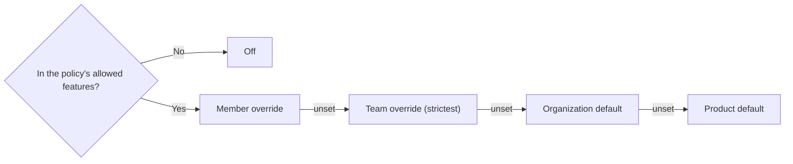

Part of the [Authentication and pairing](/docs/security/authentication-and-pairing) guide.

Authentication answers **who is calling**. Authorization answers **what that caller may do here**.
Every protected request continues through the relevant resource and policy layers after a token is
validated.

An organization membership does not automatically authorize every node. A team role or MCP scope
must still be usable on the requested resource, and Core/Gateway checks remain in force for local
execution.

## Organization invitation links

Open the invitation email to review the organization and offered role, then choose one action:

- **Accept invitation** joins the organization and opens its members page.
- **Decline** dismisses the invitation.
- **Retry** reloads an invitation that could not be loaded.

Failed accept or decline requests keep the invitation open so you can retry. If joining succeeds but
opening the organization fails, choose **Accept invitation** again. Ryu retries opening that
organization without submitting acceptance again.

## Audit records for organization changes

Organization mutation audit records describe completed actions. A rejected organization, member,
or team mutation does not create a success record in the target organization's audit history.

Audit history displays unfamiliar event names as recorded and formats unfamiliar action names
for readability.

## Invitation resends and email throttling

Only a successful, authorized invitation resend refreshes its pending seat claim. The claim follows
the invitation's actual expiry; failed or unauthenticated resends cannot extend another organization's
reserved capacity.

Invitation and organization-notification emails are throttled per recipient across organizations.
Their delivery allowance is separate from sign-in and password-recovery emails, so another
organization's notifications cannot use up your authentication-email allowance.

In-app history remains available when a notification email is throttled.

## Team-scoped sharing and Gateway policy

Sharing a conversation with a team requires membership in that team or organization administrator
access. Sharing settings cannot grant team credentials.

When a tool runs, team-scoped credentials are checked separately against the conversation owner's
current team membership. If that membership cannot be verified, team credentials are unavailable.
User and node credentials keep their normal resolution behavior.

### Gateway policy edits

Team and project Gateway policy edits require a live `gateway.configure` grant for that scope:

- A project inherits its owning team's scope.
- Organization-wide Gateway managers can manage all policy scopes.
- The same checks apply to direct edits and configuration reconciliation, including deletions by
  omission.

### Organization access policy

Organizations can add an access policy on top of these checks:

- an IP allowlist for console requests and organization keys;
- required two-factor authentication for members;
- a session max age.

See [Organization admin controls](/docs/security/organization-admin-controls), which also covers
Admin API keys, service accounts, data retention, and audit streaming.

Node initialization uses the node's protected API boundary. An exposed node requires its configured
bearer before a caller can create the node identity.

## Organization-owned feature controls

Organization owners and delegated feature managers can open **Organization → Features** to control
which Ryu surfaces are available inside that organization. The controls cover:

- Marketplace apps and plugins;
- engine browsing and updates;
- access to Bot and Agent;
- Ryu Box;
- Agent Inboxes;
- organization notifications.

### How the effective value resolves

Each feature has an organization default. A manager can also create a team override, which applies
to everyone in that team, or a member-specific override for one user.

- The first value set wins, in the order **member override → team override → organization default
  → product default**.
- When a member belongs to several teams with overrides, the strictest one wins.
- A feature that the organization policy's allowed features list excludes stays off whatever its
  toggles say.

The website applies the same effective value when it shows or hides a surface. A team override or
policy that turns a feature off for a member also hides it from that member's Marketplace view.
Members can view their effective access but cannot change it.

### API enforced and UI preference controls

The Features page labels each control as **API enforced** or **UI preference**:

- **API enforced** controls are checked again by their owning service.
- **UI preference** controls only change website presentation. They do not replace Core, node, or
  organization authorization at a mutation boundary.

If the control-plane read fails, the website hides organization-scoped surfaces until it can
establish the effective value.

### Organization controls and platform rollouts

These controls are separate from Ryu's platform rollout flags. A platform rollout controls whether
Ryu exposes a capability globally. An organization control decides whether an organization lets its
own members use an available capability.

An organization setting cannot enable a capability that Ryu has not globally released. It cannot
change plan availability or billing entitlement.

### App-owned flags

Organizations can manage app-owned flags for their published Marketplace apps from
**Organization → Features → Manage app flags**. Those keys and values are scoped to one published
app.

An app can request its current values from the public feature flag endpoint. The response does not
replace Ryu plan entitlements, the organization's app access controls, or the app's own
authorization checks.

A flag may include a public early access form. Granting an application enables that flag for the
matching verified Ryu account while its schedule is active and the kill switch is off.

See [Feature flags and early access forms](/docs/extend/develop/extensions/feature-flags) for the
form fields, public endpoints, and application review flow.

## Signup password strength

Signup, password changes, and password recovery share one password policy. The rules are listed in
[Account security changes](/docs/security/authentication-account-changes#set-a-password-or-change-your-email-address).

## Authentication request controls

Better Auth applies database-backed request rate limits to the auth service. Ryu keeps a 60-second
global window (100 requests) and adds stricter rules for protocol endpoints that can mint credentials or poll for
approval:

| Endpoint family | Limit |
|---|---:|
| OAuth token exchange | 30 requests per minute |
| OAuth client registration | 10 requests per minute |
| Device code, token, approve, or deny | 10 requests per minute per bucket |
| SCIM provisioning | 120 requests per minute |

Credential sign-in, sign-up, password-change, email, and verification routes also retain Better
Auth's built-in sensitive-route limits.

### Trusted proxies

A self-hosted deployment behind a reverse proxy should list only the proxy addresses it controls in
the auth server's trusted-proxies setting. Never trust arbitrary forwarded headers from the public
internet.

Rate limits for anonymous public agent visitors use the same setting. The server believes the
edge's client address header only from a loopback peer or a listed proxy. It keys every other
caller, private network addresses included, on its own address.

<Callout type="warn">
A tunnel or proxy on a private address must be listed, or every visitor shares that proxy's limit.
</Callout>

## Teams page

On **Organization → Teams**, switching organization or account clears the previous roster and
management controls while the selected organization's data loads.

Creating, renaming, deleting, and assigning team members require an owner or admin role in that
organization. An operation already submitted to the previous organization may finish there. Its
result does not replace the selected organization's teams or permissions.
