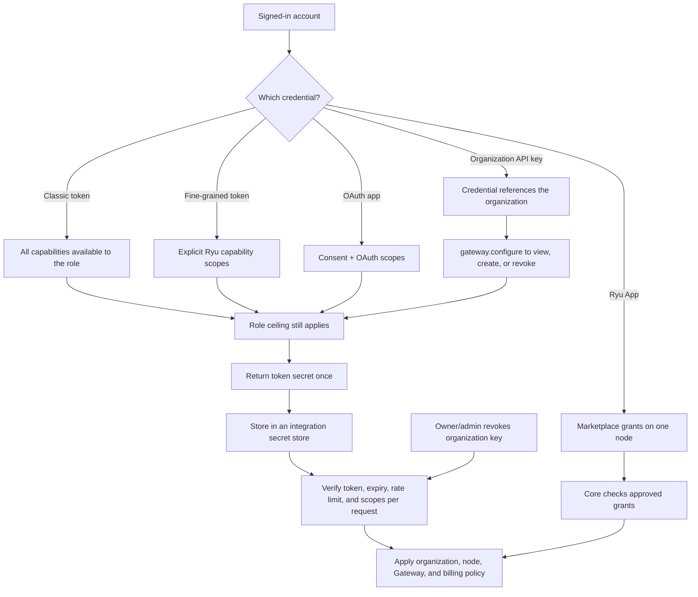
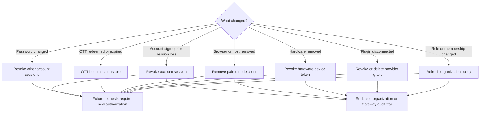

Part of the [Authentication and pairing](/docs/security/authentication-and-pairing) guide.

## Personal access tokens, OAuth apps, and Ryu Apps

Ryu splits account credentials into four kinds, in a way similar to GitHub:

- **Classic tokens** have the full Ryu capability set available to the account's role. They are
  meant for trusted scripts and local tooling. They never become a browser session and do not
  bypass organization roles or billing checks.
- **Fine-grained tokens** let you set an access level for each resource (Chat, Agents,
  Workflows, Tools, Memory, Gateway, and Files):
  - Levels run from **No access** up to that resource's highest level (for example **Read**,
    **Read & write**, or **Admin**). Higher levels include the lower ones, so write access also
    grants read.
  - **All access** and **Read-only** fill every row at once.
  - The picker lists only resources your account's role can grant (for example, **Vault** appears
    only for platform administrators). Ryu clamps every selection to the creator's server-side role
    ceiling.
- **OAuth apps** are user-owned OAuth 2.1 clients. Their owner chooses the web or native client
  type, redirect URIs, and the scopes the client may request.
  - Ryu uses Better Auth's PKCE-first authorization-code flow.
  - A confidential client secret is shown only when the app is created or its secret is rotated.
  - Revoking consent immediately invalidates that app's access and refresh tokens.
- **Ryu Apps** are marketplace apps installed on a particular Core node. Their permission grants
  and external OAuth connections belong to that node, so the desktop app shows them under
  **Settings → Ryu apps**. Installing a Ryu App and authorizing an OAuth app are separate actions.

Account settings keeps **Connections**, **Sessions & devices**, **Ryu apps**, and **OAuth apps**
separate. The OAuth apps view also contains the developer view for apps you registered and the
authorized OAuth grants you can revoke.

### Authorize an OAuth app

When an OAuth app requests access, review its name and requested scopes before choosing **Authorize**
or **Deny**.

- Each requested Ryu capability appears with its own access level. You can lower any of them, down
  to **No access**, before authorizing.
- The app receives only what you leave on, and never more than it asked for.
- Identity scopes such as your email are shown but not adjustable.

If you set every requested capability to **No access** and the app asked for no identity scopes,
**Authorize** is unavailable until you turn at least one permission back on. **Deny** always works
and returns the app a denial. Both choices stay unavailable if the consent request has no
authorization code.

If the request fails or Ryu cannot validate the application's callback, the page reports the problem
and allows you to retry. A failed response does not send you to the app.

### Organization API keys

Organization API keys remain organization-owned credentials. They continue working when the person
who created them leaves.

- Viewing their metadata, creating them, and revoking them all require the Gateway configuration
  permission (`gateway.configure`). Owners and admins hold it by default, and a custom role can
  grant it.
- Updating, disabling, or revoking an organization API key requires a recent identity confirmation
  in the current session. This protection also applies to direct authentication API requests.

### Identity confirmation for personal tokens

Creating a personal access token asks for a recent identity confirmation, so a stolen session cannot
quietly mint a long-lived token. Revoking your personal keys does not require it.

Tokens are created only from account settings or the Ryu control-plane API. The authentication API
does not accept direct key-creation requests.

## Store and reveal token values

Ryu returns a personal or organization token's plaintext only at creation time. Store it in the
integration's secret store. Do not paste it into chat, an issue, a browser URL, or a client-visible
log. List and audit views show only safe metadata such as the name, prefix, scopes, creation time,
expiry, and last use.

API key and personal access token values are hidden behind bullets by default, including the
one-time creation view:

- Use the eye button to reveal one value, or **Reveal all** to show the values in the current panel.
- **Hide all** masks them again.
- Copy still copies the original credential while it is hidden.
- Reveals are temporary. Leaving the page, reloading, or switching away from the panel's browser tab
  hides the values again.

Ryu's organization roles can manage the Better Auth key record, but they do not grant Ryu
capability scopes. The control plane remains the authority for `resource:action` permissions, and a
requested key scope can only narrow the caller's server-side ceiling.

Rotate a key when an integration changes owners, and revoke it immediately if it may have been
exposed.

## Hosted support sessions

Cloud support access is a separate, user-granted control-plane session. It is off by default.

- Choose one or more of these scopes: `billing`, `subscription`, `organization`, `sync-status`,
  `channels`, and `marketplace`.
- Omitting the scope list uses every scope in the active grant. An empty or unknown list is
  rejected.
- Access ends when the grant expires, is revoked, or is replaced.
- The support actor must be on Ryu's support allowlist and complete the staff identity step-up
  before the handoff.

### What a support session can do

Support sessions use Better Auth's native session engine and retain the actor in `impersonatedBy`.
Every session is tied to one live grant and one audit record with a reason. A session can call only
the reviewed read paths for its granted scopes.

A support session cannot:

- mutate organization state or credentials;
- mint API keys or JWTs;
- use OAuth, MCP, or Core delegation;
- read prompts, messages, conversations, documents, channel secrets, or channel system prompts.

Revoking or replacing access takes effect on the next request, even when a browser has a cached
session.

### Ending a support session

- Cookie clients use the native stop endpoint to restore the original staff session.
- A bearer-only stop ends the restricted session and asks the client to select its retained staff
  credential, without minting or reconstructing an actor token.

## Revocation and audit

Revocation is credential-specific. A user should revoke the layer that was lost instead of rotating
every credential in the system.

| Action | Stops | Does not automatically stop |
|---|---|---|
| Sign out or revoke an account session | That account bearer | A separately paired local node client |
| Change the account password | Other active account sessions | The current security-session flow or a separately paired local node client |
| Revoke a classic or fine-grained personal token | That personal integration | Other tokens or the account session |
| Revoke an organization API key | Every integration using that organization key | Other keys, sessions, or paired nodes |
| Revoke OAuth app consent | That app's access and issued tokens | The app registration itself |
| Delete an OAuth app | That app and its issued credentials | Other apps or the account session |
| Disable or uninstall a Ryu App | That app on the selected Core node | Its install on another node |
| Redeem or wait for an OTT to expire | That one app handoff | The browser session that created it |
| Remove a paired client | That client's access to one node | The user's cloud account |
| Remove hardware | That device's relay access | Other devices or the account session |
| Disconnect a plugin account | That provider connection | Other plugins or Ryu sign-in |
| Remove an organization member or role | Future org-scoped actions | Local-only node access unless separately revoked |
| Ryu suspends (bans) an account | That account's sessions, personal tokens, and OAuth app access, for as long as the suspension lasts | Organization API keys or a separately paired local node client |

Ryu's organization audit view and Gateway audit trail are the product audit surfaces. They record
bounded, redacted control activity with the actor, agent, target, outcome, and request/session
correlation when available. An audit row records what happened; it is not a risk verdict.

For retention and streaming of organization audit events, see
[Organization admin controls](/docs/security/organization-admin-controls).

## Credentials that stay separate

Each token on this page stays valid only at its own boundary. The full list of credential
boundaries is in the [credential map](/docs/security/authentication-and-pairing#credential-map).

## Related documentation

<Cards>
  <DocCard href="/docs/surfaces/desktop/user-guide/account-security" />
  <DocCard href="/docs/extend/mcp/security" />
  <DocCard href="/docs/security/permissions" />
  <DocCard href="/docs/security/trust-model" />
</Cards>
