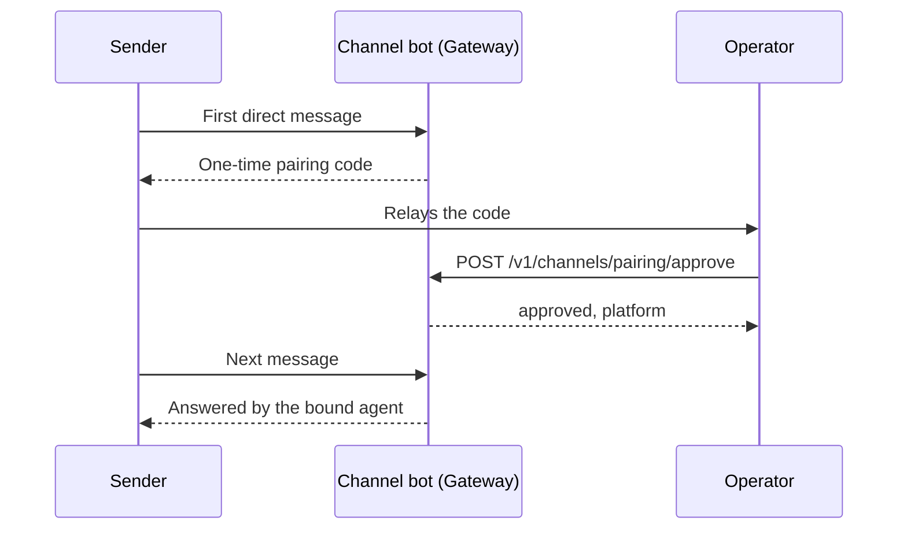
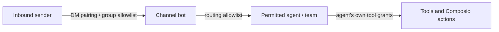

A channel (a chat surface, a bot connection, an inbound route) is an untrusted ingress. Anyone who can find the bot can make it spend your model budget.

Two independent layers gate it:

- **Access** decides whose messages are answered.
- **Routing allowlists** decide which agent a channel can address and, through that agent, which tools it can invoke.

Widening one does not widen the other.

## Access: who may talk to the bot

Every channel carries a DM policy and a group policy (`DmPolicy` and `GroupPolicy` in `crates/gateway/channels/src/pairing.rs`). They are separate because consent differs. A direct message is one person choosing to talk to your bot. In a group, one member typing at the bot is not consent from everyone in the room.

### Direct messages

| Policy | Behaviour |
|---|---|
| `pairing` (default) | An unrecognised sender is answered with a one-time **pairing code** and nothing else. Their message is not routed to any agent. Once an operator approves the code (see [Approving a pairing code](#approving-a-pairing-code)), that sender is paired and talks to the bot normally. |
| `allowlist` | Only pre-listed sender ids are admitted. Everyone else is dropped silently, with no enrolment path. |
| `open` | Every direct message is answered. Use it only when you accept paying for completions for anyone who finds the bot. |
| `disabled` | Direct messages are refused entirely; the bot works only in allowlisted groups. |

### Approving a pairing code

Pairing enrols senders without editing config. The sender gets a code, an operator approves it, and the allowlist updates itself. Nobody is admitted until a human acts.



Pairing codes are never written to the Gateway log, so the owner relays the code the sender received. Approve it with an authenticated admin request to the Gateway (the master key, or a loopback caller when the Gateway runs without auth):

```bash
curl -X POST "$GATEWAY_URL/v1/channels/pairing/approve" \
  -H "Authorization: Bearer $MASTER_KEY" \
  -H "Content-Type: application/json" \
  -d '{"code": "ABC234"}'
```

The response is `{"approved": true, "platform": "telegram"}`. It names the channel and never the sender id or phone number.

- The code is not case-sensitive and works once.
- An unknown, expired, or already-used code returns `404`.
- The sender's next message is answered normally.

### Groups

| Policy | Behaviour |
|---|---|
| `allowlist` (default) | Only listed group/chat ids are served. |
| `open` | Any group the bot has been added to is served. |
| `disabled` | The bot never answers in groups. |

Groups have **no pairing flow**. A pairing code proves one participant wants the bot; it says nothing about the rest of the room.

<Callout type="warn">
  Access decides *who is answered*. It does not replace the routing allowlist below: a paired sender still reaches only the agent the channel is bound to, and only the tools that agent was granted.
</Callout>

## Legacy environment variables

The older environment variables still set the policies:

| Environment | DM policy | Group policy |
|---|---|---|
| `RYU_CHANNEL_ALLOWED_USERS[_<PLATFORM>]` set | `allowlist` | `allowlist` (same list) |
| Unset, `RYU_CHANNEL_ALLOW_ALL=1` | `open` | `open` |
| Both unset | `pairing` | `allowlist` (empty, so closed) |

The per-platform key overrides the global one.

## Where pairing state lives

Paired senders are kept in a per-node file, not in the control-plane database. The same bot token running on another node is a different deployment with its own approvals. The Gateway also has to gate inbound traffic **while the control plane is unreachable**, so the gate cannot depend on it.

Pairing code limits:

- A code expires after 24 hours (`CODE_TTL`).
- Messaging the bot again before then returns the *same* code instead of a second one.
- A blocked sender never receives another code.
- Expired codes are discarded.
- While 1,024 codes are awaiting approval, messages from new unknown senders are ignored without a reply until some codes are approved or expire.

## Routing allowlists: what the channel can reach

Routing allowlists are account-global: they apply across nodes, not to one node. See [Channels in the Gateway dialog](/docs/gateway/channels) for where to configure them.

A channel routes to a specific agent or team, and the allowlist on that route bounds what a sender into the channel can reach.



The channel can address only an agent its route permits, and the agent can reach only the tools it was granted.

## Composio actions

An agent's Composio actions come from its own per-agent allowlist (`composio_actions`). A channel can trigger them only through an agent its route permits. The Gateway enforces this allowlist on requests it routes. ACP agents do not route through the Gateway, so it does not apply to them.

## Related

<Cards>
  <DocCard href="/docs/security/network-binding-auth" />
  <DocCard href="/docs/security/command-approval" />
  <DocCard href="/docs/gateway/channels" />
</Cards>
