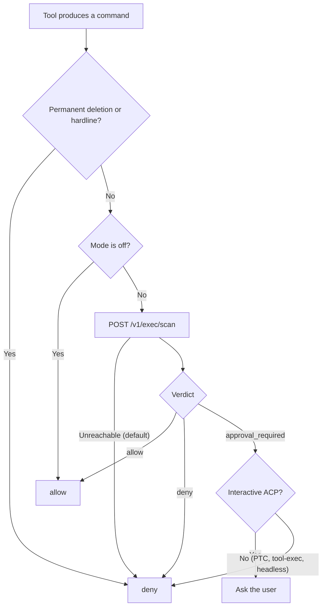

Before Core runs a shell command that a tool produced, it sends the command to the Gateway's exec-governance scanner. The scanner classifies the command and returns a verdict: allow, deny, or approval required. This human-in-the-loop (HITL) gate sits between untrusted model output and your shell.

<Figure name="approvals" />



## Modes

The mode comes from `RYU_EXEC_APPROVAL_MODE`. **The gate is armed whenever that value is anything
other than `off`, including when it is unset.** Only an explicit `off` disarms it, and an unknown
value scans as `manual`. This keeps a headless (non-interactive) run from auto-approving unscanned
commands.

Desktop saves the mode as the `exec-approval-mode` preference, and Core applies a change to the live
scanner immediately. An exported `RYU_EXEC_APPROVAL_MODE` wins over the stored preference, so an
operator can force the gate on whatever Desktop has saved.

In **Gateway → Guardrails**, the command scanner switch requires `gateway.configure`.
If saving fails, the switch returns to its saved value so you can retry. A failed
initial read leaves it disabled; reopen settings to try loading it again.

| Mode | Wire value | Behavior |
|---|---|---|
| Manual | `manual` | Every matched pattern requires human approval |
| Smart | `smart` | A severity ladder over the matched patterns. A critical match denies, a high or medium match requires approval, and low matches are allowed. It is pattern matching, not a model |
| Off | `off` | Pattern approval is disabled. The permanent-deletion and hardline blocks below still deny |

A session or global YOLO bypass, where one exists, can skip pattern approval. The hardline blocklist ignores both the mode and YOLO.

## Permanent deletion and the hardline blocklist

Ryu has a permanent-deletion guard above ordinary approval modes. It returns `deny` before a
command reaches a shell, even when pattern approval is `off`, the Gateway is unreachable, or a
managed rule would otherwise allow the command. The guard covers:

- `rm`, `unlink`, `rmdir`, `shred`, Windows `del`/`erase`/`rd`, and PowerShell removal commands
- `find -delete` and `rsync --delete`
- `git clean`, `git reset --hard`, and bulk `git checkout`/`git restore`
- common Python, Node, Ruby, and Perl deletion APIs
- raw-disk writes and destructive storage tools such as `dd ... of=/dev/...`,
  `mkfs`, `wipefs`, `blkdiscard`, `fdisk`, `parted`, and `diskutil eraseDisk`
- host power controls such as `shutdown`, `reboot`, `halt`, and `poweroff`
- explicit file-deletion patches and filesystem-shaped MCP delete tools
- literal nested deletion commands inside `bash -c`, `bash -lc`, `sh -c`, `zsh -c`, `cmd /c`, and PowerShell wrappers

The local guard (`crates/core/deletion-guard`) also refuses commands above 2 MiB and commands whose
repeated or nested wrapper searches exceed its scan-work budget.

A `scan_work_limit` denial means the command was too expensive to classify safely. Simplify the command or split the work into
smaller commands that are checked one by one. The guard never skips classification to allow an
oversized request.

The catastrophic hardline cases below also always return `deny`, regardless of mode, YOLO, or any
ordinary approval rule. They have no legitimate agent use.

- `rm -rf /` and its variants
- `rm -rf --no-preserve-root`
- the fork bomb `:(){ :|:& };:`
- `mkfs.*` targeting a root or mounted device
- `dd if=/dev/zero of=/dev/sd*` (disk zeroing)
- piping an untrusted URL straight to a shell at the filesystem root

The hardline also blocks mutable package-manager execution from agent commands. That includes bare
`pip install`, `npx`, `npm install`, `uvx`, `cargo install`, `go install`, `gem install`, and
tag-based `docker run` forms. This closes the supply-chain path where an agent reads a public setup
file and runs its package command.

Use an exact package version, a locked/hash-verified dependency set, or an immutable OCI `@sha256:`
digest instead. Pinning is not a claim that a package is safe. Review the publisher and keep the
catalog provenance checks enabled.

Ryu never silently rewrites a blocked command. Use the verified recoverable mechanism instead:

- macOS: `/usr/bin/trash <absolute-path>`; do not add `--`
- Linux: the installed `gio trash` or `trash-put` command
- Windows: the verified PowerShell helper, using .NET's `Microsoft.VisualBasic.FileIO`
  `DeleteFile`/`DeleteDirectory` APIs with `RecycleOption.SendToRecycleBin`

These are host-side recovery actions. A confined agent may be unable to run the Trash helper,
because the OS deletion boundary denies unlink and removal to the agent itself. Ask the user or a
host broker to perform the recoverable move.

If the host has no reliable recoverable mechanism, Ryu refuses to launch its managed Codex route
until one is configured. There is no configuration or approval override for permanent deletion;
the legacy `RYU_ALLOW_PERMANENT_DELETE` variable is ignored.

On Windows, Ryu probes PowerShell and the .NET Recycle Bin API before it starts a managed Codex
route. If that API is unavailable, Ryu fails closed instead of offering a permanent-delete fallback.
See the [Microsoft API reference](https://learn.microsoft.com/en-us/dotnet/api/microsoft.visualbasic.fileio.filesystem.deletefile).

## Pattern categories

Beyond the hardline set, about 56 compiled regex patterns (`build_patterns` in `crates/gateway/firewall/src/cmdscan.rs`) flag commands for approval (in `manual`) or severity classification (in `smart`). The patterns are compiled once per process, not inside the request path.

| Category | Examples |
|---|---|
| Recursive destructive | `rm -r`, `chmod 777 -R`, `chown -R root` |
| System modification | `mkfs`, `dd if=`, writes to `/dev/sd*`, `/etc/`, `~/.ssh/` |
| Service control | `systemctl stop/restart/disable/mask` |
| Process kill | `kill -9 -1`, `pkill -9` |
| Code execution | `bash -c`, `python -c`, `curl \| sh`, `bash <(curl ...)` |
| Sensitive overwrites | `tee` or `>` / `>>` to sensitive paths |
| Dangerous combos | `find -exec rm`, `xargs rm`, `sed -i` on `/etc/` |
| Database (`sql_dangerous`) | SQL `DROP`, `TRUNCATE`, `COPY ... PROGRAM`, `CREATE EXTENSION`, privilege escalation |
| Kubernetes (`k8s_dangerous`) | `kubectl exec`, `kubectl delete`, reading `secrets`, privileged pods, `cluster-admin` bindings |
| Workspace code execution (`untrusted_code_exec`) | `./security.sh`, `bash scripts/check.sh`, `source ./env.sh`, `vendor/bin/tool` |

**Workspace code execution** catches a command that runs a script or program by its path. A
repository's README can ask an agent to "run the security script before testing". The script looks
harmless to a pattern scanner and can start any binary.

Ryu treats that shape as code the repository supplied and asks before it runs, including inside
`bash -lc '…'` wrappers. The finding has `medium` severity. Limits:

- Programs under system install prefixes (`/usr/bin`, `/opt/homebrew/bin`, …) are not flagged.
- The rule applies only to commands that run on your machine, not to sandboxed backends.
- Interpreter and build commands (`python app.py`, `npm test`, `make`) also run repository code but
  are not flagged, because nearly every development turn uses them. For those, rely on
  [workspace trust](/docs/security/workspace-trust).

## The scan endpoint

Core posts the command to the Gateway before execution. The route accepts only the Gateway master key or a trusted-forwarder key.

```http
POST /v1/exec/scan
```

Request:

```json
{
  "backend": "local",
  "command": "rm -rf ./build",
  "session_id": "sess_123",
  "agent": "coder"
}
```

Response:

```json
{
  "decision": "approval_required",
  "reason": "risk patterns require manual approval",
  "findings": [
    { "pattern": "rm_recursive", "category": "recursive_destructive", "severity": "high" }
  ]
}
```

`decision` is one of `allow`, `deny`, or `approval_required`. `reason` is `null` when nothing matched. Each finding carries the matched `pattern` name, its `category`, and a `severity` of `low`, `medium`, `high`, or `critical`. The body rejects unknown fields.

## How Core maps the verdict

| Verdict | Core action |
|---|---|
| `allow` | Proceed and run the command |
| `deny` | Block, and post an exec audit event |
| `approval_required` | Depends on the exec path (see below) |

How `approval_required` resolves depends on where the command originated:

- Core programmatic tool calling (PTC) and tool-exec path: this path is synchronous and has a deadline, and it cannot wait for an approval decision. `approval_required` fails closed here: Core denies, audits, and logs the command.
- Interactive ACP seam: the request reaches the user as a permission prompt, and execution waits for their decision (allow or reject). A headless ACP session has no human to ask, so `approval_required` fails closed to reject.

## Fail-closed

If the scanner is unreachable, Core denies by default. The only override is `RYU_ALLOW_GATEWAY_FALLBACK=1`, which uses the same semantics as the exec-budget fallback. Do not set it in a shared or server deployment.

That fallback does not bypass the permanent-deletion guard. Permanent deletion remains denied
even when the ordinary scanner is disabled, unavailable, or given an allow rule.

The flagship Pi engine asks Core to check every shell command before it runs. If that check
cannot return a verdict (Core is unreachable, times out, or answers with an error), Pi blocks the
command instead of falling back to its own shorter list. Retry once Ryu is reachable again.

## ACP seam

ACP agents (Claude Code, Codex, and Pi) run their own shell, so Ryu gates them at the ACP permission-request seam. When an agent asks to run a tool and `RYU_EXEC_APPROVAL_MODE` is not `off`, Core extracts the command from the request and runs it through the same scanner before it grants the request.

- A `deny` verdict rejects the permission, even in a headless session that would otherwise auto-approve.
- `approval_required` rejects in a headless session and goes to the user in an interactive one.

A headless session approves a request on your behalf only when nothing above rejected it, and then
only within these limits:

- It picks the agent's one-time "allow" option, never an "always allow" option. An unattended run
  does not write a permanent rule into the agent's own settings.
- A shell request Ryu could not read a command from is rejected, because Ryu could not scan it.
- In a folder you have not [trusted](/docs/security/workspace-trust), every shell request is
  rejected. The scanner is accident prevention, and a malicious README can ask for a command that
  matches none of its patterns.

### File-mutating tools

File-mutating tools are gated with shell execution. Native coding agents edit a file through a
dedicated tool shaped `{ file_path, content }` or `{ file_path, new_string }`, with no `command`
field, so a shell-only scan would miss every write.

For `Write`, `Edit`, `MultiEdit`, `NotebookEdit`, and their equivalents, Core builds a
`write <path>` string and scans that. A policy that denies writes under `.ssh`, `.env`, or `/etc`
still applies. Read-only tools that carry a path but no write payload (`Read`, `Grep`) are not
scanned.

Otherwise, command extraction is best-effort, because the scanner prevents accidents and is not
containment. A tool call with no recoverable command or write target is not scanned. ACP agents keep
the credentials in their own configuration, so this gate matters for them. See
[Credential and environment scrubbing](/docs/security/credential-scrubbing) for what their
environment holds.

### Managed Codex

For the Ryu-managed Codex entry, Ryu also materializes an isolated Codex home with:

- a durable global deletion instruction;
- user-level `forbidden` command rules;
- `workspace-write` and `on-request` defaults when those settings are absent;
- a `PreToolUse` hook.

The hook is an extra layer. Codex requires the user to review and trust non-managed hooks, and
Core's local guard still denies permanent deletion if the hook is skipped, disabled, or bypassed.
Ryu never edits the user's normal `~/.codex` configuration.

Managed Codex also starts through Ryu's OS-aware child runner, which denies file removal at the OS
level and fails closed on Windows. It does not prevent truncation or overwrite. See
[Managed agent process containment](/docs/security/sandboxing-isolation#managed-agent-process-containment).

Other Codex processes launched outside Ryu, and ACP agents Ryu does not manage, are not covered by
Ryu's isolated Codex home. Use their own system or user policy layer for those processes. Command
approval also works with each agent's permission mode; see [ACP integration](/docs/extend/integrate/acp-integration).

<Callout type="warn">
Smart mode lets low-severity pattern matches run without asking, and neither mode asks about a command that matches no pattern at all. Prefer `manual` anywhere the blast radius matters.

Do not rely on either mode against a repository written to fool an agent. That is what [workspace trust](/docs/security/workspace-trust) and the agent sandbox are for.

The permanent-deletion and catastrophic hardline blocks deny unconditionally; ordinary risk patterns still depend on the configured mode. In shared or server deployments keep `RYU_EXEC_APPROVAL_MODE=manual` and never set `RYU_ALLOW_GATEWAY_FALLBACK=1`.
</Callout>

## Related

<Cards>
  <DocCard href="/docs/security/workspace-trust" />
  <DocCard href="/docs/security/sandboxing-isolation" />
  <DocCard href="/docs/security/hardening-checklist" />
  <DocCard href="/docs/core" />
</Cards>
