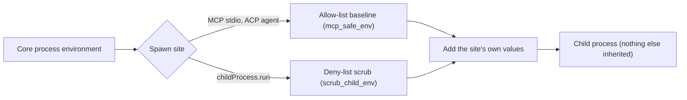

When Core spawns a subprocess, it does not pass your full environment to the child. Core starts from a scrubbed set and adds only the values that call site needs. This covers:

- MCP (Model Context Protocol) stdio servers;
- programs that a sandboxed plugin tool starts with `childProcess.run`;
- ACP agents (Claude Code, Codex, Pi).

ACP agents need their own credentials (OAuth tokens, provider keys) to work, so each agent gets the values in its own configuration on top of the scrubbed baseline. Core's ambient tokens and keys are not passed. Ryu also gates ACP agent commands with [command approval](/docs/security/command-approval) at the permission seam.

## The helpers

Both strategies live in `apps/core/src/sidecar/env_scrub.rs`. Each one is a pure function over `(key, value)` pairs. The MCP and `childProcess.run` spawn sites call `env_clear()` first and then apply the result, so the child inherits nothing else.

| Helper | Strategy | Rule |
|---|---|---|
| `scrub_child_env(base, extra_allow)` | Deny-list | Drops any variable whose key contains `KEY`, `TOKEN`, `SECRET`, `PASSWORD`, `PASSWD`, `CREDENTIAL`, or `AUTH` (case-insensitive), and `DATABASE_URL`. A key listed in `extra_allow` is kept. Everything else passes through |
| `mcp_safe_env` | Allow-list | Passes only the keys in `MCP_SAFE_ALLOWLIST` plus any `XDG_*` key. Everything else is dropped |

The deny-list check is a substring match, not a regex compiled per call.

## Per-site environment

| Spawn site | What the child receives |
|---|---|
| MCP stdio server | `MCP_SAFE_ALLOWLIST` and `XDG_*`, then the server config's own `env` block. The allowlist holds the POSIX essentials (`PATH`, `HOME`, `USER`, `LANG`, `LC_ALL`, `TERM`, `SHELL`, `TMPDIR`), the Windows essentials (`SYSTEMROOT`, `APPDATA`, `LOCALAPPDATA`, `PATHEXT`, `COMSPEC`, `USERPROFILE`, `TEMP`, and others), `DISPLAY`, and non-secret Ryu routing values such as `RYU_DIR`, `RYU_PROFILE`, and `RYU_PORT_OFFSET`. A stdio server declared in a plugin manifest also gets the per-plugin host-callback values Core mints for that plugin, but only when the same manifest's sidecar declares host-API grants |
| Program started by a sandboxed plugin tool (`childProcess.run`) | The normal environment minus secret-like keys (`scrub_child_env`), plus the per-plugin values Core mints for it |
| ACP agent | The same `MCP_SAFE_ALLOWLIST` baseline (every other inherited name is blanked, because the ACP stdio transport has no `env_clear`), then the agent's own configured values. Unscoped bridge credentials are masked (`isolate_acp_child_env` in `apps/core/src/sidecar/adapters/acp/child_env.rs`) |

An MCP server that needs a credential declares it in its own config `env` block. Core passes that block explicitly; the server never inherits the value from your shell.

The host-callback values are minted for one plugin. They give the server the same host access that plugin's own sidecar already has. A host API that needs a grant, such as a model completion under `hook:side-model`, still checks it against what the sidecar declares and what the Gateway approved.

## Defense in depth with Passport

A secret reaches a scrubbed subprocess only when a call site passes that exact key. A misbehaving tool cannot read your `OPENAI_API_KEY` because it was exported in your shell. For stored credentials that the model should never see in a prompt, see [Passport](/docs/standalone/passport).

## Related

<Cards>
  <DocCard href="/docs/security/sandboxing-isolation" />
  <DocCard href="/docs/security/outbound-dlp" />
  <DocCard href="/docs/standalone/passport" />
  <DocCard href="/docs/core/mcp-registry" />
</Cards>
