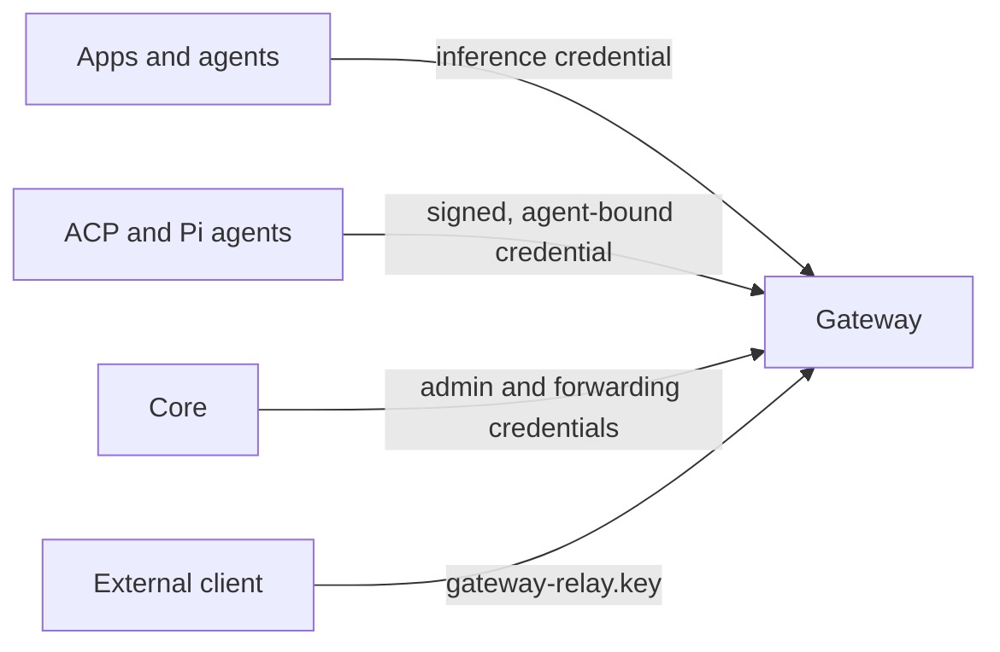

By default Core binds `127.0.0.1:7980` and the Gateway binds `127.0.0.1:7981` (loopback only, release profile). No other machine can reach them until you change the bind address (`RYU_BIND` for Core). Other profiles shift these ports; see [Local data and state](/docs/start-here/release-channels#local-data-and-state).

Core still mints and requires a local node credential. Loopback limits network reach, but it does not replace authentication between local processes.

## Token auth for non-loopback exposure

Core's protected routes require a valid owner, paired, or delegated credential, on loopback too. If
Core cannot load or persist its node credential, startup stops before any listener or child process
starts. Repair the credential storage before you restart; Ryu never substitutes an unauthenticated
owner session.

| Setting | Default | Effect |
|---|---|---|
| Bind address | `127.0.0.1` | Reachable only from the same machine |
| `RYU_TOKEN` | Generated when unset | Operator-supplied owner credential. When unset, Core persists a random owner credential in `secrets/node-auth.token` |

Clients pass the token as a standard bearer header:

```text
Authorization: Bearer <RYU_TOKEN>
```

## Gateway authentication

Gateway inference requires a credential by default, including on loopback. Ryu provisions
separate credentials for three roles:

| Credential | Held by | Grants |
|---|---|---|
| Administration | Core, or the operator of a standalone Gateway | Gateway administration |
| Trusted forwarding | Core | Forwarding model requests on behalf of callers |
| Inference | Apps and agents | Model requests only |

Core applies the credentials when it starts the Gateway and forwards model requests, so normal
local use does not require copying a key into settings. Apps and agents never receive the Gateway
administrator credential.



Native ACP and Pi agents receive signed inference credentials bound to their assigned agent
and, when available, user and conversation. Changing a request's identity cannot move its spend
to another agent or bypass that agent's budget. These credentials grant neither administration
nor trusted forwarding authority.

### Standalone Gateway keys

A standalone Gateway stores private `gateway-admin.key` and `gateway-relay.key` files beside
its configuration. External clients use the inference key from `gateway-relay.key` as their bearer;
the administrator key is reserved for administration.

Explicitly configured credentials must have at least 24 printable characters without whitespace.
The placeholders `ryu-local`, `changeme`, and `password` are rejected. Invalid configuration or
unavailable credential storage stops Gateway startup.

Core verifies a fresh signed readiness proof, bound to the listening address, protocol version,
and credential roles, before sending credentials to an already-running Gateway.
An older unauthenticated listener must be restarted with the managed configuration before Core
will use it. A reverse proxy or mesh connection does not grant administrative authority.

<Callout type="warn">
An explicit local development configuration (`[auth] require_auth = false`) can disable inference
authentication. This opt-out is unsafe. Core-managed Gateways do not use it, and the Gateway refuses
to start with it on a non-loopback bind.
</Callout>

## When to set a token

- Binding to `0.0.0.0` or a LAN address: always set `RYU_TOKEN` first. When Core is exposed beyond
  loopback, it refuses to start with a known placeholder token or a token shorter than 32 printable
  characters.
- Exposing through Tailscale, Headscale, Tailcat, Cloudflare Quick Tunnel, OpenTunnel, a plugin tunnel, or
  another proxy: set the token and verify the transport forwards the `Authorization` header. See the
  tunnel notes below.
- Local single-user use on loopback: let Core generate its local credential. Clients pair for narrower access.

<Callout type="warn">
A Cloudflare Quick Tunnel, OpenTunnel, or plugin tunnel URL is public and is not an access policy.
While any of these runs, Core treats loopback connections as remote and stops issuing local-only
credentials; see
[local-only features while a tunnel runs](/docs/core/private-networking#local-only-features-while-a-tunnel-runs).

A Tailcat address is separate from the Core token and grants access to its listener; treat both
values as secrets. For a tailnet, also follow
[Harden your tailnet](/docs/core/private-networking#harden-your-tailnet).
</Callout>

Use the owner token only for recovery and owner-only administration. Ordinary apps and MCP hosts
should use a paired capability bearer. Each paired bearer can be scoped, bound, expired, and revoked
on its own; see [Authentication and pairing](/docs/security/authentication-and-pairing).

## Rotate the owner token

For a locally generated owner token, `POST /api/node/token/rotate` atomically persists a new token and
switches every live Core verifier before responding. The previous bearer stops working immediately
across REST, realtime sockets, extension proxies, and local self-calls; no Core restart is required.

An operator-supplied `RYU_TOKEN` cannot be rotated through this route because the environment remains
authoritative. Change the deployment secret and restart the process instead.

## Related

<Cards>
  <DocCard href="/docs/security/ssrf-protection" />
  <DocCard href="/docs/security/channel-allowlists" />
  <DocCard href="/docs/security/hardening-checklist" />
</Cards>
