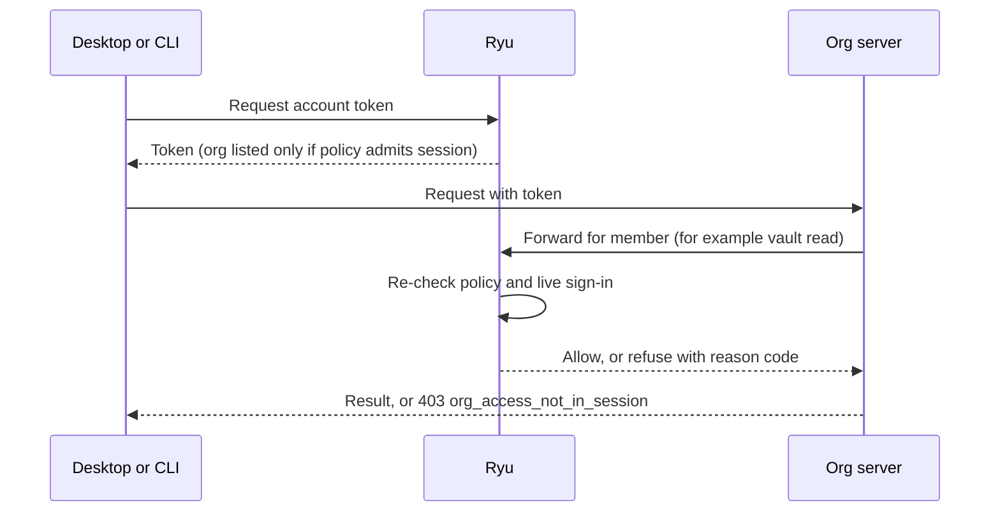

This reference covers the organization controls under **Organization** in the Console (Ryu on the
web), for owners and admins.

<Figure name="organizations" />

| Control | Who can change it |
|---|---|
| Most controls | **admin** or **owner** role |
| Admin API keys | **owner** only |
| Security settings (IP allowlist, required two-factor, session lifetime) | `access.manage` |
| Data controls (retention and audit streaming) | `data.manage` |

Owners and admins hold both permissions, and a custom role can grant either one on its own; see
[Permissions](/docs/security/permissions). Single sign-on and directory provisioning are covered in
[Enterprise SSO and SCIM](/docs/security/enterprise-identity).

## Roles

Every member has one of the built-in roles below, optionally extended by custom roles.

| Role | What it is for |
|---|---|
| Primary owner | One owner per organization with the final say over ownership (see below) |
| Owner | Everything, including billing and Admin API keys |
| Admin | Everything except billing, Admin API keys, and changing owners. Admins cannot buy or change plans, manage payment methods, top up or move credits, or buy paid nodes, and cannot grant `billing.manage` |
| Member | Run agents and workflows, create projects |
| Viewer | Read-only access |
| Billing | Read-only access plus billing management and usage reports |

The **Billing** role suits finance contacts: it can manage plans and payment details and read usage
and spend, but cannot change configuration, members, or keys.

Billing is limited to owners and members who hold `billing.manage` (the Billing role or a custom
role). Admins do not manage billing, so only owners and existing billing managers can give someone
the Billing role. An admin who
also needs billing access can be given the Billing role alongside Admin.

### Primary owner

Every organization has exactly one **primary owner**: the person who created it, or for older
organizations the earliest owner. The primary owner holds the owner role and everything that comes
with it, plus these protections and powers:

- Nobody can remove the primary owner or take away their owner role, including other owners.
- Only the primary owner can make someone an owner, invite someone as an owner, or remove another
  owner's owner role. Any owner can still step down to a lower role or leave on their own.
- Only the primary owner can delete the organization.
- The primary owner cannot leave until they hand primary ownership to someone else.

To hand it over, open **Organization → Members**, select the crown icon next to the new primary
owner, then confirm your identity. They become an owner if they are not one already, and you stay
an owner. The members list marks the current primary owner with a **Primary owner** badge.

The new primary owner must have a verified business email, the same rule that applies when someone
is promoted to a stronger role. If their email is unverified, was changed and not verified again,
or is a public mailbox, the handover is refused until they verify a business address.

## Admin API keys

**Organization → Admin keys** lists every Admin API key, active and revoked, newest first, with its
creation date, last use, and last-used address. Select **Load more** to page through older ones.

An owner can create a key (optionally with an expiry) after confirming their identity. The full key
is shown **once** and Ryu stores only a hash. Revoking a key stops it immediately.

Admin API keys start with `ryu_admin_` and authenticate the programmatic Admin API:

```http
GET /api/v1/organizations/{orgId}/members
Authorization: Bearer ryu_admin_…
```

| Resource | Operations |
|---|---|
| `/members` | list, oldest first, paginated with `next_cursor` / `?cursor=` (`?limit=` up to 500); `PATCH /members/{userId}` with `{ "role": "admin" \| "member" \| "viewer" }` (the billing role can only be assigned in Console); `DELETE /members/{userId}` |
| `/invites` | list, oldest first, paginated with `next_cursor` / `?cursor=` (`?limit=` up to 200); `DELETE /invites/{invitationId}` cancels a pending invitation, releases its seat claim, and notifies the organization like a Console revoke (an invitation already accepted, declined, or expired returns 404) |
| `/teams` | list, oldest first, paginated with `next_cursor` / `?cursor=` (`?limit=` up to 500); create |
| `/projects` | list, newest first, paginated with `next_cursor` / `?cursor=` (`?include_archived=true`, `?limit=` up to 500); create; `PATCH /projects/{id}`; `POST /projects/{id}/archive` and `/unarchive` |
| `/api-keys` | list organization API keys, oldest first, paginated with `next_cursor` / `?cursor=` (`?limit=` up to 200); `DELETE /api-keys/{keyId}` revokes one |
| `/audit` | read the control audit log, paginated with `next_cursor` / `?cursor=` |
| `/limits` | read and update spending and rate limits (send the `revision` from `GET` as `expectedRevision` to avoid overwriting a concurrent change); `GET` also returns the read-only `planRateCeiling` the hosted Gateway applies (see [usage limits](/docs/billing/usage-limits)); `GET /limits/status` shows current-window spend against each cap |
| `/usage/breakdown` | usage grouped by `user`, `key`, `team`, `model`, `provider`, `project`, or `serviceAccount` (`?groupBy=&from=&to=&bucket=day\|hour\|none`; see [usage limits](/docs/billing/usage-limits-api#breakdown)) |
| `/usage/export.csv` | the same usage rows as CSV |
| `/policies` | list the organization's policy layers (read-only) |

An Admin API key acts with admin permissions and only works for the organization it was created in.
Every Admin API call, including reads and refused calls, is recorded in the organization's audit
log with the key as the actor. A key cannot:

- manage billing, subscriptions, payment methods, or credit top-ups (it can read and update
  spending and rate limits);
- grant or change the owner role, or remove an owner;
- create invitations (not available yet; invite members from Console);
- edit policy layers (read-only here; edit them in **Organization → Policies**).

## Service accounts

**Organization → Service accounts** creates non-human principals for automation. The list shows the
newest accounts first; select **Load more** to page through older ones.

- Each service account has a role (admin, member, viewer, or billing).
- API keys minted for a service account are limited to the scopes that role allows; a request for a
  broader scope is refused.
- For a service account with a higher role than your own, you cannot create it, delete it, or revoke
  its keys.
- Deleting a service account revokes all of its keys.

### Gateway keys for service accounts

Admin and member service accounts can also hold **gateway keys** (`rgw_…`) for calling models
through the hosted gateway, for example from CI or a bot. Viewer and billing accounts cannot hold
them, and an account holds at most 10 live gateway keys. Creating one needs:

- the permission to manage nodes as well as service accounts;
- a step-up confirmation;
- managed inference (an active subscription or a positive credit balance).

Select **New gateway key** on the account. The key is shown once, together with the hosted
gateway's base URL (the **Fleet URL**). Send the key as a `Bearer` token to that URL, the same way
as any other gateway key.

The Fleet URL stays visible under the account's **Gateway keys** list and under
**Organization → Gateway keys → Fleet endpoint** after the key card is dismissed. If no fleet is
configured for your deployment, those places say so instead.

Usage from these keys is attributed to the service account. Cap it under
[service account limits](/docs/billing/usage-limits#service-account-limits) and view it with
**Usage → Service account**.

Revoking a key stops new requests within about a minute, because the hosted gateway caches a
resolved key for up to 60 seconds. Its past spend still counts toward the account's limits.
Deleting the account revokes all of its gateway keys the same way.

## Access policy

**Organization → Security → Access policy** has three controls: an IP allowlist, required
two-factor, and a session max age. They apply to everything a member does inside the organization
in Console and the API: organization settings, members, teams and invitations, servers, registry,
marketplace and fleet pages, bot access, billing, and credits.

Marketplace listing transfers and server transfers are included. Each organization's policy applies
to the member who starts, approves, accepts, declines, or cancels a transfer on its side. A member's
list of listing transfers leaves out organizations whose policy blocks the current session.
Creating a new organization, accepting an invitation, and leaving an organization are not blocked.

### Servers, OAuth apps, and member sign-ins

The policy also follows a member's access through the organization's servers:

| Path | How the policy applies |
|---|---|
| A server acts for a member (for example to fetch a GitHub repository token or read a shared Secret Vault value) | Two-factor and session age still apply; the IP allowlist is checked against the server's own address |
| An MCP client or app authorized with OAuth reaches a server through Ryu's hosted MCP endpoint | IP allowlist checked against the client's address; a member without a second factor is refused when two-factor is required; a grant older than the session lifetime must sign in again |
| An app uses the member's Ryu account sign-in, such as Ryu Desktop | The short-lived account token lists the organization only when the policy admits the session that requested it |

Servers that act for members must run on an allowed network. If you use hosted or cloud servers with
an IP allowlist, add their outbound addresses to the allowlist.

The account token lists the organization (with the member's role and teams) only when the request
comes from an allowed address, the session proved a second factor when two-factor is required, and
the session is younger than the session lifetime. Otherwise the token leaves the organization out,
and its servers do not treat the member as part of it.

The token is renewed every few minutes, and each renewal checks the policy again. If the policy
can't be checked at that moment, no token is issued and the app tries again shortly.

When a server forwards such a request to Ryu for a member (for example to read or reveal a shared
Secret Vault value), Ryu checks the policy again against the sign-in the token was issued for. That
sign-in must still be active: once the member signs out or the session is revoked, forwarded
requests stop working at once.



### Refusal codes

A server that refuses a request for this reason answers `403` with the code
`org_access_not_in_session`. When Ryu refuses a request a server forwarded, its answer names the
reason too (for example `user_jwt_org_not_admitted`, `org_ip_not_allowed` or
`org_session_expired`). In both cases the desktop app and CLI say how to fix it.

When two-factor is the reason, confirm the session with an authenticator code
(`ryu-cli secrets confirm CODE --method totp`, which also renews the token the CLI uses), or sign
out and sign in again with your authenticator app or a passkey, then retry.

At a server, someone who is not a member gets the same `403`, because the server cannot tell the two
cases apart; Ryu tells them they aren't a member.

### IP allowlist

Enter IPv4 or IPv6 addresses or CIDR blocks, one per line (for example `203.0.113.0/24` or
`2001:db8:1234::/48`). IPv4-mapped IPv6 addresses match their IPv4 entries. When the list is
non-empty, these are accepted only from those networks:

- console requests to the organization;
- organization API keys and Admin API keys;
- OAuth-authorized apps reaching the organization's servers;
- member sign-ins that servers trust;
- the organization's servers acting for a member.

If the list you are saving does not include your current address, Ryu asks you to confirm first,
because saving it would lock you out. Another admin on an allowed network would then need to change it.

Ryu takes the client address from the network connection. It only believes a forwarded address
header when the connection comes from a trusted proxy, so a client cannot claim an allowed address.
A self-hosted deployment behind a reverse proxy must list that proxy as trusted (the server's
trusted-proxies setting); otherwise every member appears to come from the proxy's address and the allowlist cannot match them.

### Require two-factor authentication

Members with neither an authenticator app nor a passkey are blocked from the organization with a
prompt to set one up in their account settings. Either factor satisfies the policy. The page shows
how many members have not enrolled yet and names a few of them; in a large organization it says how many of the total it is showing.

Before you can turn this on, you need an authenticator app or a passkey on your own account and a
qualifying session.

Having a factor is not enough: the session must also have been signed in with it.

| Session signed in with | Qualifies |
|---|---|
| Password and authenticator code, a recovery code, or a passkey | Yes |
| Only a magic link, an emailed code, a social account, or a password on a remembered device | No, refused with `org_mfa_session_required` |

In the web console the organization's pages then show a **Confirm it's you** notice:

- A member with an authenticator app can confirm the current session with an authenticator code or
  a recovery code.
- Anyone can sign out and sign in again with their authenticator app or a passkey. A passkey cannot
  confirm a session that is already open; it counts only when used to sign in.
- The desktop app and CLI qualify when the browser session that approved them did; otherwise sign
  them in again from a qualifying browser session.

A member of an organization that requires two-factor can add a passkey, set up or change an
authenticator app, or view recovery codes only from a qualifying session (or after confirming the current one). A session opened from the member's
mailbox therefore cannot enroll a new factor and use it to get in.

A personal API key used with the Managed Agents API passes the requirement only if the session that
created it qualified. Keys created from other sessions, or before this was recorded, are refused for
that organization and need to be created again.

### Session max age

Members whose sign-in session is older than this (15 minutes to 90 days) must
sign out and back in before they can reach the organization again.

## Data controls

**Organization → Data controls** shows how Ryu handles the organization's data.

- **Zero data retention** is on for every plan: prompts and completions routed through Ryu are not
  retained. It is shown for reference and cannot be turned off.
- **Data region** shows whether your Enterprise agreement includes a contracted data region.
- **Retention** deletes data older than the horizon you set, in days: gateway request logs (1 day
  minimum) and the control audit log (30 days minimum). Leave a field empty to keep that data.
  Deletion runs automatically a few times a day and cannot be undone. Public conversation share
  links belong to the member who created them, not to the organization, so organization retention
  does not remove them; members revoke their own links.

### Audit log streaming

Turn on **Stream audit events** and enter an `https://` endpoint on a public DNS name to receive
every control audit event as JSON. The stream includes invitations, removals, team changes,
organization deletion, and role updates. A role update records the previous and new role, and an
invitation records the role it grants.

Ryu shows a signing secret once when streaming is first enabled or when you rotate it. Each delivery
includes:

- `X-Ryu-Event-Id` - the audit event ID (use it to de-duplicate retries).
- `X-Ryu-Signature: t=<unix seconds>,v1=<hex>` - an HMAC-SHA256 of `<t>.<raw body>` keyed with
  your signing secret.

Verify the signature and reject old timestamps before trusting a delivery. A delivery that does not
receive a `2xx` response is retried with increasing delays for a limited number of attempts. The
endpoint must resolve to a public IPv4 address; redirects are not followed. Use **Send test event**
to check your endpoint.

## Request logs

**Organization → Request logs** lists the model and tool requests your organization's gateways
reported, newest first. Filter by member, API key prefix, model, status, and time range; select a
row's time to open its details. Request logs never contain prompts or responses, and keys appear
only as redacted prefixes. Viewing request logs requires the `audit.view` permission.

## Refused requests in the audit log

The audit log also records refused access, so you can spot a member probing for secrets or a
session coming from outside your allowlist:

- `org_access.denied` - the organization's access policy refused a member's session or an API key.
  The row carries the refusal code (`org_ip_not_allowed`, `org_mfa_required`,
  `org_mfa_session_required`, or `org_session_expired`) and, for allowlist refusals, the client
  address.
- `vault.denied` - a member asked the Secret Vault for something their capabilities don't allow,
  such as revealing or exporting a secret or editing vault policies. The row names the key and the
  missing capability, never a secret value.
- `<action>.denied` - a member's change to organization settings, members, roles, keys, or servers
  was refused with a 403.

Ryu records at most one row per member, action, and target each minute, so a retry loop doesn't
flood the log. Refusals from accounts that aren't members of the organization aren't recorded.

Vault refusals are also capped at 20 rows per member each minute across all keys. The first refusal
past the cap writes one `vault.denied` row with outcome `throttled`; later ones that minute write nothing.

## Audit log export

Enterprise organizations with audit export enabled can open **Audit log** and choose **Export CSV**.
The export combines organization and Gateway control activity: actor, event type, action, target,
agent, request, and session correlation IDs, timestamp, outcome, and redacted detail. It never
includes request bodies, provider secrets, or SCIM tokens.

Each export response returns up to 5,000 rows. When more exist, the response includes an
`X-Next-Cursor` header; request the export again with `?cursor=<value>` until no cursor is returned.

The Console download collects up to 50 pages (250,000 events, newest first) and says when it stops
early; use audit log streaming to keep the complete record. Each exported page is recorded in the
control audit log. Cells are quoted per RFC 4180, and formula-like text gets an apostrophe prefix.

## Related guides

Find these controls in the [organization console](/docs/billing/organization-console), review
membership in [organization access](/docs/billing/organization-access), and manage spend caps with
[usage limits](/docs/billing/usage-limits).
