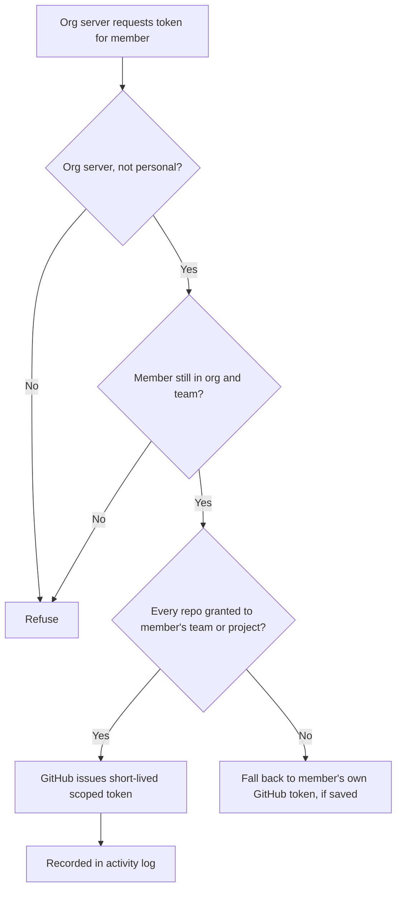

The **Integrations** page in your organization's console (**Organizations → your org →
Integrations**) holds the integrations that belong to the organization rather than to one person:

- a **GitHub App** installation shared by the organization,
- **repository access** for each team or project, and
- a **connector catalog** of approved Composio toolkits and MCP servers, with member requests.

Anyone in the organization can see the page and request a connector. Connecting GitHub, editing
repository access, changing the catalog, and deciding requests need the **Gateway configure**
permission (owners and admins have it; a custom role can grant it).

## Connect GitHub

1. Select **Connect GitHub**. Ryu opens GitHub's App installation screen.
2. Choose the GitHub organization or account, and which repositories the App may see.
3. GitHub returns you to the Integrations page with the result.

The connection link is single-purpose: it is tied to your account and this organization, and it
expires after a few minutes. One GitHub installation belongs to at most one Ryu organization.

GitHub must confirm that you own the personal account or are an active owner of the GitHub
organization before Ryu attaches its installation. Repository access alone does not authorize
sharing the installation with a Ryu organization.

When GitHub returns you, Ryu also applies the organization's current access policy (IP allowlist,
required two-factor authentication, and maximum session age) to your session before it attaches
the installation. If your session doesn't meet the policy, the page says so and nothing is
connected; resolve it and select **Connect GitHub** again.

Ask a GitHub organization owner to complete the connection if you are not an owner. GitHub may
let repository administrators install the App for selected repositories, but Ryu requires an
organization owner to bind the installation. If GitHub sends an installation request instead,
the page tells you the request was sent.

For self-hosted deployments, the organization GitHub App needs the organization **Members: read**
permission to verify active ownership. Missing permissions, blocked App access, or unavailable
ownership information prevent the connection; grant the permission and retry.

### Suspension and uninstall

If the App is suspended or uninstalled on GitHub, Ryu pauses the integration immediately and stops
issuing tokens for it.

- Ryu checks each lifecycle notification against the installation's current state on GitHub before
  applying it, and handles each GitHub delivery once. A delayed or repeated notification cannot
  reactivate a suspended integration or bring back an uninstalled one.
- GitHub does not resend a notification on its own. When Ryu cannot confirm one right away (for
  example, while GitHub is unreachable), it keeps the notification instead of dropping it.
- An integration with a notification waiting for confirmation issues no tokens. Ryu checks with
  GitHub again the next time the integration is used or the Integrations page is opened, then
  applies whatever state GitHub reports.

Uninstalling the App removes the integration's repository grants at the same time. Removing it from
the Integrations page also asks GitHub to uninstall the App and deletes every repository grant.

## Grant repositories to teams and projects

Connecting GitHub grants nothing by itself. Under **Repository access**, pick a team or project and
tick the repositories it may use, then **Save access**. Only repositories the App can see on GitHub
are listed.

- Archived projects cannot receive new repository access, and their existing grants stop working
  until the project is unarchived.
- If another admin saved repository access while you were editing, your save is refused and the
  latest access is shown so you can apply your change again.

### How a server gets a repository token

When a member runs work on one of the organization's servers, for example cloning repositories in a
cloud environment, the server asks Ryu for a GitHub token on that member's behalf.

Ryu checks, on every request:

- the server belongs to the organization and is not a personal server,
- the member is still in the organization (and in the server's team, for team servers),
- every requested repository is granted to one of the member's teams, or to the project in use.

Ryu then has GitHub issue a short-lived token (about an hour) that only covers the granted
repositories. Tokens are never stored by Ryu, and every token issued is recorded in the
organization's activity log with the repositories it covered.

If no grant covers the work, the server falls back to the member's own saved GitHub token, if they
added one. Grants only add access; they never remove a member's personal token.

## Connector catalog

The **Connector catalog** lists the Composio toolkits and MCP servers your organization approves.
Turn on **Require approval for new connectors** to withhold every connector that isn't on the list
from your organization's servers, even if it was previously added to the shared tool registry.
Skills and knowledge bundles are not connectors and are unaffected.

Members ask for a connector under **Access requests** (with an optional reason). Admins see every
request and can **Approve** (which adds it to the catalog) or **Deny**. Members see only their own
requests. Requests are listed newest first; select **Load more** to see older ones.

Every catalog change and decision is recorded in the activity log. If another admin changes the
catalog while you are editing it, your save is refused and the latest catalog is shown so you can
make your change again. Approving a request never overwrites other changes.

The catalog holds at most 500 approved connectors. Approving a request into a full catalog is
refused and the request stays pending; remove a connector you no longer need, then approve it again.

### Team catalogs

A team can have its own catalog layer under the organization's. Open **Organization → Teams**,
select **Policies** on the team, and use **Team connector catalog**. The API is
`GET`/`PUT /api/control-plane/orgs/{orgId}/teams/{teamId}/integrations/catalog`, with the same
`{ approved, requireApproval, revision }` body as the organization catalog.

Changing it needs **Gateway configure** for the organization or through a role scoped to that team;
other members see it read-only. A team catalog can only narrow what the team's servers reach:

- If either the organization or the team requires approval, approval is required.
- If both require it, a connector must be on both lists. A team cannot approve a connector the
  organization has not.

### Which servers enforce it

| Server | Enforces registry grants |
|---|---|
| Ryu-managed server | Always: it only runs the connectors, MCP servers, and skills granted to it in the shared tool registry |
| Desktop or self-hosted server bound to the organization | Once the organization, or that server's team, turns on **Require approval for new connectors** |

Until enforcement starts, a bound desktop or self-hosted server keeps its members' own local MCP
servers, so joining an organization does not turn them off.

While grants are enforced, a skill can only be installed from a catalog, a source, or a pack when
it is granted. Skills a member writes on the server are not affected.

## Related

- [Organization and resource enforcement](/docs/security/authentication-organizations)
- [Secret vault](/docs/security/secret-vault)
