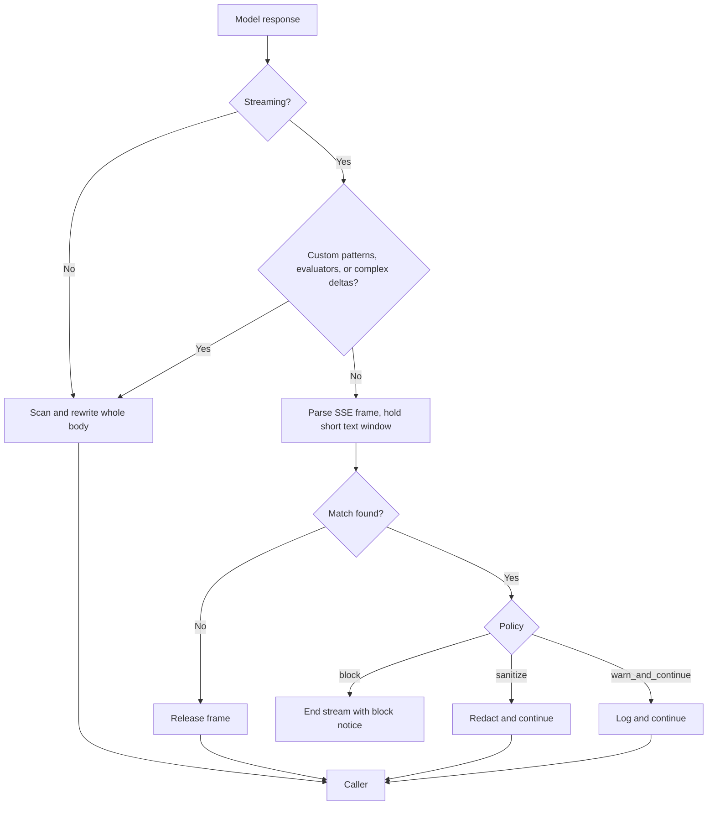

The Gateway firewall scans traffic in both directions. The outbound side is data-loss prevention (DLP): it redacts secret-like tokens from response text and from error and log surfaces, so a secret that leaks into a model response or an error message does not reach the caller verbatim.

For the full firewall, its policies, and inbound scanning, see [Gateway security](/docs/gateway/security).

The firewall is on by default (`enabled` and `scan_outbound` both default to `true` in the Gateway firewall config). On chat completions, the Messages and Responses compatibility routes, and multimodal responses, outbound secret redaction always runs, even with the firewall disabled, and does not depend on `redact_secrets`. Embeddings and rerank responses are not scrubbed. The passthrough's response redactor runs only when the firewall is enabled (see [Passthrough responses](#passthrough-responses) below).

## What gets redacted

Outbound redaction uses a fixed, built-in pattern set; custom firewall patterns do not join it. The regexes are compiled once, not inside the request path.

| Marker | Matches |
|---|---|
| `gh_pat` | GitHub tokens with a `ghp_`, `gho_`, `ghu_`, `ghs_`, or `ghr_` prefix, and fine-grained `github_pat_` tokens |
| `openai_key` | `sk-` keys, including `sk-proj-` and `sk-ant-` |
| `aws_akid` | AWS access key IDs (`AKIA` plus 16 characters) |
| `bearer` | `Bearer <token>` values |
| `token_param` | `token=`, `api_key=`, `apikey=`, and `access_token=` query or form parameters |
| `secret_param` | `password=`, `passwd=`, and `secret=` query or form parameters |

Each match is replaced with a stable marker such as `[REDACTED:gh_pat]`. The response keeps its shape; the secret is gone.

## Non-streaming and streaming responses

- **Non-streaming responses** are scanned and rewritten in full before they reach the caller.
- Built-in patterns also match a value written directly next to Chinese, Japanese or Korean text, such as `密钥sk-…`. The same applies next to any other non-ASCII letter, so a keyword glued to an accented word can be redacted too.
- **Streaming responses** reach the caller as they are generated. The Gateway parses every SSE frame and redacts its strings; there is no raw-byte fast path.
- A streamed frame is released only after the policy scan covers it.
  - Plain prose is released as soon as each word is complete. In Chinese, Japanese and Korean text, which has no spaces, each character ends a word.
  - Text that could begin a value spanning spaces is held until the value is complete or ruled out, at most about 192 bytes. That covers digits, `aws`, `-----BEGIN`, `Bearer`, `api_key` and `passport`. Connection strings (`postgres://` and the other database schemes) and `password=`, `passwd=` or `secret=` parameters are held until the next space, because those values can run through Chinese, Japanese or Korean text. A secret that arrives across several deltas is judged whole before any part of it is sent. A run of number or IBAN groups (joined by single spaces, dashes, dots or line breaks) is held until it ends and then checked whole, so card and account numbers are grouped as in the whole text; a run longer than 16 KiB holds the rest of the response.
  - Reasoning text (`reasoning_content` or `reasoning`) streams and is redacted the same way as the answer. Reasoning and answer are checked as separate strings, as in a non-streamed response: digits, or a `Bearer` or `api_key:` keyword, at the end of the reasoning never join the start of the answer into a value. A field that resumes after the other is still checked whole (see the next point).
  - If the answer resumes after a stretch of reasoning (interleaved thinking), the rest of the response is held and the answer is checked as one string when the stream ends. If a value continues across the reasoning, the response is blocked or the held text is replaced with `[REDACTED]`. The part of the value written before the reasoning has already been sent. If more than 1 MiB of the answer came before the reasoning, the held text is replaced with `[REDACTED]`, because the answer can no longer be checked as a whole.
  - Copies of the text that some providers add to each frame (Together's choice-level `text`, OpenRouter's `reasoning_details`) are redacted along with it. If a copy skips a frame or switches to another field, the rest of the response is held and the copy is checked as its own string.
  - SSE comment lines from the provider are not passed through. While nothing else is ready to send, the Gateway sends its own `: keep-alive` comment instead.
- Provider envelope fields outside `choices` (such as `id` or `model`), and provider strings inside a choice such as `reasoning_details` formats or Azure blocklist ids, are redacted with their frame.
  - OpenAI's `obfuscation` padding is replaced with filler of the same length.
  - If any other field except `id` changes between frames, the stream is held and checked as a whole, so a value split across those fields is detected and replaced with `[REDACTED]`.

The firewall `policy` decides what a streaming violation does:

| Policy | Streaming behavior |
|---|---|
| `block` (default) | The stream ends with the block notice. Text sent before the violation stays with the caller, but no part of the matched secret or PII is sent |
| `sanitize` | The stream continues with the match redacted. A match redaction cannot remove is replaced with `[REDACTED]`, or ends the stream with a block notice |
| `warn_and_continue` | The detection is logged and the stream continues |

Some responses are buffered in full before any of them is sent:

- A firewall with custom `pii` or `secret` patterns, or an enabled inline output evaluator, buffers the whole response. Custom patterns can span unbounded whitespace, and evaluators judge the complete reply, each choice on its own. When an output evaluator sanitizes, the caller gets the reply's own frames with every string sanitized, as in a non-streaming response.
- Tool-call arguments, parallel choices, and other complex delta shapes are also buffered, so each independent text stream is scanned as a whole.
  - Parallel choices (`n` > 1) are scanned one choice at a time, the way a client merges them by `index`. Text that forms only where two choices meet is not a match, the same as in a non-streaming response. A value inside one choice is caught even when its chunks arrive interleaved with another choice's.
  - Logprob tokens are checked in the order they were sampled, each choice on its own. Alternatives (`top_logprobs`) are checked one entry at a time, as in a non-streaming response.
- Delta fields that carry no text, such as the `"refusal": null` in OpenAI's first chunk, do not trigger buffering.

<Callout type="info">
Content deltas are scanned together, without provider metadata such as `id` or `model` between them. Metadata is scanned separately. A protected value split across several content deltas is redacted once, at text level: the caller sees one `[REDACTED:…]` marker in place of the value and the rest of the reply unchanged, the same text a non-streaming response gets. When a value spans other JSON strings (tool-call arguments, metadata), or reaches back into text that was already sent, Ryu may replace the held payload with `[REDACTED]` instead of keeping fragments that could rebuild the value in the client. In a reply with one choice, when no value runs from the text into a tool call, the text before the tool call keeps its own redaction and only the frames from the tool call on are replaced, on both the streaming and the fully buffered path.

Text is held back by its visible length. Zero-width, combining and TAG characters count for nothing, so invisible padding inside a value cannot release its start before the whole value is scanned.
</Callout>

## Obfuscated matches under sanitize

A model can spell PII or a secret so the scanner still detects it but a plain pattern cannot
rewrite it: a fullwidth `＠`, a zero-width character inside an address, fullwidth digits in a card
number, or invisible Unicode TAG characters. `sanitize` never releases such a match as redacted:

- When a string still holds PII or a secret after redaction, the Gateway reads it in its plain
  form and redacts the value again; the rest of the text keeps its own characters. If the value
  survives that too, the whole string becomes `[REDACTED]`. Streamed text gets the same rewrite.
- When a value spans several strings, a stream replaces the held text with `[REDACTED]`. If the
  value still survives, a buffered response is refused with a 403 and a stream ends with a block
  notice.
- An output evaluator with the `sanitize` action, such as `pii_leakage`, re-checks the redacted
  reply. If its detector still matches, including when `redact_pii` is off so nothing was redacted,
  the response is blocked and the audit row records `blocked` instead of `sanitized`.

Telemetry exports of the response content get the same per-string redaction.

## Which policy applies

Buffered and streaming chat responses are scanned with the same per-request policy: the node
baseline plus the organization, team, and agent overlays described in
[hierarchical policy resolution](/docs/gateway/security#hierarchical-policy-resolution).

An overlay that turns on `scan_outbound`, sets a stricter `policy`, or adds `custom_patterns`
therefore also applies to `stream: true` responses. When `block` ends a stream, the Gateway writes a
`firewall` audit row for the request, including when the match completes only in the final chunks.

## Keys and logprobs

Outbound scanning reads every string in the response and every object key, so a value placed in a
key of object-typed tool arguments is redacted like any other text.

A streamed frame whose choice carries `logprobs` is held until the reply ends and scanned as a whole,
because each logprob token mirrors part of the text. So is a reply carrying vLLM's `token_ids`, which
can arrive before the text they encode. When `sanitize` rewrites a choice, the Gateway
sets its `logprobs` to `null` (`apps/gateway/src/pipeline/json_text.rs`) so the tokens cannot
rebuild the redacted value.

## Companion egress redaction

Core forwards requests that come from the context companion (a screen-capture source) with the
`x-ryu-companion-source` header. The Gateway then runs `redact_companion_egress`
(`apps/gateway/src/firewall/companion.rs`), which redacts both PII and secrets before egress.

This path ignores `enabled`, `redact_pii`, and `redact_secrets`, so screen-captured text is always
sanitized, even when the firewall is fully disabled. It is one of the Gateway's
[locked guardrails](/docs/gateway/security#locked-guardrails).

Screen text can hide PII from a plain pattern: fullwidth or lookalike characters, zero-width or bidi
characters inside an address, combining underlines, dash variants, superscript, circled or
small-form characters, digits from other scripts, or invisible Unicode TAG characters. When the firewall still detects PII or a secret after the first redaction pass, the
Gateway folds the text to its plain form and redacts it again. If the value survives that too, the
whole message text is replaced with `[REDACTED:COMPANION_TEXT]` instead of being forwarded.

## Passthrough responses

The subscription-preserving passthrough for Claude Code and Codex forwards the caller's own
credentials, so the OpenAI-compatible path above never sees that traffic. The passthrough applies
its own request-side redaction and a response redactor that uses the same firewall configuration.
See [What the proxy redacts](/docs/gateway/gateway-for-any-agent#what-the-proxy-redacts).

<Callout type="warn">
Redaction matches known shapes. A secret in a format the patterns above do not cover passes through. Treat DLP as a backstop, not as a guarantee that every secret is caught.
</Callout>

## Related

<Cards>
  <DocCard href="/docs/security/credential-scrubbing" />
  <DocCard href="/docs/security/ssrf-protection" />
  <DocCard href="/docs/gateway/security" />
</Cards>
