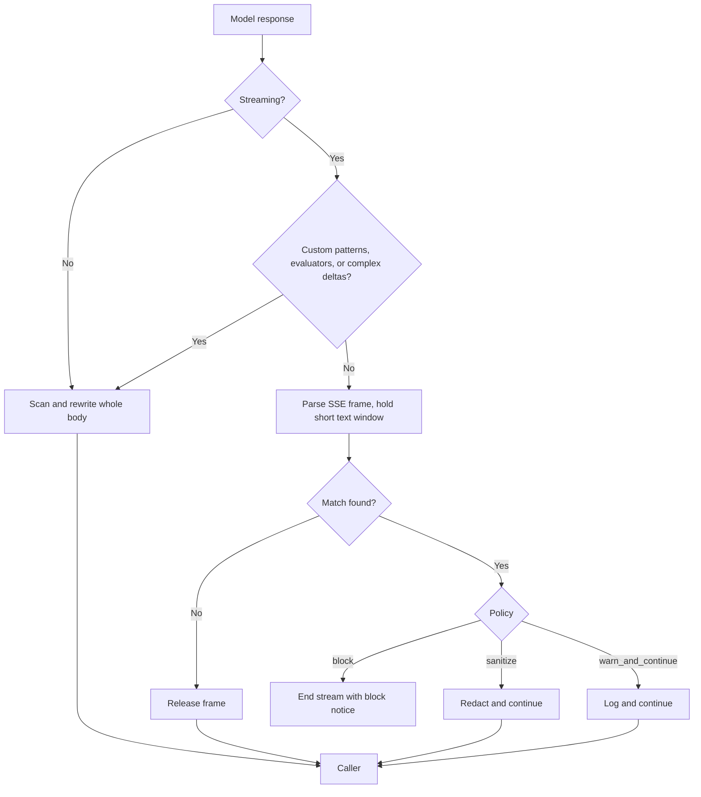

The Gateway firewall scans traffic in both directions. The outbound side is data-loss prevention (DLP): it redacts secret-like tokens from response text and from error and log surfaces, so a secret that leaks into a model response or an error message does not reach the caller verbatim.

For the full firewall, its policies, and inbound scanning, see [Gateway security](/docs/gateway/security).

The firewall is on by default (`enabled` and `scan_outbound` both default to `true` in the Gateway firewall config). Outbound secret redaction runs whenever the firewall is enabled; it does not depend on the `redact_secrets` setting.

## What gets redacted

`redact_outbound` uses a fixed pattern set from `build_outbound_patterns` (`crates/gateway/firewall/src/lib.rs`). The regexes are compiled once, not inside the request path.

| Marker | Matches |
|---|---|
| `gh_pat` | GitHub tokens with a `ghp_`, `gho_`, `ghu_`, `ghs_`, or `ghr_` prefix, and fine-grained `github_pat_` tokens |
| `openai_key` | `sk-` keys, including `sk-proj-` and `sk-ant-` |
| `aws_akid` | AWS access key IDs (`AKIA` plus 16 characters) |
| `bearer` | `Bearer <token>` values |
| `token_param` | `token=`, `api_key=`, `apikey=`, and `access_token=` query or form parameters |
| `secret_param` | `password=`, `passwd=`, and `secret=` query or form parameters |

Each match is replaced with a stable marker such as `[REDACTED:gh_pat]`. The response keeps its shape; the secret is gone.

## Non-streaming and streaming responses

- **Non-streaming responses** are scanned and rewritten in full before they reach the caller.
- **Streaming responses** reach the caller as they are generated. The Gateway parses every SSE frame and redacts its strings; there is no raw-byte fast path.
- A streamed frame is released only after the policy scan covers it. The Gateway holds back a short window of recent text, so a secret that arrives across several deltas is judged whole before any part of it is sent.

The firewall `policy` decides what a streaming violation does:

| Policy | Streaming behavior |
|---|---|
| `block` (default) | The stream ends with the block notice. Text sent before the violation stays with the caller, but no part of the matched secret or PII is sent |
| `sanitize` | The stream continues with the match redacted |
| `warn_and_continue` | The detection is logged and the stream continues |

Some responses are buffered in full before any of them is sent:

- A firewall with custom patterns or output evaluators buffers the whole response. Custom patterns can span unbounded whitespace, and evaluators judge the complete reply.
- Tool-call arguments, parallel choices, and other complex delta shapes are also buffered, so each independent text stream is scanned as a whole.

<Callout type="info">
Content deltas are scanned together, without provider metadata such as `id` or `model` between them. Metadata is scanned separately. When a protected value spans several JSON strings, Ryu may replace the held payload with `[REDACTED]` instead of keeping fragments that could rebuild the value in the client.
</Callout>

## Which policy applies

Buffered and streaming chat responses are scanned with the same per-request policy: the node
baseline plus the organization, team, and agent overlays described in
[hierarchical policy resolution](/docs/gateway/security#hierarchical-policy-resolution).

An overlay that turns on `scan_outbound`, sets a stricter `policy`, or adds `custom_patterns`
therefore also applies to `stream: true` responses. When `block` ends a stream, the Gateway writes a
`firewall` audit row for the request, including when the match completes only in the final chunks.

## Keys and logprobs

Outbound scanning reads every string in the response and every object key, so a value placed in a
key of object-typed tool arguments is redacted like any other text.

A streamed frame whose choice carries `logprobs` is held until the reply ends and scanned as a whole,
because each logprob token mirrors part of the text. When `sanitize` rewrites a choice, the Gateway
sets its `logprobs` to `null` (`apps/gateway/src/pipeline/json_text.rs`) so the tokens cannot
rebuild the redacted value.

## Companion egress redaction

Core forwards requests that come from the context companion (a screen-capture source) with the
`x-ryu-companion-source` header. The Gateway then runs `redact_companion_egress`
(`apps/gateway/src/firewall/mod.rs`), which redacts both PII and secrets before egress.

This path ignores `enabled`, `redact_pii`, and `redact_secrets`, so screen-captured text is always
sanitized, even when the firewall is fully disabled. It is one of the Gateway's
[locked guardrails](/docs/gateway/security#locked-guardrails).

## Passthrough responses

The subscription-preserving passthrough for Claude Code and Codex forwards the caller's own
credentials, so the OpenAI-compatible path above never sees that traffic. The passthrough applies
its own request-side redaction and a response redactor that uses the same firewall configuration.
See [What the proxy redacts](/docs/gateway/gateway-for-any-agent#what-the-proxy-redacts).

<Callout type="warn">
Redaction matches known shapes. A secret in a format the patterns above do not cover passes through. Treat DLP as a backstop, not as a guarantee that every secret is caught.
</Callout>

## Related

<Cards>
  <DocCard href="/docs/security/credential-scrubbing" />
  <DocCard href="/docs/security/ssrf-protection" />
  <DocCard href="/docs/gateway/security" />
</Cards>
