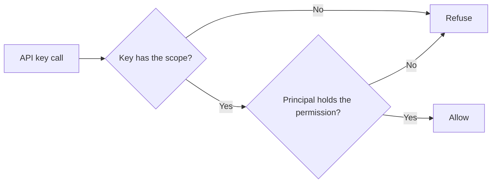

This page lists where each key from the [permission vocabulary](/docs/security/permissions#the-permission-vocabulary) is enforced. For how Core decides whether a request reaches a handler at all, see [How Core gates a request](/docs/security/permissions#how-core-gates-a-request).

## Handlers gated today

Core wires `enforce_permission` into these handler families (call sites in `apps/core/src/server/mod.rs`):

| Permission | Surface |
|---|---|
| `gateway.view` | Read gateway configuration, status, and Doctor reports |
| `gateway.configure` | `PUT /api/gateway/config` and `GET /api/gateway/budget/spend` (live budget counters for any user, agent, or session) |
| `audit.view` | `GET /api/gateway/traffic` (the live traffic feed, which names every member's requests, models, and cost) |
| `workflow.view` / `run` / `edit` / `delete` | Workflow REST handlers |
| `space.read` / `write` / `delete` | Space document REST handlers |
| `agent.view` | Agent REST reads plus sync scans and status |
| `agent.run` | Agent runs, ACP resume, and proactive openings |
| `agent.edit` | Agent writes plus sync profiles, imports, exports, and conflict resolution |
| `agent.delete` | Agent deletion |

Invoking `POST /api/agent-sync/export` requires `agent.edit`. Core then filters the
bundle to agent definitions the caller may view and conversations the caller may read.

### Live traffic and budget spend

The live traffic and budget spend gates check the caller's own organization role. Only the node
owner token or a member's own signed-in session reaches them, including the session Desktop and the
CLI use to reach a managed node.

Credentials delegated to an OAuth or MCP client and paired-device credentials are refused before the
handler runs, whatever scope they carry. A client authorized for `gateway:route` therefore cannot
inherit an owner's or admin's view of everyone's traffic and spend. A member's own spend remains
available from `GET /api/usage/me`.

## Hosted API key scopes

The Messaging, Mail, and prompt scopes below exist only on the hosted control plane. An API key
needs a matching scope as well as the permission. For Mail and the prompt registry, each call checks the permission of what
the key acts for:

- the owner of a personal key;
- the role of the service account that holds a service-account key;
- the member who created any other organization key.

For Messaging, a personal key needs its owner's permission on every call. On every surface below,
an organization key can only be created with a scope its creator's own organization permissions
grant.

| Surface | Permissions | Key scopes | Notes |
|---|---|---|---|
| Ryu Messaging (reads, sends, number purchases, settings) | `messaging.read`, `messaging.manage` | `messaging:read`, `messaging:manage` | These scopes are never delegated to a node |
| Hosted Agent Mail | `mail.read` (reads), `mail.manage` (sends and changes) | `mail:read`, `mail:send`, `mail:manage` | A classic token includes `mail:read` and `mail:send` but never `mail:manage`; choose it on a fine-grained token |
| Organization prompt registry | `agent.view` (list and resolve), `agent.edit` (create prompts, commit versions, move labels), `agent.delete` (delete a prompt) | `prompts:read` (reads), `prompts:manage` (the rest) | A classic token includes `prompts:read` but never `prompts:manage`; OAuth clients cannot request prompt scopes |

An OAuth (MCP) grant gets `mail:manage` only when the client names it and you choose it on the
consent screen, and it can then only create inboxes. See
[Ryu Mail API](/docs/standalone/mail-api#hosted-mail-api-keys) and
[Prompts](/docs/extend/develop/sdk/prompts#registries).

## Control-plane surfaces

| Permission | Control-plane surface |
|---|---|
| `notifications.*` | The organization notification page |
| `teams.manage`, `projects.manage`, `nodes.manage` | Their matching control-plane mutations |
| `registry.manage` | Registry mutations, plus reading the organization's registry grants and each catalog entry's configuration (other members see entry names and metadata only) |
| `gateway.configure` | Reading and changing the organization Gateway config, its config diff and revision history, the firewall rules, and organization API keys |
| `channel.manage` | Creating an organization-owned channel, and updating one created by another member |
| `marketplace.*` | Catalog visibility, publishing, and ownership transfer |
| `features.manage` | Feature controls, member overrides, and app feature rollouts |

The remaining keys (`tool.exec`, `members.manage`, `roles.manage`, `billing.manage`) are part of the
shared vocabulary; member, role, and billing management remain behind their Better Auth and
billing policy boundaries.

### Team projects

A project's team sets which team policy applies to it and which team grants, keys, and nodes reach it.

- To create, rename, archive, or restore a team's project, you need an organization-wide
  `teams.manage` grant, or `projects.manage` inside that team (which a member has only while they
  belong to it).
- Moving a project to another team, or removing its team, needs organization-wide `teams.manage`,
  or a team-scoped `teams.manage` grant for every team the project leaves or joins.

### Security and data controls

`access.manage` gates the organization's security settings (IP allowlist, required two-factor, and
session lifetime) and its SSO and SCIM configuration, including SCIM connection revocation.
`data.manage` gates data controls: log retention and SIEM audit streaming, including its signing
secret and test event.

Owners and admins hold both. A custom role can grant either one without granting the other, and
holding `members.manage` or `roles.manage` grants neither. Some actions need more:

- Registering, updating, verifying, or deleting an SSO provider also needs the built-in owner or
  admin role, because the sign-in provider layer enforces that itself.
- Generating or rotating a SCIM token needs the owner or admin role and `members.manage` as well as
  `access.manage`, because a SCIM token can remove any member who is not an owner, admins included.

### Audit

`audit.view` gates:

- the organization Audit log, which merges org control changes with reported Gateway control changes;
- the organization request audit search (`GET /api/aggregation/orgs/{orgId}/audit`);
- Core's live traffic feed.

The local Gateway audit endpoint retains its own master-key gate.

## Editing node resource exceptions

Desktop **Gateway → Permissions** lists only resources with custom ACL rules. Select **Edit** to
change one, or choose a reported resource type and enter its identifier.

- The editor prefers the node's principal directory for roles, teams, and people. If that directory
  is unavailable, it keeps the saved rule and offers a warned identifier field. Use the exact stable
  ID, because an unknown ID will save but match no principal.
- A failed resource-list or permission-vocabulary read shows a **Retry** action instead of
  presenting an empty rule set as if the read succeeded.
- The **Everyone in the org** target is available only when the selected node reports an
  organization ID; an unbound personal node has no organization scope to grant.
- Saving an all-Inherit rule removes that exception so normal role permissions apply again.

Switching nodes or resources loads that selection's permissions. A delayed reply from a previous
selection does not replace the current editor or show its save result.

If you edit a rule while **Save** is still in progress, those newer changes stay unsaved after the
earlier save completes; choose **Save** again to apply them. A failed save reports the error and
keeps your edits available for retry.

## Related

<Cards>
  <DocCard href="/docs/security/permissions" />
  <DocCard href="/docs/security/permissions-marketplace" />
  <DocCard href="/docs/security/organization-admin-controls" />
</Cards>
