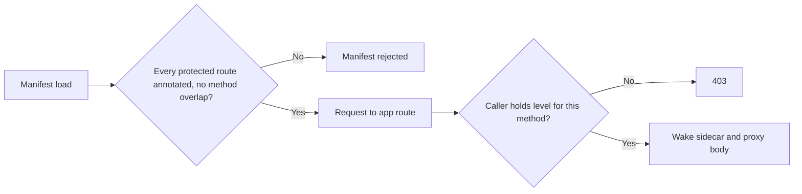

Marketplace packages use the five independent `app.*` permissions in the [permission vocabulary](/docs/security/permissions#the-permission-vocabulary), regardless of whether the
package is an app, plugin, skill, agent, workflow, theme, output style, Space, profile, or bundle.
There is no implicit implication between install, update, enable, disable, and uninstall.

Core validates the node scope before resolving the ACL:

| Node scope | Caller requirement |
|---|---|
| Organization | Caller belongs to the organization |
| Team | Caller belongs to the team, or is an organization owner/admin |
| Personal | Caller is the owning user; organization administration does not bypass this |
| Unbound | Existing local-token owner behavior is preserved |

## Default grants

- Owners and admins receive the default lifecycle permissions on organization and team nodes.
- Ordinary members and viewers receive none by default; team, member, role, and custom-role grants
  are explicit.
- An individual deny overrides a team grant.
- The stable node ID is preserved when a gateway credential rotates, so an ACL continues to govern
  the same machine.

A denied lifecycle request returns a structured `403` with `required_permission` and `node_scope`,
before filesystem or package state changes.

## Node and resource ACL edits

| Route | Purpose |
|---|---|
| `GET /api/plugins/lifecycle-capabilities` | Read-only desktop explanation of the caller's lifecycle permissions |
| `GET`/`PUT /api/acl/resources/node/:nodeId` | Read or edit a node ACL. Editing requires `roles.manage`; a personal-node owner and an organization owner or admin have implicit management authority |
| `PUT /api/acl/resources/:kind/:id` | Edit a resource ACL for Spaces, conversations, agents, workflows, and nodes |

Resource ACL edits follow the same limits as custom roles. Except for an organization owner or the
personal-node owner, an editor:

- can only add or remove a permission they hold on that resource themselves;
- cannot change a rule aimed at the `owner` or `admin` role, or at a member whose built-in role is
  above theirs;
- cannot add or remove a deny for a whole team, the organization, or a custom role, because such a
  deny can also reach an owner. Only an organization owner can. Anyone else can still grant those
  targets permissions they hold.

Rules that stay unchanged need no extra authority. A refused edit returns `403` and names the
permissions or targets involved. If Core cannot confirm a targeted member's role, the edit is refused.

## App-owned sidecar routes

Apps can publish a separate `permission_levels` vocabulary for their own proxied sidecar routes.
Core validates that every protected non-health route is annotated and matches the incoming HTTP
method. It checks the caller's effective app level before waking the sidecar or buffering the
request body.

When one path serves both reads and writes, the manifest declares separate method rows (for example,
`GET /drafts` with `drafts.view` and `POST /drafts` with `drafts.edit`). Missing levels and method
overlaps are rejected at manifest load. An org-bound caller without the required level receives `403`.

### Level implications

A level's `implies` list can only include levels the same app owns.

- A manifest whose own level implies a built-in permission (for example, `myapp.use` implying
  `space.delete`) is rejected at load.
- A built-in permission an app declares has its `implies` list ignored. The grant picker shows its
  label and description only when the app ships with Ryu.

### Shared level ids

A level id declared by an app that ships with Ryu belongs to that app. An installed app that
declares the same id has its implications for it ignored.

If two installed apps declare the same level id, neither owns it, whichever order they were
installed or loaded in, until one of the apps is removed. Granting that id grants only the id itself.

Denials still follow each app's own implications for it, so installing an app that names another
app's level can only narrow access, never widen it. A deny of `foo.view` still denies a `foo.admin`
that implies it.

The grant picker doesn't offer a shared id, because either app could have written its label. Core
lists the shared id and every other dropped implication in the permission vocabulary. The picker
shows only the implications Core enforces, so granting an app level never also grants a built-in
permission or another app's level.

<Callout type="info">
App levels govern access to the app surface, not the OS capabilities of its sidecar process. Native
sidecars remain publisher-trust boundaries as described in
[Plugin isolation](/docs/security/plugin-isolation).
</Callout>

## Related

<Cards>
  <DocCard href="/docs/security/permissions" />
  <DocCard href="/docs/security/permissions-enforcement" />
  <DocCard href="/docs/security/plugin-isolation" />
</Cards>
