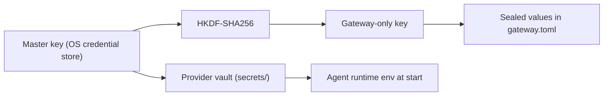

A provider API key can spend money on your provider account. This page explains where Ryu keeps
the keys you link, what that storage protects against, and what it cannot protect against. It is
for anyone who pastes a provider key into Ryu.

<Callout type="warn">
  **Set a spending limit on every provider key.** No local storage scheme can stop a key from
  being misused once it leaks, whether the leak happens on your device, in another tool that
  holds the same key, or in a breach at a third-party service. A hard limit in the provider's
  billing settings caps the damage. Ryu asks you to confirm you have set one each time you save
  a key.
</Callout>

## Set limits before you paste a key

1. Create a **new key used only by Ryu**. If it ever leaks, you can revoke it without breaking
   your other tools.
2. Set a **hard monthly spend limit** for the account, project, or key in the provider's billing
   settings:
   - Anthropic: **Console → Settings → Limits**.
   - OpenAI: **Platform → Settings → Organization → Limits**. Project budgets can also be set per
     project.
   - OpenRouter: set a **credit limit** on the individual key under **Settings → Keys**.
   - Other providers: look for usage limits, budgets, or prepaid credits in billing settings. A
     prepaid balance with auto-recharge turned off also works as a cap.
3. Turn on the provider's **usage alerts** so you hear about unusual spend early.
4. If you suspect a key has leaked, **revoke it at the provider first**, then remove it from Ryu
   and add a new one.

The desktop app shows these links next to the key field. Saving stays disabled until you confirm
that you have set a limit for that key.

## Where Ryu stores your keys

Ryu has two places where you can link provider keys, and they are stored differently. Both use
the same master key.

### Settings → Providers (chat providers)

Keys you add under **Settings → Providers → API keys**, and keys for custom OpenAI-compatible
providers, go into Core's provider vault:

- **Encrypted at rest.** Each key is sealed with ChaCha20-Poly1305, an authenticated cipher, using
  a 256-bit master key and a fresh random 96-bit nonce for every record. The vault is a SQLite
  database in the data folder's `secrets/` directory, which is owner-only (`0700` on macOS and Linux).
- **The master key is kept outside the data folder.** By default it lives in your operating
  system's credential store: macOS Keychain, Windows Credential Manager, or the Linux Secret
  Service. A copy of `~/.ryu` (for example, a backup, a synced folder, or a stolen disk image) is
  not enough to decrypt the vault.
- **Fallbacks.** On a machine with no working credential store, Ryu falls back to an owner-only
  `master.key` file in the same `secrets/` directory. Servers can supply the key through the
  `RYU_MASTER_KEY` environment variable instead. See
  [Encryption at rest](/docs/core/encryption-at-rest) for the full key resolution order and the
  backup implications.
- **Fail-closed.** If the master key cannot be loaded, the vault refuses to open. Ryu does not
  substitute a temporary key or fall back to storing plaintext.
- **No plaintext copy for the agent runtime.** The agent runtime reads its provider settings from
  its own `auth.json` and `models.json` files. Ryu writes only a `${RYU_PI_…}` reference there and
  hands the real key to the runtime in its process environment when it starts, so on disk the key
  stays only in the vault. The runtime and the tools it starts (its shell, sub-agents, language servers) can read that
  environment while they run.
- **Exception: OAuth subscription logins.** When you sign in to a provider with OAuth instead of an
  API key, the agent runtime refreshes those tokens itself and writes them back to `auth.json`.
  They stay plaintext in an owner-only file (`0600`) inside an owner-only directory (`0700`).

### Gateway → Keys (BYOK)

Keys you add under **Gateway → Keys**, used for chat, embeddings, speech, images, and video
routing, are stored in the Gateway's `gateway.toml` configuration file:

- **Encrypted at rest.** Each key is stored in the file as a sealed `encc:v1:` value:
  ChaCha20-Poly1305 with a fresh random nonce, under a Gateway-only key derived (HKDF-SHA256) from
  the same master key that protects the provider vault. The rest of the file (routing, firewall,
  account names) stays readable, so you can still review and edit it.
- **The same applies to every other credential in that file:** web search and fetch accounts,
  Google Cloud TTS and Amazon Polly credentials, SDK accounts, the Gateway's client API keys and
  admin key, channel bot tokens and secrets, and service secrets such as the Composio key.
- **The Gateway never holds the master key.** When Ryu starts the Gateway, Core hands it only its
  derived key. The Gateway removes that key from its environment before it starts anything else,
  so plugins, MCP servers, and channel adapters it launches do not inherit it.
- **Standalone Gateways.** A Gateway you run on its own gets the same derived key from
  `ryu-core gateway-seal-env` or from `RYU_MASTER_KEY`. Until it has one, Ryu does not save new
  credentials into its file.
- **Existing files are converted automatically.** Keys saved by an older version, or typed into
  the file by hand, are read as they are and sealed in place the next time the Gateway starts
  (comments and layout are kept). If no key is available, Ryu refuses to save a new credential
  rather than store it in plaintext.
- The file is still written owner-only (`0600`). Ryu refuses to follow symbolic links when opening
  it, and refuses to edit it if other users can read it or if a different user owns it.
- The desktop app also mirrors the first key for each provider into your OS credential store.

## What never happens to your keys

- **They are never sent back to the app.** After you save a key, settings show only whether a key
  is set. The Gateway configuration API replaces every key with `***` when it returns the
  configuration.
- **They are not passed to plugins or MCP servers.** Core removes secret-looking variables from the
  environment before it starts sandboxed plugin programs, and starts MCP stdio servers with only a
  small allowlist. See [Credential scrubbing](/docs/security/credential-scrubbing).
- **The local API requires a token.** Core's HTTP API listens on loopback only by default, and every
  protected route needs a bearer token. If no token is configured, those routes fail closed. See
  [Network binding and auth](/docs/security/network-binding-auth).
- **They are left out of Ryu backups and data exports.** Snapshots skip the provider vault, the
  runtime's `auth.json` and `models.json`, and other credential files. `gateway.toml` lives in
  your OS configuration folder, outside the data folder that backups copy. Ryu Cloud nodes keep
  their provider keys server-side, and the desktop shows those keys as read-only.

## What this protects against

| Threat | Protected? | Why |
|---|---|---|
| Someone copies your data folder, a backup, or a disk image | **Yes**, for vault and Gateway keys | Vault keys and `gateway.toml` credentials are encrypted, and the master key is not in the copy. **No** for OAuth subscription tokens the agent runtime keeps in its `auth.json`, or for anything if the file-fallback `master.key` is in the copy. |
| Another user account on the same computer | **Yes** | Key files and directories are readable only by your user. |
| A website or remote attacker reaching Ryu over the network | **Yes** | The API listens on loopback by default and requires a bearer token. |
| A sandboxed plugin or MCP server you installed | **Mostly** | They get a scrubbed environment and cannot read keys through the API. Code that can run arbitrary programs as your user falls into the next row. |
| Malware or any untrusted program running **as your user** | **No** | See below. |

### The limit no app can remove

A program running under your own user account has the same permissions as Ryu. It can read the
same owner-only files Ryu reads, and depending on the operating system it can ask the credential
store for the same master key. On Linux, for example, the Secret Service hands an unlocked secret
to any process in your session.

No local app that has to use your key without asking for a password every time can fully hide
that key from other code running as you. Any app that claims otherwise is relying on secrecy, not
security.

That is why Ryu asks you to:

- set a spending limit on every key, so a stolen key is worth very little;
- use a separate key for Ryu, so you can revoke it on its own;
- keep untrusted software off the machine, and review plugin and MCP permissions before you grant
  them (see [Plugin isolation](/docs/security/plugin-isolation) and
  [Command approval](/docs/security/command-approval)).

For servers and shared machines, provide `RYU_MASTER_KEY` from your secret manager and run Ryu
under its own dedicated OS user. See the [Hardening checklist](/docs/security/hardening-checklist).
