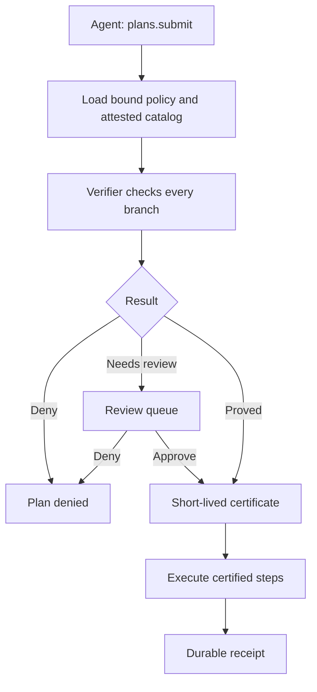

Safe Actions is Ryu's fail-closed execution mode for tool-using agents. It separates deciding on a
plan from executing it:

1. an agent submits a finite typed plan through `plans.submit`;
2. Core loads the agent's bound policy and the current attested tool catalog;
3. the deterministic verifier checks every possible branch without running a tool;
4. Core either denies the plan, queues it for review, or issues a short-lived certificate; and
5. Core executes only the exact certified steps and writes a durable receipt.



The Safe Actions app is the policy, review, and receipt interface. Core remains the authority: app
code cannot issue certificates or create an execution bypass.

## Enable the execution profile

Install **Safe Actions** from the Store, then:

1. set an Active agent's safety profile to **Verified plans only**;
2. attest the effects and concrete resources of each tool the agent may call;
3. create a policy in the app's **Policies** tab and bind it to that agent; and
4. ask the agent to use `plans.submit` for tool work with a caller-generated `request_id`.

The `request_id` is an idempotency key for one intended submission, scoped to the calling agent and
conversation principal:

- Reuse it when retrying that submission after a lost response.
- Generate a new value for a later intentional execution.
- The key does not change when a policy, catalog, or agent revision changes. Retrying the same plan
  returns the original durable submission; reusing the key for different plan bytes is rejected.

A verified-plan agent is offered only the three `plans.*` tools (`plans.submit`, `plans.status`, and
`plans.catalog`). Raw registry tools, discovery meta-tools, and the programmatic JavaScript
execute/resume tools are hidden.

Core also repeats the check at dispatch, so calling a hidden tool by name, replaying an old raw
approval, or using another Core tool-call endpoint does not bypass the profile.

## Typed plans

A plan has one root node and schema version `1`. The supported nodes are:

- `call` - one concrete registry tool and typed arguments;
- `sequence` - child nodes in order;
- `parallel` - independent read-only children; and
- `if` - a typed predicate plus both the `then_node` and `else_node`.

Arguments may be JSON literals, objects, arrays, or a typed `step_output` reference with a JSON
Pointer. References must come from a dominating earlier call. Loops, arbitrary code, dynamic tool
names, and a caller-supplied "verified" flag are not part of the language. Both branches of every
condition are verified, including the branch that does not run.

Verifier v1 supports the JSON Schema subset it can enforce directly:

| Supported | Denies the catalog entry |
|---|---|
| Explicit JSON `type`, object `properties`, `required`, `additionalProperties`, array `items` | Malformed types and boolean `false` |
| Annotation-only fields such as titles and descriptions | `$ref`, combinators, patterns, and ranges |
| Boolean `true` (the only unrestricted schema) | Other unsupported validation keywords |

Unsupported keywords deny the entry instead of being silently ignored.

```json
{
  "schema_version": 1,
  "root": {
    "kind": "sequence",
    "id": "root",
    "nodes": [
      {
        "kind": "call",
        "id": "lookup",
        "tool": "crm.get_customer",
        "arguments": {
          "kind": "object",
          "fields": {
            "id": { "kind": "literal", "value": "customer-42" }
          }
        }
      }
    ]
  }
}
```

## Default-deny policies

Policies allow exact tool names or one trailing namespace wildcard such as `crm.*`. They also bound
effects, resources, plan bytes, node count, and nesting depth. A separate review set can require a
human decision for specific tools or effects. Deny patterns take precedence over allow patterns.

Parallel plans are off by default. When enabled, v1 accepts only read-only parallel branches. Core
records their step receipts in deterministic plan order.

## Trusted effect contracts

Verification does not guess effects from a tool name. Every called tool needs a trusted effect
contract. In v1, the protected contract API and Companion accept operator attestations for tools in
the live catalog. A contract declares a non-empty effect set and either:

- one or more RFC 6901 selectors that derive concrete resource identifiers from literal string
  arguments, such as `/path => filesystem:`; or
- an explicit attestation that the tool's resources are argument-independent, plus the static
  resources affected by every call.

Schema v1 rejects dynamic step-output resource selectors because their authority cannot be proved
before execution. Derived resources are checked against the policy and displayed per call. Empty
resource evidence, malformed selectors, non-ASCII or traversal-like resource identifiers, and
missing, untrusted, empty, or changed contracts make the plan fail closed.

### Catalog hash

The catalog hash covers tool schemas, resolved dispatch chains, implementation revision digests,
and contracts. An operator attestation is stored against the live implementation digest:

| Tool kind | Digest binds |
|---|---|
| App | The complete resolved backend configuration, grants, permissions, and timeout |
| MCP | The complete resolved server configuration and owner |
| Core | A versioned ABI marker |

Replacing a tool, changing a schema or alias target, changing the Core ABI, or editing an attestation
removes trust until the implementation is re-attested. It also invalidates certificates based on
the old catalog.

<Callout type="warn">
For a remote MCP server, the digest proves the configured endpoint and launch settings. It does not
prove that the remote service keeps the same behavior behind an unchanged endpoint.
</Callout>

Policy updates and deletes use an exact version. Contract replacements use both the previous
contract hash and its previous implementation hash. Stale editors receive a conflict and must reload,
so one operator cannot silently overwrite another operator's newer decision.

## Certificates and reviews

A certificate binds all of the following:

- the canonical plan hash;
- the policy hash;
- the attested catalog hash;
- the agent revision;
- the verifier version; and
- its issue and expiry times.

The certificate ID is opaque and stored by Core. Before execution and again before every tool step,
Core reloads the plan, policy, catalog, and agent, recomputes the bindings, and validates the
certificate. Each call then receives a Core-private step grant binding the certificate, step ID,
exact tool/alias chain, and argument hash.

A policy can return **Needs review** instead of proving or denying a plan. The Reviews tab shows the
entire plan shape, per-call Core argument hashes, derived resources, findings, counterexamples, and
full proof hashes. Core replaces every literal argument with an explicit redaction marker before the
review reaches the Companion; the exact argument hashes remain bound.

Approval resumes the persisted plan through the same certificate and execution path; it does not
replay a raw tool call. The approved path still runs `PreToolUse` firewalls, awaited tool-result
redaction, and `PostToolUse` observers around the provider call. Competing approval or deny requests
are resolved with an atomic pending-to-decided transition.

Every approve or deny request carries the plan hash of the review on screen as `expected_plan_hash`.
Core refuses the decision unless that hash matches the persisted submission named in the request, so
a decision can only apply to the plan the reviewer actually inspected.

Selecting another review in the queue removes the previous review and any open confirmation at once.
The decision controls return only when the newly selected plan has loaded.

If policy, catalog, agent, plan, or verifier bindings change after the review was loaded, Core
invalidates the review instead of authorizing different evidence. The Companion disables approval when
any persisted evidence is missing.

## Receipts and failures

Receipts contain certificate bindings, step order, tool IDs, argument hashes, result hashes,
timestamps, status, and a correlation hash for uncertain outcomes. They do not store raw tool
arguments, results, or provider error text. Per-step retained output is bounded, and provider calls
have a Core timeout.

Safe Actions deduplicates retries that use the same `request_id`. It does not claim that every
external provider supports exactly-once effects.

| Event | Receipt status |
|---|---|
| Provider error, timeout, or persistence failure after dispatch | `uncertain` |
| Core stops while a step is running | `unknown_after_crash` |

Ryu does not silently mark either state successful or retry it. Inspect the external system and
submit a new request only when it is safe to do so.

If a tool needs an identity connection or consent during certified execution, its elicitation
envelope is recorded as `blocked`, never as a successful tool result. Connect the identity and submit
a new request so the new authorization state is verified from the beginning.

`plans.status` accepts the tracking ID returned by submission both before and after execution. The
lookup is scoped to the server-bound agent and, when present, its conversation principal; one agent
cannot read another agent's receipt by guessing an ID.

## Protected HTTP surface

The app bridge is restricted to `/api/tools/plans/*`. The protected endpoints are:

| Method | Route | Purpose |
|---|---|---|
| `GET` | `/api/tools/plans/agents` | List agents on the **Verified plans only** profile |
| `GET`, `POST` | `/api/tools/plans/policies` | List or create policies |
| `GET`, `PUT`, `DELETE` | `/api/tools/plans/policies/:id` | Read, update, or delete one policy (exact version) |
| `POST` | `/api/tools/plans/policies/:id/check` | Validate the policy, or dry-run a plan (`agent_id`, `plan`) against it |
| `GET` | `/api/tools/plans/catalog` | Read the attested tool catalog |
| `POST` | `/api/tools/plans/catalog/contracts` | Store an operator effect-contract attestation |
| `GET` | `/api/tools/plans/reviews`, `/api/tools/plans/reviews/:id` | List reviews or read one |
| `POST` | `/api/tools/plans/reviews/:id/approve`, `/api/tools/plans/reviews/:id/deny` | Decide a review (`expected_plan_hash` required) |
| `GET` | `/api/tools/plans/receipts`, `/api/tools/plans/receipts/:id` | List receipts or read one |

The v1 Companion bridge requires the `safe-actions:manage` grant for both reads and mutations. The
host rejects absolute URLs, traversal, queries, and methods outside the fixed route set before a
request reaches Core.

On a shared node, Core additionally requires:

- a verified member of the node's organization for reads;
- an Admin or Owner for policy, contract, or review decisions.

Core stamps the authenticated user ID on contract attestations and review decisions; local
single-user nodes use the `local-operator` principal. A node configured as managed but missing its
organization registration is unavailable for Safe Actions administration instead of falling back to
local access.

Continue with [Security](/docs/security), [command approval](/docs/security/command-approval), [Core approvals](/docs/core/approvals), [Gateway governance](/docs/gateway/governance), and the [Safe Actions app](/docs/apps/safe-actions).
