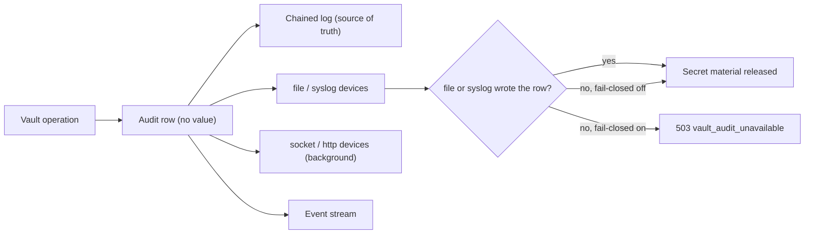

Part of the [Secret Vault](/docs/security/secret-vault) guide. Every vault operation is audited and can be streamed as an event; neither
ever carries a value.

## Audit

Every change, reveal, export, approval, and runtime resolution writes an audit row with the actor,
action, environment, folder, and name, never the value.

- **Tamper evidence.** Rows are chained with a keyed hash. `GET /api/vault/audit/verify` (or
  `ryu-cli secrets audit --verify`) detects an edited or deleted row.
- **Retention.** Rows older than `RYU_VAULT_AUDIT_RETENTION_DAYS` (`vault.auditRetentionDays` in
  [`node-config.json`](/docs/start-here/configuration#core-node-config); default 365, `0` keeps
  everything) are pruned without breaking verification of the rest.
- **Other audit trails.** Runtime resolutions are also reported to the Gateway exec audit, and
  shared values are audited by the control plane.



### Audit devices

The chained log stays the source of truth. You can also send every row to external audit
devices, managed with `GET /api/vault/audit/devices` and `PUT`/`DELETE
/api/vault/audit/devices/{id}` (admin on `sys/audit`):

| Kind | Options | Delivery |
|---|---|---|
| `file` | `path` (absolute, under an audit directory), `maxBytes` (default 10 MiB), `maxFiles` (default 5) | JSON Lines, rotated by size; the file is reopened for every row, so an external `logrotate` move is picked up without a signal |
| `syslog` | `address` (`unix:/dev/log` default, or `udp:host:514`), `facility` (default 10), `tag` | RFC 5424 datagrams |
| `socket` | `address` (`tcp:host:port` or `unix:/path`), `timeoutMs` | Newline-delimited JSON, sent in the background |
| `http` | `url` (HTTPS; http only for loopback), `secretRef` | `POST` in the background with retries, signed with `x-ryu-timestamp` and `x-ryu-signature` when `secretRef` is set |

Options outside this table are rejected.

**Where a `file` device may write.** Only under `logs/audit/` in the Ryu data directory, or under a
directory listed in `RYU_VAULT_AUDIT_DIRS` (OS path-list syntax). Other locations in the data
directory are refused. Symlinks and non-regular files are refused. An existing file is appended to
or rotated only when it already holds vault audit records.

**Where a network device may connect.**

- Never to link-local or cloud-metadata addresses.
- To private network ranges only with `RYU_VAULT_AUDIT_ALLOW_PRIVATE=1`. Loopback is always allowed.
- HTTP redirects are not followed.
- An `http` URL cannot carry credentials, either as `user:password@` or as a credential-like query
  parameter such as `api_key`.

**What a device receives.** Each device gets the same row as the chained log, plus its chain
`hmac`, and never a value. With `hmacFields` (on by default), these fields are replaced with
`hmac-sha256:<hex>` under a per-device salt:

- the actor id, scope id, secret name, and request id;
- the `accessor`, `leaseId`, `names`, and `conversationId` details.

To find an identifier in a device's log, ask for the same digest with `POST /api/vault/sys/audit-hash`
and `{"device": "<id>", "input": "<name or accessor>"}`. Signing secrets are referenced as
`env:NAME` or `file:/absolute/path`. Inline secrets are rejected.

### Fail-closed auditing

Set `RYU_VAULT_AUDIT_FAIL_CLOSED=1` (or `vault.auditFailClosed` in `node-config.json`) to make
auditing a gate. Every operation that hands out secret material then returns `503 vault_audit_unavailable` unless an enabled `file` or `syslog` device
wrote the row. This includes the case where no device is configured.

The gate covers these operations:

- value reveal, export, and snapshot export;
- runtime resolution, including values read live from an external store;
- control-group redemption and item field reveal;
- payment card use (fill, broker substitution, and number or security code reveal);
- TOTP codes, static-role credentials, response unwrapping, and cubbyhole reads;
- transit decrypt, data keys, signatures and HMACs, and transit key export and backup;
- PKI issue, SSH certificate signing, and identity tokens;
- vault token and AppRole secret id issuance, password generation, and dynamic credential issue.

A dynamic credential, token, or secret id that is withheld is revoked again. A refused unwrap
leaves the wrapping token usable for a retry.

Background devices (`socket`, `http`) are best-effort and never satisfy fail-closed on their own,
so configure a `file` or `syslog` device alongside them. Rows written inside a database transaction
reach devices and subscribers only after the transaction commits.

Audit devices are operator-owned, local audit data. They are separate from product telemetry and
crash reporting, and the privacy and telemetry consent settings neither enable nor disable them.

## Event notifications

`GET /api/vault/events` streams vault changes as server-sent events, so clients can refresh
without polling. Machines with a vault token can use `GET /api/vault/agent/events`.

Each `vault` event carries `type`, `seq`, `at`, `action`, and when relevant `environment`, `path`,
`name`, `version`, and `leaseId`. Events never carry a value. Types include:

- **Values.** `kv-write`, `kv-delete`, and `kv-destroy`.
- **Keys and the seal.** `key-rotate`, `seal`, and `unseal`.
- **Leases.** `lease-create`, `lease-renew`, `lease-revoke`, and `lease-expire` (a lease the reaper
  ended at its expiry).
- **Governance.** `policy-change`, `change-request`, and `change-decision`.

You only receive an event if you hold `list` on its policy key. That is `ENV/folder/NAME` for a
secret or a change request, and otherwise the key the matching admin route checks:

| Events | Policy key |
|---|---|
| `policy-change` | `sys/policies` |
| `environment-change` | `sys/environments/<slug>` |
| `import-change` | `sys/imports` |
| `seal`, `unseal`, and seal-key `key-rotate` | `sys/seal` |
| `transit-change` and transit `key-rotate` | `sys/transit/<key>` |
| `lease-*` | `sys/dynamic/<role>` |
| `certificate-revoke` | `sys/pki/revoke` |
| `machine-change`, `credential-revoke` | `sys/machines` |
| `audit-device-change` | `sys/audit` |
| `bootstrap-apply` | `sys/init` |

Machine tokens only see node-scoped secrets. A stream re-checks its credentials every 30 seconds
and after any policy, machine, or credential change. It ends when they no longer authenticate or
when a machine token expires, and the client should reconnect.

You can narrow the stream with `types` (comma-separated), `environment`, and a policy-key glob in
`path`, such as `?path=prod/payments/*`. A `lagged` event means the client fell behind and should
refetch.

## Declarative initialization

A fleet node or headless install can declare its vault baseline in a JSON file named by
`RYU_VAULT_INIT_FILE`. The file is applied after the store opens at startup, and again on
`POST /api/vault/sys/init/apply` (admin on `sys/init`):

```json
{
  "reconcile": false,
  "environments": [{ "slug": "prod", "name": "Production", "protected": true }],
  "policies": [{ "name": "ci", "rules": [{ "path": "prod/*", "capabilities": ["use"] }] }],
  "bindings": [{ "policy": "ci", "subject": "machine:mi_ci" }],
  "transitKeys": [{ "name": "payments", "type": "aes256-gcm96" }],
  "auditDevices": [
    { "id": "file", "kind": "file", "options": { "path": "/var/log/ryu/vault-audit.jsonl" } }
  ]
}
```

Applying is idempotent:

- Missing items are created, and matching items are left alone.
- Items that differ are reported as drift and left unchanged unless `reconcile` is `true`.
- A transit key whose type differs is always reported and never replaced.

The file cannot hold secret values. Unknown fields are rejected at every level, including device
options, and every change is audited as `system:bootstrap`. The example's `/var/log/ryu` path needs
`RYU_VAULT_AUDIT_DIRS=/var/log/ryu`.

## Routes

| Method | Route | Behavior |
|---|---|---|
| `GET` | `/api/vault/audit` | Pages the audit log (admin) |
| `GET` | `/api/vault/audit/devices` | Lists audit devices and their delivery health (admin) |
| `POST` | `/api/vault/sys/audit-hash` | Computes a device's salted digest for an identifier (admin) |
| `GET` | `/api/vault/events` | Streams value-free change events (SSE, `list` per event) |

The full list is in the [Core API reference](/docs/extend/develop/api-reference/core/vault).
