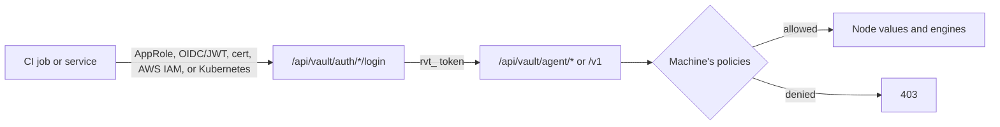

The [Secret Vault](/docs/security/secret-vault) stores named values. The engines on this page let
CI jobs and services log in without a person, mint short-lived credentials, encrypt and sign data,
and issue certificates and tokens. Every engine runs inside Core, keeps its key material encrypted
with the vault's keys, and writes to the vault audit log.

Engine objects use the same [capabilities and policies](/docs/security/secret-vault-policies#capabilities-and-policies)
as values, on `sys/<engine>/<name>` keys. Managing an object (a key, a role, an identity) needs
`admin`; using it (encrypting, issuing, signing) needs `use`. Configuration managers and the local
operator of an unbound node hold both.

## Machine identities

CI runners, scheduled jobs, and services log in as a **machine identity** and receive a short-lived
vault token (`rvt_…`, one hour by default). Machines hold no capabilities by default: attach
policies to the identity, or bind them to `machine:<id>`.

Lifetime caps, renewal, use limits, CIDR binding, child tokens, wrapping, and cubbyholes are on
[tokens, wrapping, and quotas](/docs/security/secret-vault-tokens).



**AppRole** pairs a public role id with a secret id that an administrator issues. A secret id can
expire and can be limited to a number of uses. Ryu stores only hashes of secret ids and tokens.

```sh
curl -X POST "$RYU_CORE_URL/api/vault/auth/approle/login" \
  -H 'content-type: application/json' \
  -d '{"roleId":"role_…","secretId":"sid_…"}'
```

**OIDC/JWT** (`POST /api/vault/auth/jwt/login`) accepts a signed token from an issuer you trust, such as GitHub Actions, GitLab CI, or
Kubernetes service accounts. Configure the issuer, a JWKS URL or PEM public key, and at least one
audience or bound claim so the issuer alone cannot log in:

```json
{
  "name": "deploy-api",
  "auth": {
    "kind": "jwt",
    "issuer": "https://token.actions.githubusercontent.com",
    "jwksUrl": "https://token.actions.githubusercontent.com/.well-known/jwks",
    "audiences": ["ryu"],
    "boundClaims": { "repository": ["acme/api"], "ref": ["refs/heads/main"] }
  },
  "policies": ["deploy-read"]
}
```

A failed JWT login returns the same `403 vault_denied: login rejected` whether the identity is
unknown, uses another method, is disabled, or rejected the token. The vault audit log records the
reason.

With a token, send `x-ryu-vault-token` to the `/api/vault/agent/*` routes, or set
`RYU_VAULT_TOKEN` for `ryu-cli secrets run`, `export`, and `get`. Machines read **Node** values, so
save values meant for them with `ryu-cli secrets set NAME --scope node`.

The
[Ryu GitHub Action](/docs/ci/github-actions#export-ryu-vault-secrets)'s `secrets` input logs in and exports the listed values as
masked environment variables.

For a node on this machine reached over plain `http://` (such as `http://127.0.0.1:7980`), `ryu`
first checks with the Core's node token that the process on that port is your Core. It sends the
vault token only on a connection that passed the check.

Without `RYU_CORE_TOKEN` it cannot check the address. Machine commands (`get`, `export`, `run`,
`login`, `unwrap`, and the broker CA) then stop with an error instead of sending a vault token,
AppRole secret, or wrapping token, or using values from an unchecked listener. Set
`RYU_CORE_TOKEN` to the Core's node token, or reach the node over `https://`.

Machines can also log in with a TLS certificate, AWS IAM credentials, or a Kubernetes service
account; see [more machine logins](/docs/security/secret-vault-seal-auth#tls-certificate-login).

### HashiCorp Vault-compatible API

Tools that already speak the HashiCorp Vault HTTP API, such as the `vault` CLI and its client
libraries, can use a subset of that API under `/v1/`. Point `VAULT_ADDR` at your Ryu node and
authenticate with a machine identity:

```sh
export VAULT_ADDR="$RYU_URL"
export VAULT_TOKEN=$(vault write -field=token auth/approle/login role_id=role_… secret_id=sid_…)
vault kv put secret/app/db USER=svc PASSWORD=…
vault kv get secret/app/db
vault kv list secret/app
```

Supported routes:

- `auth/approle/login`, and `auth/jwt/login` with the identity name as `role`;
- `auth/token/lookup-self` and `auth/token/revoke-self`;
- `sys/internal/ui/mounts/secret/<path>`, which reports a KV version 2 mount so `vault kv` picks
  the right format;
- the KV version 2 engine at `secret/`. `data/<path>` reads, writes, and soft-deletes;
  `metadata/<path>` reads metadata, lists, and permanently deletes.

Requests take the token in `X-Vault-Token` or `Authorization: Bearer`. Response wrapping
(`-wrap-ttl`, `X-Vault-Wrap-TTL`) is refused with `400`; use `X-Ryu-Wrap-TTL` on the `/api/vault`
routes instead.

**Storage mapping.** A Vault secret path `app/db` is the folder `/app/db`, and each key in the
secret is a separate **Node** value there, so keys must be environment-variable names. Requests use
the node's active environment unless an `X-Ryu-Environment` header names another one.

**Versions.** A write replaces the whole key set in one step, as in Vault, and creates a new secret
version. A direct change to one of the keys outside this API also advances the version. Only the
current version can be read. `options.cas` is enforced atomically, `cas: 0` means create only, and
a write must carry `options.cas` where a value or environment requires check-and-set.

**Authorization.** Every key is checked against the machine's policies, as Vault checks a whole
path:

- If the token cannot read one key, the read is refused rather than partial.
- Listing and metadata need `list` (or `read`).
- A token with no possible access to a path gets `permission denied` whether or not it exists.
- Writes to a protected environment need `admin` on every key, because approvals cannot be carried
  over this API.
- Writes to a folder sourced from an [external store](/docs/security/secret-vault-external) are
  refused.

Errors use Vault's `{"errors": [...]}` format.

## Dynamic credentials

A dynamic role creates a fresh credential each time it is requested and deletes it when its
**lease** ends. Leases have a TTL and a maximum lifetime; the holder can renew or revoke early, and
Ryu revokes expired leases automatically. Revoking every lease of a role is one call when a
credential is suspected leaked.

| Provider | Issues | On revoke |
|---|---|---|
| `postgres` | A login role created from your statements (`{{name}}`, `{{password}}`, `{{expiration}}`) | Terminates its sessions and drops the role |
| `aws-sts` | `AssumeRole` session credentials (15 minutes to 12 hours) | Ends the lease; the session expires on its own |
| `webhook` | Whatever your HTTPS endpoint returns for `issue` | Calls your endpoint with `revoke` |
| `redis` (alias `valkey`) | An ACL user with the role's `aclRules` (default `~* +@read`) | Deletes the ACL user |
| `random` | A generated value with lease bookkeeping | Ends the lease |

Webhook calls are signed with `x-ryu-signature: sha256=<HMAC of "<timestamp>.<body>">` and carry
`x-ryu-timestamp`, so your endpoint can reject forged or replayed requests. The provider's own
admin credential is stored encrypted and never returned.

To rotate a credential for an account that already exists instead of creating one per lease, use a
[static role](/docs/security/secret-vault-seal-auth#static-roles). A
[lease-count quota](/docs/security/secret-vault-tokens#quotas) caps how many leases a role can hold,
and [lease administration](/docs/security/secret-vault-tokens#lease-administration) looks up and
revokes leases by prefix.

## Transit encryption

Transit keys encrypt, decrypt, sign, verify, and HMAC data for an application that never sees the
key. Inputs and outputs are base64; ciphertexts look like `ryu:v2:…`.

Rotating a key adds a version:
new data uses the latest version, older ciphertexts keep decrypting down to
`minDecryptionVersion`, and `rewrap` upgrades a ciphertext without exposing its plaintext.
`datakey` returns a fresh data key together with its wrapped form for envelope encryption.

| Key type | Operations |
| --- | --- |
| `aes256-gcm96`, `chacha20-poly1305` | encrypt, decrypt, rewrap, datakey, HMAC |
| `ed25519`, `ecdsa-p256`, `ecdsa-p384` | sign, verify, HMAC |
| `rsa-2048`, `rsa-3072`, `rsa-4096` | encrypt and decrypt (OAEP-SHA256), sign and verify (`signatureAlgorithm` is `pss` or `pkcs1v15`), HMAC |
| `hmac` | HMAC |

`verify` also checks an HMAC sent as `hmac` instead of `signature`. Encrypt and decrypt accept base64
`associatedData`, which must match on decrypt. Signing keys list their public keys on the key, and
`GET /api/vault/transit/export/public-key/{name}` returns them to callers with `use`.

**Derived and convergent keys.** With `derived: true` on an AES or ChaCha key, every request sends
a base64 `context`, and the key is derived from the version and context (HKDF-SHA256). One key then
encrypts each tenant's data under its own subkey.

Add `convergent: true` and the same plaintext and context always give the same ciphertext, so you
can look up or deduplicate encrypted values. This reveals when two values are equal, so use it only
where that is acceptable.

**Versions.**

- `minEncryptionVersion` is the oldest version a caller may pick with `keyVersion` to encrypt, sign,
  or HMAC (`0` allows any).
- A version below `minDecryptionVersion` is never used. A non-zero `minEncryptionVersion` cannot be
  below it, so the vault never produces output it would refuse to decrypt.
- `POST /api/vault/transit/keys/{name}/trim` with `minAvailableVersion` permanently deletes older
  versions, never past `minDecryptionVersion`. Data under a trimmed version cannot be decrypted.
- `autoRotatePeriodSecs` (at least one hour) rotates the key automatically.

**Export and backup.** Key material leaves the vault only from `exportable` keys.
`GET /api/vault/transit/export/{encryption-key|signing-key|hmac-key}/{name}[/{version}]` returns it
to `admin` callers.

With `allowPlaintextBackup` also set, `GET /api/vault/transit/backup/{name}` returns every version
and the key's settings. `POST /api/vault/transit/restore` (`backup`, an optional new `name`, and
`force` to replace a key) restores it. Both flags can be turned on but never off, and every export,
backup, and restore is audited. A backup holds plaintext key material: store it like the keys.

**Bring your own key.** This uses the same format as Vault's transit import:

1. `GET /api/vault/transit/wrapping-key` returns an RSA-4096 public key (`admin` on
   `sys/transit/_wrapping-key`).
2. Wrap your key with a fresh AES-256 key (AES key wrap with padding, RFC 5649). Encrypt that AES
   key with the wrapping key (RSA-OAEP, SHA-256).
3. Send base64 of the RSA ciphertext followed by the wrapped key, with the key `type`, to
   `POST /api/vault/transit/keys/{name}/import`.

AES, ChaCha, and HMAC keys are 32 raw bytes, Ed25519 keys a 32-byte seed or PKCS#8, and ECDSA and RSA
keys PKCS#8 DER. `POST /api/vault/transit/keys/{name}/import-version` adds a version to an imported
key; generated keys refuse it.

**Deleting.** With `deletionAllowed` set, `DELETE /api/vault/transit/keys/{name}` deletes a key
permanently, as Vault does, and the name can be reused at once. `?soft=true` hides it but keeps it
recoverable: `GET /api/vault/transit/deleted` lists such keys and
`POST /api/vault/transit/keys/{name}/recover` restores one.

A soft-deleted key is purged after `vault.transitSoftDeleteDays` in
[`node-config.json`](/docs/start-here/configuration#core-node-config)
(`RYU_VAULT_TRANSIT_SOFT_DELETE_DAYS`, default 7), and its name cannot be reused until then.
Restoring a backup over a key with `force` also needs `deletionAllowed` on that key.

## Certificates (PKI)

Create an internal certificate authority, define roles that limit the domain names, IP addresses,
key usages, and lifetimes a certificate may have, and issue certificates or sign CSRs under a role.

Issued certificates are recorded by serial and include `caChain`, the issuing CA followed by its own
chain. Revoking one adds it to the CRL at `/api/vault/pki/issuers/{name}/crl`. The private key is
returned once at issue time and is not stored.

To keep a root offline or chain under your organization's CA, make the issuer an intermediate:

1. `POST /api/vault/pki/issuers/{name}/intermediate/generate` with a `commonName` creates the key
   inside the vault and returns a CSR.
2. Have the CSR signed by your root. A root in this vault can sign it with
   `POST /api/vault/pki/issuers/{root}/sign-intermediate` (`csr`, `commonName`, optional
   `ttlSecs`); the result is a CA that can issue certificates but not further CAs.
3. `POST /api/vault/pki/issuers/{name}/intermediate/set-signed` with the signed `certificate` and
   an optional `caChain` (PEM, nearest first). The certificate must match the generated key, be a
   CA, and be valid now; when a chain is given, its first certificate must have signed it.

`POST /api/vault/pki/issuers/{name}/import` imports an existing CA `certificate` and its PKCS#8
`privateKey`, optionally with `caChain`. The key is stored encrypted and never returned.

`POST /api/vault/pki/tidy` removes records of certificates that expired more than
`safetyBufferSecs` ago (default 72 hours); the vault also does this daily. Expired certificates
no longer need to appear on a CRL.

## Workload identity tokens

The vault can issue signed identity tokens (JWTs) so CI jobs, services, and agents can sign in to
cloud providers and other services that accept OpenID Connect federation, such as AWS IAM web
identity, GCP workload identity federation, or Azure federated credentials, without a stored
cloud key.

1. Set the issuer to the externally reachable URL of the vault's identity endpoint:
   `PUT /api/vault/identity/config` with
   `{"issuer": "https://ryu.example.com/api/vault/identity"}` (or set
   `RYU_VAULT_IDENTITY_ISSUER`). The vault refuses to issue tokens until an issuer is set.
2. Create a role with `PUT /api/vault/identity/roles/{name}`, setting `audience` (the `aud` claim your
   provider expects), `ttlSecs` (60 to 86400, default 3600), and an optional `template` for extra
   claims, for example
   `{"machine": "{{identity.name}}", "policies": {{identity.policies}}}`. The template can use
   `{{identity.id}}`, `{{identity.name}}`, `{{identity.kind}}`, and `{{identity.policies}}`, and
   cannot set `iss`, `sub`, `aud`, `iat`, `nbf`, `exp`, or `jti`.
3. Register `https://ryu.example.com/api/vault/identity` as an OIDC provider with your cloud and
   trust the role's audience and subject.

A caller with `use` on `sys/identity/{role}` gets a token from
`POST /api/vault/identity/token/{role}`, and a machine from
`POST /api/vault/agent/identity/token/{role}` with its vault token. The subject is `machine:<id>`
for machine identities. Human callers need a signed-in user: a request with only the node bearer is
refused, because every such caller would share one subject.

Providers verify tokens with the discovery document at
`/api/vault/identity/.well-known/openid-configuration` and the keys at
`/api/vault/identity/.well-known/keys`, both served without authentication.

Tokens are signed with ES256. The signing key rotates every `rotationPeriodSecs` (default 7 days)
or on `POST /api/vault/identity/keys/rotate`. A retired key stays published for 24 hours so tokens
it signed keep verifying. Managing the configuration needs `admin` on `sys/identity/_config`.

## SSH certificates

An SSH certificate authority signs users' or hosts' public keys into short-lived OpenSSH
certificates, so servers trust one CA key instead of a list of user keys. A role sets the
certificate type, allowed principals, default and maximum lifetime, and extensions. Add the CA's
public key to `TrustedUserCAKeys` on your servers.

The signer accepts complete OpenSSH public keys for Ed25519, RSA, the NIST ECDSA
curves, and Ed25519 security keys. Malformed or extra key fields are rejected before
signing. Principals, certificate type, lifetime, and extensions remain constrained
by the role even when the submitted key comes from an untrusted source.

## One-time passwords (TOTP)

The TOTP engine holds time-based one-time-password seeds (RFC 6238) so an automation can sign in
to a service that requires a second factor, or so your own service can check a code. A key is
either **generated** by the vault or **imported** from an `otpauth://totp/…` URL or a Base32
seed. Keys support SHA1, SHA256, and SHA512, 6 or 8 digits, and a period of 15 to 300 seconds.

A generated key needs an issuer and an account. Its enrollment URL is returned once, at creation,
with an SVG or PNG QR code when you pass `qrFormat`; `exported: false` keeps the seed inside the
vault. If the URL is too long for a QR code, nothing is stored.

After creation no route returns a seed: callers get the current code or submit one to validate.
Validation accepts codes within the key's `skew` (0 to 2 steps either side of now). It rejects a
code from a step at or before the last accepted one, so a code cannot be replayed.

Keys live on `sys/totp/<name>`. Creating and deleting needs `admin`, reading metadata needs `list`,
and getting or validating a code needs `use`. Machine identities use the `/api/vault/agent/totp/…`
routes with the same capabilities.

A stored value can hold a seed too. `secret:NAME#totp` resolves a value that contains a Base32
seed or an `otpauth://totp/` URL to its current code instead of the stored value. A value that is
not a usable seed resolves to nothing, so the raw value is never sent in its place.

## Password policies

A password policy names a length (8 to 256) and up to 16 character-set rules, each with an
optional minimum count:

```json
{
  "length": 20,
  "rules": [
    { "charset": "abcdefghijklmnopqrstuvwxyz", "minChars": 1 },
    { "charset": "ABCDEFGHIJKLMNOPQRSTUVWXYZ", "minChars": 1 },
    { "charset": "0123456789", "minChars": 2 },
    { "charset": "!@#$%^&*", "minChars": 1 }
  ]
}
```

Generated passwords draw from every rule's characters and always meet each minimum. A policy
whose minimums cannot fit inside its length is rejected when you save it. Policies live on
`sys/password-policies/<name>`. Saving and deleting needs `admin`, reading needs `list`, and
generating a password needs `use`.

A value's generator can name a policy instead of a length and charset:
`{ "kind": "random", "policy": "<name>" }`. First-write generation and automatic rotation then
follow that policy, and a write fails if the policy does not exist.

A policy cannot be deleted while any stored value, including a soft-deleted one, still uses it. The
error reports how many values use it; their names are in the audit log.

Sealing, unsealing, and data-key rotation are on
[Vault unseal, rekey, and static roles](/docs/security/secret-vault-seal-auth#seal-unseal-and-key-rotation),
and encrypted snapshots are on the [Secret Vault](/docs/security/secret-vault#snapshots) page.
