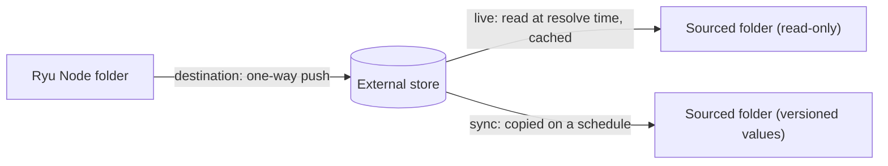

If your secrets already live in OpenBao, HashiCorp Vault, or Infisical, the
[Secret Vault](/docs/security/secret-vault) can use them without copying values by hand.

- A **store** is a connection to one of those systems.
- A **source** pulls a remote path into a Ryu folder.
- A **destination** pushes a Ryu folder to a remote path.

Sources and destinations both work at **Node** scope.



## Stores

Connect a store with `POST /api/vault/external/stores`, for example:

```json
{
  "name": "corp-bao",
  "kind": "openbao",
  "address": "https://bao.example.com",
  "authMethod": "approle",
  "mount": "secret",
  "kvVersion": 2,
  "credentials": { "roleId": "…", "secretId": "…" }
}
```

| `kind` | Auth methods | Location fields |
|---|---|---|
| `openbao`, `hashicorp-vault` | `token`, `approle`, `kubernetes` | `mount`, `pathPrefix`, `kvVersion` (1 or 2), optional `namespace` |
| `infisical` | `universal-auth` | `projectId`, `infisicalEnvironment`, `secretPath` |

Store credentials (a token, an AppRole secret id, or an Infisical client secret) are encrypted with
the vault's keys and are never returned, logged, or audited. For `kubernetes` auth, the service
account token is read from the location the operator sets in `RYU_VAULT_EXTERNAL_K8S_JWT_PATH`,
never from the request.

`POST /api/vault/external/stores/{id}/test` checks the connection and credentials. A store that
still has sources or destinations cannot be deleted.

Managing a store, its sources, and its destinations needs `admin` on `sys/external/<store>`.

## Sources

A source binds a Ryu environment and folder to one remote path:

```json
{ "storeId": "…", "environment": "prod", "path": "/payments", "remotePath": "payments", "mode": "live" }
```

Binding a folder also needs `write` and `delete` on it. A source replaces the folder's values
without a change request, so in a protected environment it also needs `admin` on the folder.

- **`live`** reads the remote folder when a `secret:` reference is resolved, through a cache
  (`cacheTtlSecs`, 60 seconds by default, 5 seconds to one hour). If the store cannot be reached,
  the lookup fails closed: the reference resolves to nothing. Set `staleIfErrorSecs` (up to one day)
  to keep serving the last good answer that long after the cache expires.
- **`sync`** copies the remote folder into ordinary versioned values on a schedule
  (`syncIntervalSecs`, five minutes by default). `POST /api/vault/external/sources/{id}/sync` syncs
  now. A remote key that is not a valid value name stops the whole sync, so no partial copy is made.
  Syncs of one source run one at a time, so a scheduled sync and a manual one never mix values from
  two different remote reads.

A sourced folder is **read-only** for Node-scope writes, including writes through the
[HashiCorp Vault-compatible API](/docs/security/secret-vault-engines#hashicorp-vault-compatible-api):
they return `409 vault_conflict`. Change the value in the external store instead.

User values still take precedence over a sourced Node folder. Removing a source stops sourcing;
synced values stay as local values.

## Destinations

A destination pushes a Ryu Node folder one way to a remote path, after every write to the folder
and on an interval (`intervalSecs`, one hour by default). `POST
/api/vault/external/destinations/{id}/push` pushes now. Creating one also needs `read` and `list`
on the folder.

- For OpenBao and HashiCorp Vault, the remote secret is replaced as a whole. An empty Ryu folder
  never wipes a remote secret that has values.
- For Infisical, keys are only created or updated. A key deleted in Ryu stays in Infisical.

A failing push is retried with exponential backoff, capped at the destination's interval. A folder
with a live source cannot also be pushed, and a remote path that a source pulls from cannot be a
destination. Removing a destination leaves the remote values in place.

## Network rules

Store addresses must use `https`. Each hostname is resolved once, every address is checked, and
redirects and HTTP proxies are not used. Link-local and cloud-metadata addresses are always
refused.

Each also has a [`node-config.json`](/docs/start-here/configuration#core-node-config) path, and a set environment value wins over the file.

| Variable (`node-config.json` path) | Effect |
|---|---|
| `RYU_VAULT_EXTERNAL_ALLOW_PRIVATE=1` (`vault.externalAllowPrivate`) | Allows stores on private network ranges |
| `RYU_VAULT_EXTERNAL_ALLOW_LOOPBACK=1` (`vault.externalAllowLoopback`) | Allows stores on this host's loopback interface, over `http` too, for local development |

Continue with the [Secret Vault](/docs/security/secret-vault),
[Vault engines and machine access](/docs/security/secret-vault-engines), and the
[Core API reference](/docs/extend/develop/api-reference/core/vault).
