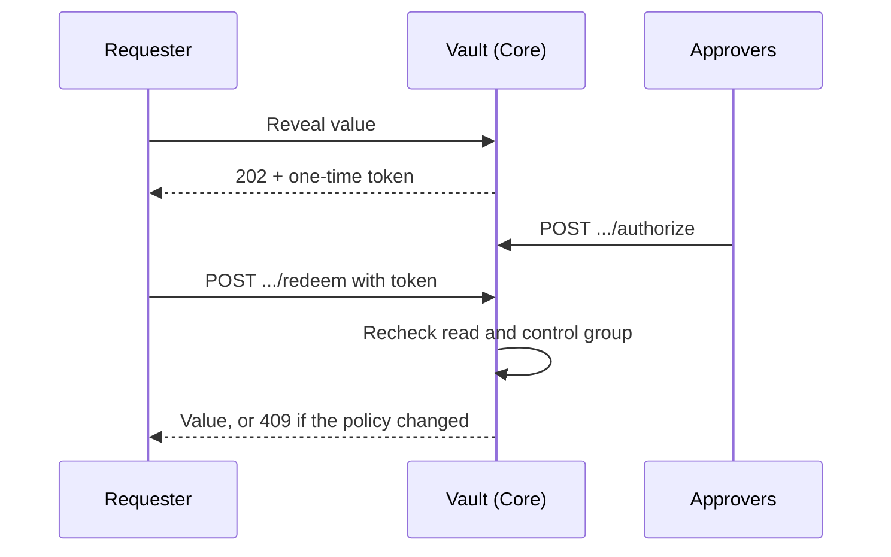
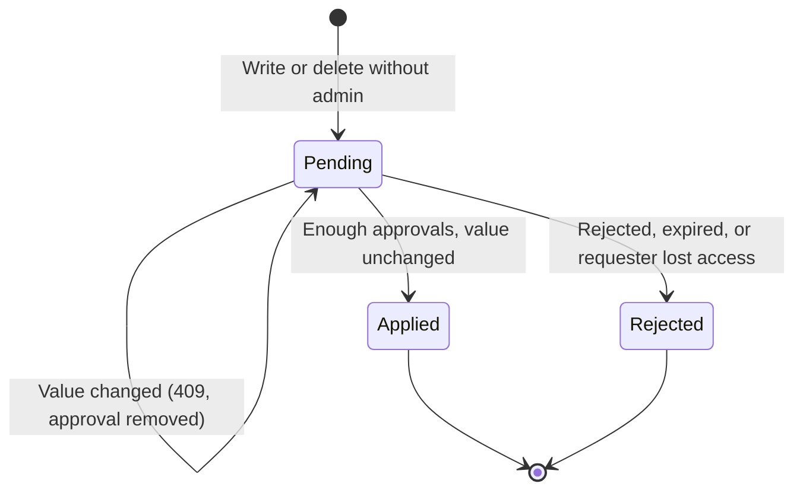

Part of the [Secret Vault](/docs/security/secret-vault) guide. Every operation on a value needs a capability, and policies add or remove
capabilities by path.

## Capabilities and policies

Each operation needs a capability on the value's `ENV/folder/NAME` key:

| Capability | Allows |
|---|---|
| `list` | Seeing that a value exists, with its metadata |
| `use` | Runtime resolution inside a governed MCP call |
| `read` | Revealing or exporting the value |
| `write` | Creating, updating, rolling back, or restoring it |
| `delete` | Soft-deleting or destroying it |
| `admin` | Managing environments, folders, policies, engines, and the seal |
| `approve` | Approving changes in protected environments |

Defaults keep the levels above: you hold every capability on your own User values, members can
`list` and `use` Node, Team, and Organization values in their boundary, and configuration
managers (`gateway.configure`) can do everything. On an unbound local node the local operator holds
every capability.

Creating a folder needs `write` and deleting an empty folder needs `admin` on
`sys/folders/<environment>/<folder>` (the root folder is `sys/folders/<environment>`). The folder
path is normalized first, so `db`, `/db`, and `/db/` all check `sys/folders/prod/db`. A policy deny
on that key also applies to configuration managers.

A **policy** adds or removes capabilities with path globs (`*` matches one segment, `**` any depth):

```json
{
  "description": "QA can read staging, never production",
  "rules": [
    { "path": "staging/**", "capabilities": ["list", "read", "use"] },
    { "path": "prod/**", "capabilities": ["read", "use"], "deny": true }
  ]
}
```

### Bindings

Bind a policy to a subject:

- `user:<id>`
- `team:<id>`
- `role:<name>`
- `machine:<id>`

A binding can carry an `expiresAt` for temporary access; it stops applying at that time. An
explicit deny always wins, including over the defaults.

Removing a member deletes their `user:<id>` bindings. A `user:<id>` binding created before the
member's current membership never applies, so someone who leaves and is invited again starts with
no user bindings until an admin binds them again.

In an organization vault, a `role:<name>` binding must name a built-in role or an existing custom
role.

Because a role binding follows whoever holds the role, `roles.manage` alone is not enough to
create, delete, assign, or remove a custom role that an active vault binding names. The caller
also needs vault `admin` on `sys/policies`, so a role manager cannot grant themselves a vault
policy, or shed a deny, through role assignment.

### Scope limits

A policy never reaches past a value's scope. Its path names no owner, so a rule on `default/**`
applies only to values you can already see:

- your own User values;
- teams you belong to (every team for organization admins);
- this node and organization.

Another member's personal values and other teams' values stay out of your secret list, scans, and
event stream whatever your policies grant. Approving a change request is the exception: an
`approve` grant lets you decide a request on any value that matches its path.

### Subjects during tool calls

When an agent uses a value during a tool call, the same subjects apply as on the Vault page: your
user, your current role, and every team you belong to in the organization. This holds on
organization, team, and personal nodes, whichever team (if any) the conversation is shared with.
Only the team values a tool call can read stay limited to the node's or conversation's team.

- A team node resolves shared values only for members of its own team. For anyone else, Team and
  Organization values are unavailable on that node.
- On a node joined to an organization, Core checks your current membership with the control plane
  before it resolves any value. If it cannot confirm your role and full team list (for example,
  the control plane is unreachable), no vault or password-manager value resolves for that call,
  and the vault audit log records the denied use.
- A broker session a person mints carries that person's user, role, and team subjects from the
  time it was minted. Those subjects apply to every `secret:` and password-manager reference the
  session injects, as they do to the cards it uses.

### Check your capabilities

`GET /api/vault/capabilities-self?paths=prod/API_KEY` shows what your policies grant on a path and
whether a control group applies. It does not include the defaults that come from a value's scope
(such as full access to your own user values); the secret list shows each value's effective
capabilities.

### Templated paths

A rule path can name the caller instead of a fixed folder with `{{identity.user.id}}`,
`{{identity.machine.id}}`, `{{identity.team.ids}}` (one path per team), or `{{identity.roles}}`.
For example, `users/{{identity.user.id}}/**` gives every user their own folder with one policy.

- Templates are checked when the policy is saved.
- An identity value is substituted only when it is a plain name (no `/`, `*`, `?`, braces, or
  spaces).
- When a template cannot be filled, an allow rule does not apply and a deny rule applies to every
  name in that position.

### Parameter constraints

A rule that grants `write` can limit what a write carries. A JSON-object value contributes its
top-level keys as parameters; any other value is the single parameter `value`.

```json
{
  "path": "prod/**",
  "capabilities": ["write"],
  "allowedParameters": { "region": ["eu-*"], "owner": ["{{identity.user.id}}"] },
  "deniedParameters": { "region": ["eu-dev"] },
  "requiredParameters": ["owner"]
}
```

`*` as a parameter name means every parameter, an empty value list means any value, and values may
use `*` and `?`.

A write that breaks a constraint is refused with `403`. This covers:

- a JSON merge patch (checked on the merged value);
- a write through the Vault-compatible `/v1` API;
- a value you supply while approving an agent's credential request (the request stays pending).

Imports skip values that break a constraint, and a rollback or restore that would put such a value
back is refused. A folder whose `write` rule carries constraints cannot be sourced from an
external store, because synced values are written later without a caller to check them against.

### Control groups

A rule that grants `read` can require approval before a value is released:

```json
{
  "path": "prod/**",
  "capabilities": ["read"],
  "controlGroup": {
    "ttlSecs": 3600,
    "factors": [{ "name": "security", "approvers": ["team:security"], "approvals": 2 }]
  }
}
```

A gated read goes through these steps:

1. Revealing a matching value answers `202` with a pending request and a one-time token instead of
   the value.
2. Approvers named by each factor call `POST /api/vault/control-groups/{id}/authorize`. The
   requester can never approve their own request.
3. Once every factor has enough distinct approvals, the requester sends the token to
   `POST /api/vault/control-groups/{id}/redeem` to get the value.



When several matching rules carry control groups, the request needs every factor from every one
of those rules, even when two rules reuse a factor name, and the shortest `ttlSecs` applies.

Redemption rechecks your `read` access and the control group that applies now. If a policy change
has altered the factors, approvers, or approval counts since the request was opened, the redeem
answers `409` and you open a new request. A token works once and expires with the request
(default 24 hours).

Values behind a control group are left out of exports, snapshots, and scans, and machine tokens
cannot read them, including through the Vault-compatible `/v1` API. Routes that cannot open a
request refuse a gated read with `403 vault_control_group_required`. These are item reveals, value
subkeys, and static role credentials.

An external push destination cannot be created by a caller whose read of the folder is gated, and
every push leaves out values that any policy gates with a control group. Each user can hold up to
16 open requests at a time.

Templated paths, parameter constraints, and control groups apply to values stored on this device.
Team and org policies kept by the control plane accept templated paths, but the control plane has no
identity to fill them, so templated allow rules there do not apply. Team and org policies cannot
carry parameter constraints or control groups yet; saving one that does is refused.

## Protected environments and approvals

Mark an environment **protected** and set how many approvals it needs (1 to 5). A write or delete
there from someone without `admin` becomes a change request instead of a change.

Another person with `approve` approves or rejects it. The request applies once it has enough
approvals, and the requester cannot approve their own request. The proposed value is stored
encrypted and is never shown in the request list.



### Approval checks

A request can be approved for 7 days. Each approval checks it again, and the request is rejected
rather than applied if it is older than that.

It is also rejected, with the reason `requester_no_longer_authorized`, when the requester no
longer holds `write` (or `delete`) on the value:

- For values the control plane keeps, that covers a temporary binding that expired, a removed
  binding, leaving a team, and leaving the organization.
- For values on this device, each approval re-checks the requester against the policy bindings in
  force now, so an expired or removed binding or a new deny rule rejects the request. A change to
  the requester's role or teams is not seen there.

A request made before this check was added is rejected when approved and must be requested again.

Each request shows its `expiresAt`. For values the control plane keeps, a request also has
`expired`. `true` means it is still pending in storage but its 7 days have passed. The flag does not
reflect the requester's access, which is only checked when someone approves.

### Version pinning

Each request records `baseVersion`, the version the value was at when the request was made (`0` if
it did not exist yet), along with the state of the value at that time. A request applies only while
the value is unchanged since then.

Approving it does not apply over a change made in the meantime:

- a new version, such as an urgent rotation;
- an edit that only changes metadata;
- a delete or a restore.

If the value has changed, the final approval returns `409` and the request goes back to pending
with its approval removed; reject it and request the change again. This holds for values on this
device and for values the control plane keeps.

A write to a protected environment that sends `expectedVersion` (or, for values on this device,
`expectedMetadataVersion`) is refused with `409` right away if that version is no longer current.
The request is never pinned to a version you did not see.

If you raise an environment's approval count, requests that are already pending need the new
count too.

## Routes

| Method | Route | Behavior |
|---|---|---|
| `GET` | `/api/vault/capabilities-self` | Your capabilities on policy paths |
| `POST` | `/api/vault/control-groups/{id}/authorize` | Approves a control-group request |
| `POST` | `/api/vault/control-groups/{id}/redeem` | Exchanges an approved one-time token for the value |

The full list is in the [Core API reference](/docs/extend/develop/api-reference/core/vault).
